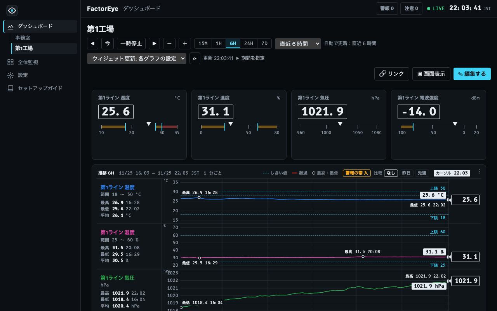
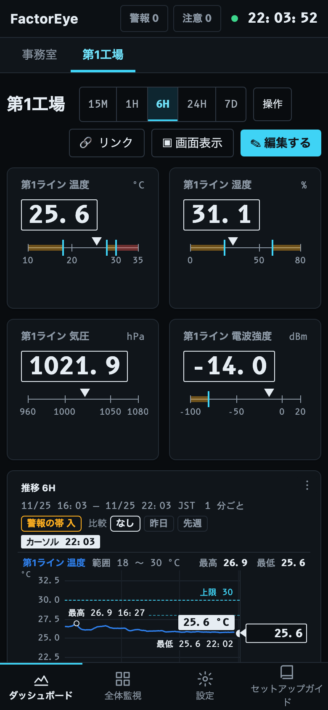

# FactorEye

FactorEye は、工場の設備の状態を見える化する OSS です。既存の PC と安価なセンサーだけで使えます。

センサー（ESP32 や Raspberry Pi など）から送られる値を受信し、蓄積し、ダッシュボードにグラフで表示します。しきい値を超えたら、Discord や Webhook で知らせます。

<p>
  
  
</p>

*画面は実機のセンサー（ATOM Lite ＋ ENV ユニット）の値です。センサーとダッシュボードの名前は例です*

## 簡単、でも自由に見える

- **すぐ見える**: センサー値を `POST /api/ingest/readings` で送るだけで、グラフになります。
- **自由に並べる**: 計器グラフ・計器・メーター・状態の帯・アラーム一覧・生産数などを、ダッシュボードに好きに配置できます。スマホでは縦 1 列に並びます。
- **読みやすいグラフ**: 暗い操作室風の画面（明るい画面にも切り替え可）。ドラッグで拡大、時刻の軸のドラッグで移動、全グラフでカーソルが連動します。CSV の保存、昨日・先週との重ね表示もできます。
- **知らせる**: 上限・下限（軽故障・重故障）のしきい値で、Discord と Webhook（Zapier / Make / n8n など）に通知します。

## 使い方は簡単

Ubuntu・Debian・Raspberry Pi OS（64bit）で、次の 1 行を実行します。Docker が無ければ自動で入れます。

```bash
curl -fsSL https://raw.githubusercontent.com/hide23link/factoreye/main/install/install.sh | sudo bash
```

公開済みの最新の版（v1.1.0 以降。[リリース](https://github.com/hide23link/factoreye/releases)・[変更履歴](CHANGELOG.md)）が入ります。

1. 表示された URL をブラウザで開く（管理パスワードは一度しか出ないので控える）
2. 左のメニュー（スマホは下のメニューの「ガイド」）の「セットアップガイド」に沿って、センサーを登録する
3. センサー側に [`clients/`](clients/) のライブラリかサンプルをコピーして、値を送る

Mac / Windows（Docker Desktop）や、設定・更新・削除の方法は [`install/README.md`](install/README.md) を参照してください。

> 配布版は http です。インターネットから使う場合は、Caddy や Cloudflare Tunnel などで https にしてください。

## ドキュメント

[仕様書](docs/architecture.md) ・ [変更履歴](CHANGELOG.md) ・ [機器キー](docs/device-keys.md) ・ [開発環境](docs/development.md) ・ [コントリビューション](CONTRIBUTING.md) ・ [セキュリティ](SECURITY.md)

## ライセンス

[MIT License](LICENSE)
