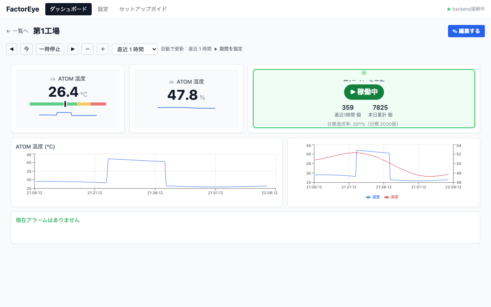

# FactorEye

予算が限られた中小製造業が、既存の PC と安価なセンサーだけで使える工場監視 OSS です。

- センサー値を REST API で集め、しきい値でアラームを評価し、ダッシュボードに表示する
- 通知は Discord、外部連携は Webhook（Zapier / Make / n8n など）
- self-hosted が基本（Docker Compose で自社の PC などに展開し、データは社内に残る）



*画面はデモデータです*

## インストール

### Ubuntu / Raspberry Pi（1 コマンド）

Ubuntu・Debian・Raspberry Pi OS（64bit）で実行します。Docker が無ければ自動で入れます。

```bash
curl -fsSL https://raw.githubusercontent.com/hide23link/factoreye/main/install/install.sh | sudo bash
```

表示された URL をブラウザで開き、画面右上の「セットアップガイド」に沿ってセンサーを登録します。最後に表示される**管理パスワード**は一度しか出ないので控えてください。もう一度実行すると、データを残したまま更新します。

設定ファイルは `/opt/factoreye/config/.env`、管理コマンドは `/opt/factoreye/factoreye.sh` です。

### Mac / Windows（Docker Desktop）

[`install/docker-compose.yml`](install/docker-compose.yml) と [`install/.env.template`](install/.env.template) を同じフォルダに置き、`.env.template` を `config/.env` にコピーして `__GENERATE__` の 4 か所をランダムな文字列に置き換えてから起動します。

```bash
docker compose --env-file config/.env up -d
```

画面は http://localhost:3001 です。

> 配布版は http です。インターネットから使う場合は、Caddy や Cloudflare Tunnel などで https にしてください。

## 主な機能

- **取り込み**: `POST /api/ingest/readings` でセンサー値を受け取る
- **アラーム**: 上限・下限 × 軽故障・重故障のしきい値、確認（ack）
- **通知**: Discord、Webhook
- **ダッシュボード**: グラフ・最新値・アラーム一覧・生産数を自由に配置
- **クライアント**: ESP32（M5 ATOM など）、Raspberry Pi（[`clients/`](clients/)）

## ドキュメント

- [仕様書](docs/architecture.md)
- [機器キーの使い方](docs/device-keys.md)
- [開発環境](docs/development.md)
- [コントリビューション](CONTRIBUTING.md) ・ [セキュリティ](SECURITY.md)

## ライセンス

[MIT License](LICENSE)
