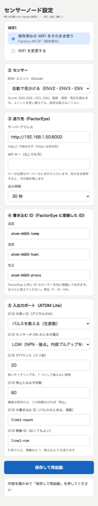
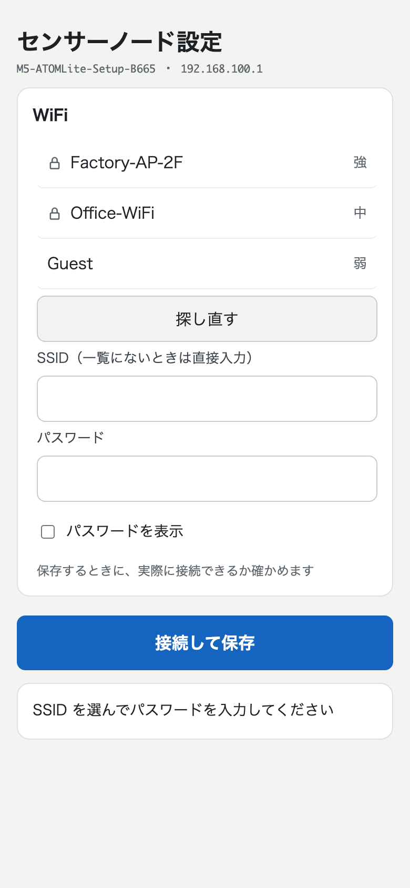

# FactorEyeNode（M5 ATOM などで FactorEye にデータを送る）

M5Stack の **ATOM Lite** などに書き込むだけで、**温度・湿度・気圧（ENV ユニット）**と、**入出力ポートの信号（生産数のパルス・スイッチ・電圧）**を FactorEye に送れるスケッチです。
WiFi の名前・送り先・センサーの種類は、**スマホの設定画面**で入れます（書き込み直し不要）。

- 仕様の詳細: [SPEC.md](SPEC.md)
- 対応機種: ATOM Lite / ATOMS3 Lite / NanoC6 / M5StickC・Plus・Plus2 / M5Stack Basic（[SPEC.md](SPEC.md) 第 4 章）

---

<p align="center">
  
</p>

*書き込んだあと、スマホで開く設定画面（M5 ATOM Lite、パルスを数える設定の例）*

---

## 用意するもの

- 上記のいずれかの M5 本体と USB ケーブル
- ENV ユニット（ENV2 / ENV3 / ENV4。温湿度・気圧を送るとき。Grove ケーブルでつなぐ）
- 動いている FactorEye（[ルートの README](../../README.md)）。本体と同じ LAN に置く
- [Arduino IDE 2](https://www.arduino.cc/en/software)

## 書き込み方（1 回だけ）

1. **ボード定義を入れる**: Arduino IDE の「ボードマネージャー」で `esp32`（Espressif Systems、3.0 以上）を入れる
2. **ライブラリを入れる**
   - 「ライブラリマネージャー」で **M5Unit-ENV** を入れる（依存するライブラリも一緒に入れる）。M5Stack Basic は **M5Unified** も入れる
   - **FactorEyeClient**: このリポジトリの [`clients/arduino-m5stack/`](../arduino-m5stack/) フォルダを、`FactorEyeClient` という名前で Arduino のライブラリフォルダ（Mac / Windows とも `ドキュメント/Arduino/libraries/`）にコピーする
3. **スケッチを開く**: `clients/FactorEyeNode/FactorEyeNode.ino` を Arduino IDE で開く（WiFi 設定の部品は同梱しているので、追加の準備は要りません）
4. **ボードを選ぶ**: ATOM Lite は **M5Atom**、ATOMS3 Lite は **M5AtomS3**、NanoC6 は **M5NanoC6**、M5Stack Basic は **M5Stack-Core-ESP32**（パーティションは「No OTA (2MB APP/2MB SPIFFS)」）
5. **書き込む**（アップロード）。シリアルモニタは 115200 bps

## 初めての設定（スマホで 3 分）

1. 書き込み後、LED が**赤く点滅**します（設定モード）
2. スマホの WiFi 一覧から **`M5-ATOMLite-Setup-XXXX`**（機種により名前の頭が変わります）につなぎます。パスワードはありません。設定画面が自動で開きます（開かないときは、ブラウザで `http://192.168.100.1/` を開く）
3. 画面の項目を入れて「接続して保存」を押します（最初は、近くの WiFi の一覧から選びます）

   


   | 項目 | 入れるもの |
   |---|---|
   | WiFi | 近くの SSID を選び、パスワードを入れる |
   | ② センサー | ENV ユニットをつなぐなら「自動で見分ける」。ポートだけ使うなら「つながない」 |
   | ③ サーバーアドレス | FactorEye のアドレス（例 `http://192.168.1.50:8000`）。`http://` で始める |
   | ③ API キー | 機器ごとのキーを使う設定のときだけ（[`docs/device-keys.md`](../../docs/device-keys.md)）。使わないなら空のまま |
   | ③ 送る間隔 | 10 秒 / 30 秒 / 1 分 / 5 分 |
   | ④ 書き込む ID | 温度・湿度・気圧の ID。台ごとに違う初期値が入ります |
   | ⑤ 入出力ポート | ポートごとの使い方（下の表） |

4. 接続に成功すると設定が保存され、自動で再起動します。**LED が青の点灯**になれば、送信中です

**設定を変えたいとき**: ボタンを押しながら電源を入れると、設定モードに戻ります（NanoC6・M5StickC・M5Stack Basic は、電源を入れてから数秒の間にボタンを押す）。保存した WiFi はそのまま使えます。

## FactorEye 側の準備

送る前に、画面の「設定」→「センサー」で、**設定画面に入れたものと同じ ID のセンサーを登録**します（温度・湿度・気圧・ポートごと）。単位は温度 ℃・湿度 %・気圧 hPa。
FactorEye を `INGEST_AUTO_CREATE=on`（自前ホストのみ）で動かしていれば、登録しなくても、送り始めに自動で作られます。

## ポートの使い方

| 使い方 | 用途 | 送る値 |
|---|---|---|
| パルスを数える（生産数） | 赤外線・近接センサーなどの ON 信号を数える | 5 秒ごとの個数。「稼働 ID」を入れると、稼働 1 / 停止 0 も送る |
| デジタル入力（プルアップ） | 乾接点のスイッチ（閉じると 0） | 0 / 1 |
| デジタル入力 | 外から電圧が来る信号 | 0 / 1 |
| アナログ入力 | 電圧の測定（0〜3.3V） | V |

生産数は FactorEye の「生産数」ウィジェット（合計表示）で見ます。パルスの詳しい設定（ON のときの電圧・デバウンス・停止とみなす秒数）は [SPEC.md](SPEC.md) 3.1 を参照してください。

## LED の意味

| LED | 意味 |
|---|---|
| 赤の点滅 | 設定モード |
| 青の点滅 | WiFi に接続中 |
| 青の点灯 | 動作中 |
| 黄色の点滅 | 異常（サーバーアドレスの誤り・ENV ユニットが見つからない・送信が長く成功していない） |

画面つきの M5Stack Basic は、LED のかわりに画面に状態を出します。

## うまくいかないとき

シリアルモニタ（115200 bps）に、状態が日本語で出ます。

| 症状 | 確認すること |
|---|---|
| 黄色の点滅 | シリアルの `[Node]` の行を見る。「サーバー確認 … → -1」ならアドレス・ネットワーク。404 なら FactorEye に同じ ID のセンサーが未登録。401 なら API キー |
| 設定画面が開かない | スマホのモバイルデータを切り、`http://192.168.100.1/` を直接開く |
| 値が FactorEye に出ない | サーバーアドレスは `http://` のみ対応（https は未対応）。ID の綴りを確認 |
| WiFi が消えた | 「Erase All Flash」で書き込むと保存した WiFi も消えます。通常のアップロードを使ってください |

## パルス計測を試す（任意）

別の M5 に [`tools/PulseGenerator/`](tools/PulseGenerator/PulseGenerator.ino) を書き込み、出力ピンを測定側の入力ポートにつなぐ（GND も共通）と、決まったパターンのパルスで試せます。

## テスト（PC 上。実機不要）

```sh
./test/host/run.sh
```

## ライセンス

MIT（リポジトリの [LICENSE](../../LICENSE)）。
