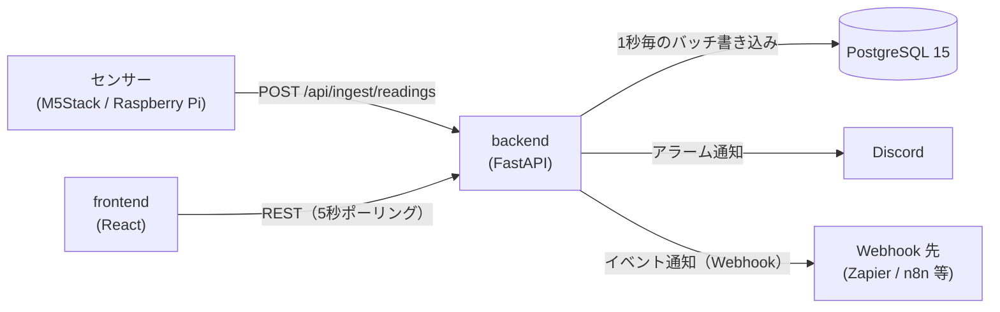

# FactorEye 仕様書

FactorEye の仕様（現行実装）をまとめたものです。各項目はコードと照合しています。
変更の経緯と判断理由は [`decisions.md`](decisions.md)、リリースごとの変更は [`CHANGELOG.md`](../CHANGELOG.md) を参照してください。

---

## 1. 概要

既存の PC と安価なセンサー（M5Stack / Raspberry Pi など）だけで使える工場監視 OSS です。

- センサー値を REST API で受け取り、しきい値でアラームを評価し、ダッシュボードに表示する
- 通知は Discord Webhook、外部連携は汎用 Webhook（Zapier / Make / n8n 等）
- self-hosted（Docker Compose）が基本。同じコードで SaaS（マルチテナント）モードも動く

### 非目標（現時点）

- Kubernetes・マイクロサービス・ロードバランシング
- RBAC・SSO・ユーザー単位の権限（self-hosted は認証なしで、ネットワーク境界で守る前提）
- 生産管理の高度な機能（OEE・停止理由の記録・シフト管理など）

---

## 2. 構成



| レイヤー | 技術 |
|---|---|
| Backend | Python 3.12 / FastAPI / SQLModel（SQLAlchemy 2.0）/ Alembic |
| Database | PostgreSQL 15（SQLite は使わない） |
| Frontend | TypeScript / React 18 / Vite / Zustand / TanStack Query / Recharts / react-grid-layout |
| 品質 | pytest・mypy・ruff・pip-audit（backend）、Vitest・ESLint・tsc・npm audit（frontend）、Playwright（E2E） |

**デプロイ**: `docker-compose.yml`（backend / frontend / postgres）。ポートは backend 8000、frontend 3001、postgres 5432。

---

## 3. データモデル

| テーブル | 役割 | 主な内容 |
|---|---|---|
| `sensors` | センサー | 名前（ワークスペース内で一意）、`ingest_key`（全体で一意。取り込みAPIがキーだけで特定するため）、単位、しきい値4項目、不感帯、有効/無効 |
| `readings` | 測定値 | sensor_id、値、`recorded_at`（取り込んだサーバー時刻）。`(sensor_id, recorded_at)` で索引 |
| `alarms` | アラーム | sensor_id、状態（active / acknowledged / resolved）、重要度（warning / critical）、しきい値方向（min / max）、確認者、`last_notified_at`。ユーザー操作では削除しない（センサーを削除すると関連分も削除される） |
| `dashboards` | ダッシュボード | 名前、説明、レイアウト設定。削除は論理削除（`deleted_at`） |
| `widgets` / `widget_configs` | ウィジェット | ダッシュボードの配置（12列グリッド）、種別、センサーとの紐付け、設定 |
| `notification_settings` | 通知設定 | ワークスペースごとに1行（self-hosted は NULL の1行）。重故障・軽故障それぞれの Discord Webhook URL、有効/無効、重故障の再通知 |
| `webhook_subscriptions` | Webhook 購読 | イベント種別、送信先 URL、有効/無効 |
| `users` / `workspaces` / `refresh_tokens` | 認証（SaaS のみ） | ユーザー、ワークスペース（テナント）、リフレッシュトークン |

- センサーの `workspace_id` などテナント列は SaaS モードで使う（`NULL` が self-hosted）
- 管理者アカウントは DB に入れない（後述 §10）

---

## 4. REST API

認証欄の「APIキー」は `X-API-Key` ヘッダー（§5）。「JWT」は `AUTH_MODE=multi_tenant` 時のみ必要なもの。

| Method | Path | 内容 | 認証 |
|---|---|---|---|
| GET | `/health` | 稼働確認。DB 接続状態を返す（`ok` / `degraded`） | なし |
| POST | `/api/ingest/readings` | センサー値の取り込み（単発・バッチ） | APIキー（self-hosted） |
| GET / POST | `/api/sensors` | センサー一覧・作成 | なし |
| GET / PUT / DELETE | `/api/sensors/{id}` | 詳細・更新・削除（物理削除） | なし |
| GET | `/api/sensors/{id}/readings` | 測定値（`from` / `to` / `limit`） | なし |
| GET | `/api/sensors/{id}/readings/aggregate` | 期間の合計と件数（`from` 必須） | なし |
| GET | `/api/readings` | 全センサーの直近測定値（`sensor_id` / `limit`） | なし |
| GET | `/api/alarms` | アラーム一覧（`status` / `sensor_id`） | なし |
| GET | `/api/alarms/{id}` | アラーム詳細 | なし |
| PATCH | `/api/alarms/{id}/ack` | アラームの確認（`acknowledgedBy` を記録） | なし |
| GET / POST | `/api/dashboards` | ダッシュボード一覧・作成 | なし |
| GET / PUT / DELETE | `/api/dashboards/{id}` | 詳細・更新・削除（論理削除） | なし |
| POST | `/api/dashboards/{id}/widgets` | ウィジェット追加 | なし |
| PUT / DELETE | `/api/widgets/{id}` | ウィジェット更新・削除 | なし |
| GET / PUT | `/api/settings/notifications` | Discord 通知設定 | なし |
| GET / POST | `/api/settings/webhooks` | Webhook 購読の一覧・作成 | なし |
| PUT / DELETE | `/api/settings/webhooks/{id}` | Webhook 購読の更新・削除 | なし |
| GET | `/api/settings/migration/status` | 移行機能の状態（書き出し・取り込みのどちらが使えるか） | なし |
| GET | `/api/settings/migration/export` | ワークスペースを書き出す（SaaS のみ。404 は self-hosted） | JWT |
| POST | `/api/settings/migration/import?dry_run=&with_notifications=` | 書き出しファイル（gzip の本文）を取り込む（self-hosted のみ。404 は SaaS） | なし |
| POST | `/api/auth/register` `/login` `/refresh` `/logout` | 認証（SaaS のみ） | なし |
| GET | `/api/me` | 自分のユーザーとワークスペース（SaaS のみ） | JWT |
| `/api/admin/*` | 管理者 API（SaaS のみ、§10） | 管理者トークン | 管理者 |

- API の詳細は `DEBUG` 時（`ENVIRONMENT != production`）に `/docs` で確認できる
- JSON のキーは camelCase

---

## 5. センサーの取り込み（Ingest）

### 認証
- **self-hosted（`AUTH_MODE=disabled`）**: `X-API-Key` ヘッダーに `INGEST_API_KEY` を送る。不一致は 401
- **SaaS（`AUTH_MODE=multi_tenant`）**: ヘッダー不要。本文の `ingestKey`（センサー単位のキー）で識別する

### リクエスト
```json
{ "ingestKey": "sensor-001", "value": 23.5 }
```
バッチは `readings` 配列（各要素に `value` と任意の `timestamp`）で送る。`value` も `readings` も無い場合は 400。

### 応答
| 状況 | HTTP |
|---|---|
| 受理（バッファに追加） | 202 |
| JSON 不正・形式不正 | 400 |
| APIキーが不正 | 401 |
| `ingestKey` が存在しない | 404 |
| センサーが無効 | 403 |
| 取り込み制限超過（IP ごと） | 429 |

### 時刻
- `recorded_at` は **サーバーが受信した時刻**を採用する。デバイス側の時刻は信頼しない（ずれや改ざんを避けるため）

### バッファ
- 受信値はメモリに溜め、**1秒ごとに一括 INSERT** する。同じバッチ処理の中でアラーム評価を行い、そのあと通知と Webhook 配信を行う
- トレードオフ: クラッシュ時、最大 1 秒分のデータが失われ得る

### レート制限
- IP ごとに **100 回/分**（`INGEST_RATE_LIMIT`、既定 `100/minute`）
- `INGEST_RATE_LIMIT=off` で解除できる（実機・負荷テスト用。起動時に警告が出る）。解除中は上限が無いので、テスト後は必ず既定値に戻す

---

## 6. アラーム評価

### しきい値
- センサーごとに **上限・下限 × 軽故障・重故障の 4 項目**（`thresholdMaxWarning` など）を設定できる。使わない項目は未設定（null）でよい
- **不感帯**（`thresholdDeadBand`、既定 0）: 閾値付近で値が揺れても発生と解除を繰り返さないための幅
  - 発生: 閾値を超えた時点で即時
  - 解除: 閾値から不感帯の幅だけ戻ったときに解除

### 状態遷移
| 状況 | 動作 |
|---|---|
| 初めて閾値を超えた | アラーム（active）を新規作成し、通知する |
| 発生中に重要度が変わった（軽故障 ⇄ 重故障） | 新規は作らず既存行を更新し、通知する |
| 発生中で重要度が同じ | 何もしない（重故障の再通知を除く） |
| 条件が解除された | 既存行を resolved にする（通知はしない） |
| 確認（ack） | active → acknowledged。解決するまで一覧に残る |

同じ条件のアラームは 1 件にまとめる（重複防止）。アラーム行は削除しない（履歴として残す）。

---

## 7. 通知

### Discord（基本機能）
- 設定は `notification_settings` で管理し、設定画面の「通知」タブで編集する
- **重故障と軽故障に別々の Webhook URL** を設定できる（チャンネルを分けられる）
- 重故障: 通常送信（通知音あり）。軽故障: サイレント送信（Discord の `SUPPRESS_NOTIFICATIONS` フラグ。チャンネルには表示される）
- **重故障の再通知**（既定で無効、間隔の既定は 30 分）: 未解決のまま間隔を超えたら同じアラームを再通知する。行は増やさず `last_notified_at` のみ更新する。軽故障には適用しない
- メッセージは日本語・日本時間の短い本文（発生時刻と送信時刻。再通知時は継続時間が分かる形）
- 送信失敗はログに残して無視する。取り込みパイプラインは止めない

### Webhook（外部連携）
Zapier・Make・n8n などのノーコード自動化サービスへ、イベントを JSON で送ります。利用者はコードを書く必要がありません。

| イベント | 発生タイミング | 主な項目 |
|---|---|---|
| `reading.received` | センサー値を受信するたび | `sensorId`, `value`, `recordedAt` |
| `alarm.triggered` | アラームが発生するたび（重要度の変化を含む） | `sensorId`, `sensorName`, `value`, `severity`, `thresholdBreached`, `triggeredAt`, `isRepeat` |

- 送信は `POST`（JSON、タイムアウト 10 秒）。失敗時の再試行は**しない**（ログのみ）
- 購読はワークスペース単位。購読の有効/無効を切り替えられる
- **送信先の制限（SSRF 対策）**: 次の条件を満たす宛先だけ送る
  - `https` のみ
  - 名前解決した**すべての**アドレスが公開 IP（ループバック・プライベート・リンクローカル・メタデータ用アドレス等は不可）
  - 登録・変更時に検証し、送信直前にも再検証する。リダイレクトは追わない
  - 例外: 環境変数 `WEBHOOK_ALLOW_PRIVATE_NETWORKS=true` で社内ネットワーク（http・プライベート IP）を許可できる。自己ホストで社内の自動化基盤を使う場合のみ。既定は `false`
- 既知の制限: 検証と接続の間の DNS 変化（DNS rebinding）は防ぎきれていない。また 1 件ごとに非同期送信するため、大量の取り込み時は送信数が増える（バッチ化・同時実行数の制限は未対応）

---

## 8. ダッシュボード

- 12 列グリッドで自由に配置・サイズ変更できる（画面幅に応じて列数が変わる）。配置はサーバーに保存する
- 画面は **5 秒間隔のポーリング**で更新する（WebSocket は使わない）
- ウィジェット種別:

| 種別 | 内容 |
|---|---|
| `SensorGraph` | 折れ線・棒・面グラフ。色、Y 軸の範囲、時間窓を設定できる |
| `MultiSensorComparison` | 複数センサーを重ねた比較グラフ |
| `StatValue` | 最新値の大きな表示とスパークライン。しきい値に応じて色が変わる |
| `AlarmAlert` | 発生中・確認済みのアラーム一覧と確認ボタン |
| `ProductionStatus` | 稼働 ON/OFF、直近 1 時間と本日の生産数、本日の目標達成率 |

- 生産数は「直近 1 時間」「本日累計」「目標達成率」で集計する（生データは返さず、SQL で集計する）

---

## 9. デバイス連携

- REST（JSON）が届けばどのデバイスでも使える
- 公式クライアント（MIT）:
  - `clients/arduino-m5stack/`（M5Stack / ESP32）
  - `clients/raspberry-pi/`（Python。GPIO / 1-Wire センサーの例を含む）
- **送信失敗時の再試行（デバイス側）**: 指数バックオフ（1・2・4・8・16 秒、上限 30 秒、±10% のジッター）。失敗分は最大 100 件のリングバッファに保持し、次回成功時にまとめて送る
- テスト用の工場エミュレータ: `tools/factory-emulator/`。手動操作画面（既定 `http://localhost:8765`）で生産負荷・温度・電力を指定し、しきい値アラームを狙って発生させられる

---

## 10. 認証・SaaS モード（`AUTH_MODE=multi_tenant`）

### 認証
- メール + パスワード（bcrypt）+ JWT
- アクセストークン 15 分、リフレッシュトークン 30 日（DB に保存し、使うたびにローテーション。旧トークンは即時失効）
- 全データはワークスペース単位で分離する

### Free Tier の制限
- センサーは **1 ワークスペースあたり 10 個まで**。11 個目の登録は 402
- 測定値は **90 日**を超えたものを毎日 03:00（UTC）に削除する。**SaaS のセンサーだけが対象**（self-hosted は無期限）
- ダッシュボード・ウィジェット・アラームは無制限

### 管理者画面（`/admin`）
SaaS の運用者向け。一般ユーザーのログイン画面とは別物です。
- 管理者アカウントは DB に入れず、サーバーのテキストファイル（`admin/admins.txt`、`ID:bcryptハッシュ` の 1 行 1 件）で管理する。追加・パスワード変更・削除は `app.admin_cli` で行う。ファイルは都度読み直すため、再起動なしで反映される
- 管理者トークンは 60 分で、リフレッシュはできない。ログインは 1 分あたり 5 回まで
- トークンは `sessionStorage` に保存する（タブを閉じると消える）
- 機能: 件数・DB 使用量の確認、ユーザー一覧・詳細、メール・プラン・パスワードの変更（パスワード変更で既存のリフレッシュトークンを全て失効）、ユーザーの削除（関連データを全て削除）
- 管理者ファイルは DB バックアップに含まれないため、別途保管が必要

---

## 11. 運用

### ヘルスチェック
`GET /health` の応答:
```json
{ "status": "ok", "timestamp": "...", "services": { "database": "connected" } }
```
DB に接続できない場合は `status` が `degraded` になる。

### バックアップ
- `infra/backup.sh` が PostgreSQL を `pg_dump` で取得する。cron で毎日 3 時に実行する想定
- 保持は既定で 7 日（`BACKUP_RETENTION_DAYS`）。復元は `infra/restore.sh`
- 手順は [`infra/README.md`](../infra/README.md)

### 設定（環境変数）
| 変数 | 既定 | 内容 |
|---|---|---|
| `DATABASE_URL` | 開発用の値 | DB 接続先。本番では必ず変更する |
| `INGEST_API_KEY` | `change-this-in-production` | 取り込みの共有キー（self-hosted）。本番では必ず変更する |
| `JWT_SECRET` | `change-this-in-production` | JWT の署名鍵。本番では必ず変更する |
| `ENVIRONMENT` | `development` | `production` で `/docs` を無効化 |
| `FRONTEND_URL` | `http://localhost:3001` | CORS の許可オリジン（`*` は使わない） |
| `AUTH_MODE` | `disabled` | `multi_tenant` で SaaS モード |
| `INGEST_RATE_LIMIT` | `100/minute` | 取り込みの制限。`off` で解除 |
| `WEBHOOK_ALLOW_PRIVATE_NETWORKS` | `false` | Webhook の社内ネットワーク送信を許可（§7） |

### セキュリティ上の前提
- self-hosted の API は取り込み以外に認証がない。**インターネットに直接公開しない**（ネットワーク境界で守る）
- 秘密情報（`.env`）はリポジトリに含めない
- CI で `pip-audit`・`npm audit` を実行する

---

## 12. テスト

| 種類 | 内容 | 実行 |
|---|---|---|
| Backend | pytest（PostgreSQL に接続）・mypy（strict）・ruff | `backend/` で実行（§12.1 の注意） |
| Frontend | Vitest・typecheck・ESLint | `frontend/` で実行 |
| E2E | Playwright（セットアップウィザード、アラームの発生と確認） | スタック起動後に `e2e/` で実行 |

### 12.1 テスト用 DB についての注意
backend のテストは、テストごとにすべてのテーブルを作り直し、終了時に削除する。**`DATABASE_URL` を開発用・本番用の DB に向けてはいけない**。テスト専用の DB（例: `factoreye_test`）を指定すること。CI は専用の PostgreSQL を都度起動するため、この問題は起きない。

---

## 13. 既知の制限と今後の課題

- 取り込みの制限は IP 単位。ゲートウェイ 1 台に多数のセンサーを束ねる構成では、制限に当たりやすい（ゲートウェイ単位への変更などが必要）
- Webhook: 再試行なし、同時送信数の制限なし、DNS rebinding 未対応（§7）
- 測定値の保持期間は、self-hosted では無期限（削除ポリシーなし）
- 管理画面: ユーザーのページング、管理者の画面からの追加・削除は未対応
- 次の段階の候補: ルールベースの設定
- SaaS → OSS の移行: `backend/app/migrate_saas_to_oss.py`（`export` で1ワークスペースを書き出し、`import` で移行先の self-hosted DB へ取り込む）。ID と取り込みキーは保つ。ユーザー・認証情報は移さない。取り込みは1トランザクションで、`--dry-run` で件数だけ確認できる。移行後はデバイスの送信に `X-API-Key` ヘッダーが必要になる点に注意
