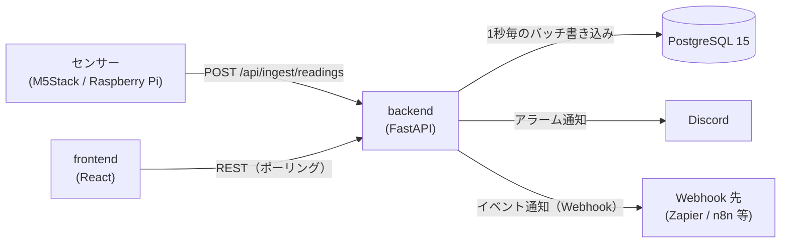

# FactorEye 仕様書

FactorEye の仕様（現行実装）をまとめたものです。各項目はコードと照合しています。
変更の経緯と判断理由は [`decisions.md`](decisions.md)、リリースごとの変更は [`CHANGELOG.md`](../CHANGELOG.md) を参照してください。

---

## 1. 概要

既存の PC と安価なセンサー（M5Stack / Raspberry Pi など）だけで使える工場監視 OSS です。

- センサー値を REST API で受け取り、しきい値でアラームを評価し、ダッシュボードに表示する
- 通知は Discord Webhook、外部連携は汎用 Webhook（Zapier / Make / n8n 等）
- self-hosted（Docker Compose）が基本。同じコードで SaaS（マルチテナント）モードも動く

### 非目標（現時点）

- Kubernetes・マイクロサービス・ロードバランシング
- RBAC・SSO・ユーザー単位の権限（self-hosted は認証なしで、ネットワーク境界で守る前提）
- 生産管理の高度な機能（OEE・停止理由の記録・シフト管理など）

---

## 2. 構成



| レイヤー | 技術 |
|---|---|
| Backend | Python 3.12 / FastAPI / SQLModel（SQLAlchemy 2.0）/ Alembic |
| Database | PostgreSQL 15（SQLite は使わない） |
| Frontend | TypeScript / React 18 / Vite / Zustand / TanStack Query / Recharts / react-grid-layout |
| 品質 | pytest・mypy・ruff・pip-audit（backend）、Vitest・ESLint・tsc・npm audit（frontend）、Playwright（E2E） |

**復旧ツール**: `tools/recovery/`。バックアップの確認・比較・書き出し・書き戻しを行う、本体とは別のプログラム（§11.1）。

**デプロイ**: `docker-compose.yml`（backend / frontend / postgres）。ポートは backend 8000、frontend 3001、postgres 5432（postgres は `127.0.0.1` だけに公開し、LAN には出さない）。イメージは多段ビルドで、実行段には本体と実行時依存だけを入れる（frontend は nginx で静的配信。判断とサイズは [decisions.md](decisions.md)）。

---

## 3. データモデル

| テーブル | 役割 | 主な内容 |
|---|---|---|
| `sensors` | センサー | 名前（ワークスペース内で一意）、`ingest_key`（全体で一意。取り込みAPIがキーだけで特定するため）、単位、しきい値4項目、不感帯、有効/無効、`device_id`（所属する機器。NULL は機器のキーに紐づかない。機器ごとのキーは §5） |
| `readings` | 測定値 | sensor_id、値、`recorded_at`（既定は取り込んだサーバー時刻。`INGEST_DEVICE_TIME=on` では機器が付けた測定時刻で、秒単位）。主キーは `(sensor_id, recorded_at)`（連番の `id` は無い。同じセンサーで同じ時刻の値は持てない。サーバー時刻のときは、1 回の送信内の i 番目の値を i マイクロ秒ずらして保存する。同じ時刻の値は後から来た値で上書きする） |
| `alarms` | アラーム | sensor_id、状態（active / acknowledged / resolved）、重要度（warning / critical）、しきい値方向（min / max）、確認者、`last_notified_at`。ユーザー操作では削除しない（センサーを削除すると関連分も削除される） |
| `dashboards` | ダッシュボード | 名前、説明、レイアウト設定。削除は論理削除（`deleted_at`） |
| `widgets` | ウィジェット | ダッシュボードの配置（12列グリッド）、種別、センサーとの紐付け、設定 |
| `notification_settings` | 通知設定 | ワークスペースごとに1行（self-hosted は NULL の1行）。重故障・軽故障それぞれの Discord Webhook URL、有効/無効、重故障の再通知 |
| `webhook_subscriptions` | Webhook 購読 | イベント種別、送信先 URL、有効/無効 |
| `ingest_devices` | 機器ごとのキー（self-hosted のみ） | 機器の名前（一意）、キーの SHA-256 ハッシュ（キーそのものは保存しない）、作成日時、失効日時。センサーの `device_id` の参照先 |
| `users` / `workspaces` / `refresh_tokens` | 認証（SaaS のみ） | ユーザー、ワークスペース（テナント）、リフレッシュトークン |

- センサーの `workspace_id` などテナント列は SaaS モードで使う（`NULL` が self-hosted）
- 管理者アカウントは DB に入れない（後述 §10）

---

## 4. REST API

認証欄の「APIキー」は `X-API-Key` ヘッダー（§5）。「JWT」は `AUTH_MODE=multi_tenant`（SaaS）時のみ必要なもの。
**認証欄が「なし」の API も、SaaS では JWT が必須**（なければ 401）。SaaS で JWT が要らないのは、`/health`、`/api/ingest/readings`（本文の `ingestKey` で識別）、`/api/auth/*`、`/api/settings/migration/status` だけ。管理者 API（`/api/admin/*`）は利用者の JWT ではなく、管理者トークンで認可する（§10）。self-hosted は取り込み以外に認証がない（§11）。

| Method | Path | 内容 | 認証 |
|---|---|---|---|
| GET | `/health` | 稼働確認。DB 接続状態を返す（`ok` / `degraded`） | なし |
| POST | `/api/ingest/readings` | センサー値の取り込み（単発・バッチ） | APIキー（self-hosted。`INGEST_AUTH=off` でなし） |
| GET / POST | `/api/sensors` | センサー一覧（ETag 付き。`If-None-Match` が一致すれば 304）・作成 | なし |
| GET / PUT / DELETE | `/api/sensors/{id}` | 詳細・更新・削除（物理削除） | なし |
| GET | `/api/sensors/{id}/readings` | 測定値（`from` / `to` / `limit`） | なし |
| GET | `/api/sensors/{id}/readings/downsampled` | グラフ用の間引き。`from` / `to` の範囲を `buckets` 区間（既定 500・上限 1000）に分け、区間ごとの最小・平均・最大・件数を返す | なし |
| GET | `/api/sensors/{id}/readings/aggregate` | 期間の合計と件数（`from` 必須） | なし |
| GET | `/api/readings` | 全センサーの直近測定値（`sensor_id` / `limit`） | なし |
| GET | `/api/alarms` | アラーム一覧（`status` / `sensor_id` / `limit` / `offset`）。新しい順。`limit` は 1〜500（省略時は条件に合う全件） | なし |
| GET | `/api/alarms/{id}` | アラーム詳細 | なし |
| PATCH | `/api/alarms/{id}/ack` | アラームの確認（`acknowledgedBy` を記録） | なし |
| GET / POST | `/api/dashboards` | ダッシュボード一覧・作成 | なし |
| GET / PUT / DELETE | `/api/dashboards/{id}` | 詳細・更新・削除（論理削除） | なし |
| POST | `/api/dashboards/{id}/widgets` | ウィジェット追加 | なし |
| PUT / DELETE | `/api/widgets/{id}` | ウィジェット更新・削除 | なし |
| GET / PUT | `/api/settings/notifications` | Discord 通知設定 | なし |
| GET / POST | `/api/settings/webhooks` | Webhook 購読の一覧・作成 | なし |
| PUT / DELETE | `/api/settings/webhooks/{id}` | Webhook 購読の更新・削除 | なし |
| GET | `/api/settings/migration/status` | 移行機能の状態（書き出し・取り込みのどちらが使えるか） | なし |
| GET | `/api/settings/migration/export` | ワークスペースを書き出す（SaaS は自分のワークスペース、self-hosted は全データ。§10.1） | なし |
| POST | `/api/settings/migration/import?dry_run=&with_notifications=` | 書き出しファイル（gzip の本文）を取り込む（self-hosted のみ。404 は SaaS） | なし |
| POST | `/api/auth/register` `/login` `/refresh` `/logout` | 認証（SaaS のみ） | なし |
| GET | `/api/me` | 自分のユーザーとワークスペース（SaaS のみ） | JWT |
| `/api/admin/*` | 管理者 API（SaaS のみ、§10） | 管理者トークン | 管理者 |

- API の詳細は `DEBUG` 時（`ENVIRONMENT != production`）に `/docs` で確認できる
- JSON のキーは camelCase

### 4.1 一覧 API の応答（性能）

- **アラーム一覧のページング**: `limit` と `offset` で区切る。並びは `triggered_at` の新しい順で、同時刻は `id` の降順（ページの境界で重複・抜けを出さないため）。`total` は、ページで区切る前の、条件に合う件数
- **センサー一覧の版（ETag）**: 版は、件数と最終更新時刻（`updated_at` の最大）から作る。応答に `ETag` と `Cache-Control: no-cache` を付ける。`If-None-Match` が一致すれば、本体を送らずに 304 を返す
- **版ごとの JSON のキャッシュ**: 完成した一覧の JSON を、版ごとにプロセス内に保持する（上限 32 件）。版は、読み出しの前に作るため、キャッシュの内容が版より古くなることはない
- **応答の作り方**: 一覧は ORM のオブジェクトを作らず、必要な列だけを読む。Pydantic のモデルから JSON を 1 回だけ作る（`app/api/responses.py`）。OpenAPI の定義は `response_model` で残す。応答の形（camelCase の項目）は変えない
- **注意**: 版とキャッシュはプロセスごとに持つ。ワーカーを増やすと、ワーカーごとに持つ（内容は一致する）。センサーの作成・更新・削除は、必ず件数か `updated_at` を変えること（版の判定に使うため）

---

## 5. センサーの取り込み（Ingest）

### 認証
- **self-hosted（`AUTH_MODE=disabled`）**: 既定（`INGEST_AUTH=key`）では、`X-API-Key` ヘッダーに `INGEST_API_KEY` を送る。不一致は 401。`INGEST_AUTH=off` のときは、キーなしで受け付ける（送られてきたヘッダーは無視する）。このとき、センサーは本文の `ingestKey` だけで識別されるので、`ingestKey` を知っていれば誰でも値を書ける。取り込みの口を LAN などに限定して使う。起動時に警告をログに出す。レート制限（IP ごと）は変わらないが、制限の鍵は `CF-Connecting-IP` ヘッダーを優先して読む（`app/rate_limit.py`）ので、backend に直接届く経路（プロキシを通らない LAN など）では、そのヘッダーを偽装して制限を避けられる。キーなしの運用では、取り込みの口の前に置くプロキシで `CF-Connecting-IP` を上書きするか、信頼できる経路に限る。LAN 向けの窓口（nginx）は `infra/lan-ingest/` にある
- **SaaS（`AUTH_MODE=multi_tenant`）**: ヘッダー不要。本文の `ingestKey`（センサー単位のキー）で識別する

### リクエスト
```json
{ "ingestKey": "sensor-001", "value": 23.5 }
```
**センサーの自動登録（self-hosted だけ）**: `INGEST_AUTO_CREATE=on` のとき、未登録の `ingestKey` は 404 にせず、センサーを自動で作る。本文に `"name"`・`"unit"` を付けると、その名前・単位で作る（付けなければ、名前は `ingestKey`、単位は `-`）。登録済みのセンサーは、`name`・`unit` で上書きしない。決まり: `ingestKey` は、英数字と `.` `_` `-` だけ・64 文字まで（違えば 400。末尾の改行も不可）／センサーの総数（無効なものも数える）が `INGEST_AUTO_CREATE_MAX_SENSORS`（既定 100）に達したら、作らない（403）／`name`・`unit` は、拒否せずに整える（制御文字・NUL・表示の向きを変える文字を除き、前後の空白を削り、名前は 100 文字・単位は 20 文字に切る。空なら、名前は `ingestKey`、単位は `-`）。登録済みのセンサーでは、`name`・`unit` を見ない（変な値でも 400 にならない）／名前が重なるときは、「名前 (ingestKey)」→ `ingestKey` → 乱数つき、の順に使う／作る処理は、PostgreSQL の advisory lock で、同時に 1 つずつ行うので、同時に大量に来ても、上限を超えず、同じ `ingestKey` も 1 つだけ作る。**既定は off**。on の間は、打ち間違いの ID でも、センサーができる。削除したセンサーも、次の送信で、また作られる。**SaaS（`multi_tenant`）では使えない**（`ingestKey` だけでは、どのワークスペースかが決まらないため。無視する）。起動時に警告をログに出す。
バッチは `readings` 配列（各要素に `value` と任意の `timestamp`）で送る。`readings` は 1 リクエストあたり 1,000 件まで。`value` も `readings` も無い場合、1,001 件以上の場合、`value` が NaN・Infinity の場合は 400。

**照合のキャッシュ**: 取り込みのたびの DB の問い合わせ（機器のキーの照合、センサーの検索）を、`INGEST_CACHE_SECONDS`（既定 5 秒）だけ覚えておく（`app/ingest_cache.py`）。覚えるのは見つかった結果だけ（間違ったキー・未登録のセンサーは覚えない）。同じプロセスでのセンサーの更新・削除、機器の作成・所属・失効は、すぐ反映する。**別のプロセス（`--workers`）や CLI からの変更は、最大で保持秒数だけ遅れる**（失効したキーが最大 5 秒は通る、無効にしたセンサーが最大 5 秒は受け付ける）。SaaS にも同じ仕組みが入る。

**機器ごとのキー（self-hosted だけ）**: 機器（現場の 1 台）ごとにキーを発行し、`X-Device-Key` ヘッダーで送る。キーは発行の時に 1 回だけ表示し、DB には SHA-256 のハッシュだけを保存する（`ingest_devices` 表）。センサーは `device_id` で機器に所属させる（`python -m app.device_cli attach <機器名> <ingestKey>...`）。
- 所属のあるセンサーには、そのセンサーの機器のキーでしか送れない（キーが無いと 401、別の機器のキーは 403。`sensors`・`samples` では `rejected` に出し、残りは受け付ける）
- 所属のないセンサーには、機器のキーでは送れない（403）。機器のキーが無い送信（従来の形）は、所属のないセンサーにだけ送れる
- キーは `python -m app.device_cli create <機器名>` で発行し、`revoke <機器名>` で失効させる（失効したキーは 401）
- 機器のキーを付けたときは、共通の `X-API-Key` の検査を省く（機器ごとのキーで認証する）。SaaS 版では無視する（従来どおり）
- 本文は、読みながら大きさを数える。Content-Length の無い（chunked）送信も、8MB を超えたら 413

**時刻ごとにまとめる形（`samples`）**: `{ "samples": [ { "timestamp": "2026-10-30T12:00:00Z", "values": { "loc001-v": 12.34, "loc001-i": 0.512, "loc001-e": -1.234 } }, ... ] }`。1 つの時刻に、複数のセンサーの値（`{ingestKey: 値}`）をまとめる。時刻を値ごとに繰り返さないので、1 秒サンプリングで小さく送れる。`ingestKey`・`sensors` とは同時に使えない（3 つのうち 1 つ）。時刻を省くと受信時刻。未登録などのセンサーは `sensors` と同じく `rejected` に出し、残りは受け付ける。1 リクエストあたり、時刻 1,000 個・値の合計 70,000 件まで。

**複数センサーを 1 回で送る形**: `{ "sensors": [ { "ingestKey": "...", "value" か "readings": ... }, ... ] }`（各要素は従来の形と同じ。`name`・`unit` も使える）。`ingestKey` とは同時に使えない（どちらか 1 つ）。1 リクエストあたり 2,000 センサー・測定値の合計 70,000 件まで（超えると 400）。センサーごとの問題（未登録 404・無効 403・値なし 400 など）は、全体を失敗にせず、応答の `rejected`（`ingestKey`・`status`・`detail`）に出して、残りは受け付ける（202）。従来の形では `rejected` は常に空で、問題は今までどおり 4xx になる。`timestamp` の範囲外が 1 つでもあれば、全体を 400 にする。
- `accepted` は **受け付けた件数**で、保存した件数ではない（同じ (センサー, 時刻) の値は、後から来た値で上書きする。時刻が固定のままの機器のバグは、応答では分からないので、サーバーのログの `overwrote … readings` を見る）
- **時刻は秒で管理する**: `INGEST_DEVICE_TIME=on` のとき、`timestamp` は秒単位に切り捨てて保存する（`12:00:00.9` は `12:00:00`。同じ秒の値は、後から来た値で上書きされる）。数値は UNIX 秒だけ（ミリ秒・マイクロ秒の数値は 400）400 の `detail` は、範囲の誤りでは文字列、形の誤りでは配列
- `sensors` が空配列なら `accepted: 0` の 202。要素の `ingestKey` の欠落・型違いは送信全体の 400（`rejected` にはならない）、値が無い要素だけが `rejected`（400）
- 本文は 8MB まで（超えると 413）。件数は、読み込んだ直後に数え、上限を超えたら 400（組み立ての前）
- 解決したアラームより前の超過は、あとから届いても新しい発生にならない（機器の時刻のとき）
- 取り込みのバッファは最大 10 万件。1,050 値/秒だと、DB が止まって約 95 秒で古い値から捨て始める

### 応答
| 状況 | HTTP |
|---|---|
| 受理（バッファに追加）。`sensors` の形では、一部のセンサーが `rejected` でも 202 | 202 |
| JSON 不正・形式不正（`ingestKey` に NUL を含む場合も） | 400 |
| `INGEST_DEVICE_TIME=on` で、`timestamp` に時差が無い・未来（10 秒超）・30 日より前が含まれる | 400 |
| `INGEST_AUTO_CREATE=on` で、未登録の `ingestKey` が、英数字と `. _ -` の 64 文字までに合わない | 400 |
| APIキーが不正 | 401 |
| `ingestKey` が存在しない（自動登録が off、または SaaS） | 404 |
| センサーが無効 | 403 |
| 自動登録で、センサーの総数（無効なものも数える）が `INGEST_AUTO_CREATE_MAX_SENSORS` に達している | 403 |
| 自動登録で、名前の候補がすべて重なった（まれ） | 409 |
| 取り込み制限超過（IP ごと） | 429 |

### 時刻
- `recorded_at` は既定で **サーバーが受信した時刻**を採用する。デバイス側の時刻は信頼しない（ずれや改ざんを避けるため）
- **測定時刻の指定（self-hosted だけ、`INGEST_DEVICE_TIME=on`、既定 off）**: 各値に `timestamp`（時差つきの ISO 8601 `"2026-10-30T12:00:00.123Z"`、または UNIX 秒）を付けると、その時刻で保存する。付けない値は受信時刻のまま（1 つの送信に混在してよい）。off のときと SaaS では `timestamp` を無視する（従来どおり）
  - 時差なし・未来（10 秒超）・30 日より前の `timestamp` を含む送信は、全体を 400 にする（機器に時計のずれを知らせる）。通信が切れて溜めた値を、後から送り直してよい
  - 同じ (センサー, 時刻) を送り直しても二重にならない（後から来た値で上書きする。送り直しの値が同じなら変わらない）。アラームの評価は、その時刻で行う（古い値を溜めて送ると、順序が前後することがある）
  - 機器の時計（NTP など）が合っていることが前提

### バッファ
- 受信値はメモリに溜め、**1秒ごとに一括 INSERT** する。同じバッチ処理の中でアラーム評価を行い、そのあと通知と Webhook 配信を行う
- DB への書き込み（commit）より前に失敗した場合は、取り出した値をバッファの先頭に戻し、次の周期で再試行する。DB の一時的な停止では値は失われない。再試行待ちは最大 10 万件で、超えた分は古いものから捨てる（ログに警告）
- 受信から書き込みまでの間に削除されたセンサーの値は捨てる（外部キー違反でバッチ全体が失敗し続けるのを防ぐため）
- 通常の停止（再起動・デプロイ）では、バッファに残った値を書いてから終了する
- トレードオフ: プロセスのクラッシュ時、バッファ上の未書き込みの値（通常は最大 1 秒分、DB 停止中はそれ以上）が失われ得る

### レート制限
- IP ごとに **100 回/分**（`INGEST_RATE_LIMIT`、既定 `100/minute`）
- `INGEST_RATE_LIMIT=off` で解除できる（実機・負荷テスト用。起動時に警告が出る）。解除中は上限が無いので、テスト後は必ず既定値に戻す
- 管理画面から **期限付きで解除** できる（§10「取り込みのレート制限」）。環境変数が `off` のときは、この画面からは変更できず、環境変数が優先される

---

## 6. アラーム評価

### しきい値
- センサーごとに **上限・下限 × 軽故障・重故障の 4 項目**（`thresholdMaxWarning` など）を設定できる。使わない項目は未設定（null）でよい
- **不感帯**（`thresholdDeadBand`、既定 0）: 閾値付近で値が揺れても発生と解除を繰り返さないための幅
  - 発生: 閾値を超えた時点で即時
  - 解除: 閾値から不感帯の幅だけ戻ったときに解除

### 状態遷移
| 状況 | 動作 |
|---|---|
| 初めて閾値を超えた | アラーム（active）を新規作成し、通知する |
| 発生中に重要度が変わった（軽故障 ⇄ 重故障） | 新規は作らず既存行を更新し、通知する |
| 発生中で重要度が同じ | 何もしない（重故障の再通知を除く） |
| 条件が解除された | 既存行を resolved にする（通知はしない） |
| 確認（ack） | active → acknowledged。解決するまで一覧に残る |

同じ条件のアラームは 1 件にまとめる（重複防止）。アラーム行は削除しない（履歴として残す）。

---

## 7. 通知

### Discord（基本機能）
- 設定は `notification_settings` で管理し、設定画面の「通知」タブで編集する
- **重故障と軽故障に別々の Webhook URL** を設定できる（チャンネルを分けられる）
- 重故障: 通常送信（通知音あり）。軽故障: サイレント送信（Discord の `SUPPRESS_NOTIFICATIONS` フラグ。チャンネルには表示される）
- **重故障の再通知**（既定で無効、間隔の既定は 30 分）: 未解決のまま間隔を超えたら同じアラームを再通知する。行は増やさず `last_notified_at` のみ更新する。軽故障には適用しない
- メッセージは日本語・日本時間の短い本文（発生時刻と送信時刻。再通知時は継続時間が分かる形）
- 送信失敗はログに残して無視する。取り込みパイプラインは止めない

### Webhook（外部連携）
Zapier・Make・n8n などのノーコード自動化サービスへ、イベントを JSON で送ります。利用者はコードを書く必要がありません。

| イベント | 発生タイミング | 主な項目 |
|---|---|---|
| `reading.received` | センサー値を受信するたび | `sensorId`, `value`, `recordedAt` |
| `alarm.triggered` | アラームが発生するたび（重要度の変化を含む） | `sensorId`, `sensorName`, `value`, `severity`, `thresholdBreached`, `triggeredAt`, `isRepeat` |

- 送信は `POST`（JSON、タイムアウト 10 秒）。失敗時の再試行は**しない**（ログのみ）
- 購読はワークスペース単位。購読の有効/無効を切り替えられる
- **送信先の制限（SSRF 対策）**: 次の条件を満たす宛先だけ送る
  - `https` のみ
  - 名前解決した**すべての**アドレスが公開 IP（ループバック・プライベート・リンクローカル・メタデータ用アドレス等は不可）
  - 登録・変更時に検証し、送信直前にも再検証する。リダイレクトは追わない
  - 例外: 環境変数 `WEBHOOK_ALLOW_PRIVATE_NETWORKS=true` で社内ネットワーク（http・プライベート IP）を許可できる。自己ホストで社内の自動化基盤を使う場合のみ。既定は `false`
- **送信数の上限**: 接続は 1 つのクライアントで使い回す。同時に送るのは 10 件まで（送信直前の検証を含む）。送信待ちが 1,000 件を超えたら、新しいものは送らずに捨てる（捨てた件数は、多くても 1 分に 1 回ログに出す）。送信先が遅い・大量に取り込むときに、CPU・メモリ・接続を使い切らないため
- 既知の制限: 検証と接続の間の DNS 変化（DNS rebinding）は防ぎきれていない。1 件ごとに送るため、バッチ化はしていない

---

## 8. ダッシュボード

- 12 列グリッドで自由に配置・サイズ変更できる（画面幅に応じて列数が変わる）。配置はサーバーに保存する
- 画面は**ポーリング**で更新する（WebSocket は使わない）。センサー値・アラーム・ダッシュボードの中身は 5 秒ごと、グラフ（`SensorGraph`・`MultiSensorComparison`）の直近モードは 30 秒ごとに取り直す
- ウィジェット種別:

| 種別 | 内容 |
|---|---|
| `SensorGraph` | 折れ線・棒・面グラフ。色、Y 軸の範囲、時間窓を設定できる |
| `MultiSensorComparison` | 複数センサーを重ねた比較グラフ |
| `StatValue` | 最新値の大きな表示とスパークライン。しきい値に応じて色が変わる |
| `AlarmAlert` | 発生中・確認済みのアラーム一覧と確認ボタン |
| `ProductionStatus` | 稼働 ON/OFF、直近 1 時間と本日の生産数、本日の目標達成率 |

- 生産数は「直近 1 時間」「本日累計」「目標達成率」で集計する（生データは返さず、SQL で集計する）

### 時間の操作（SensorGraph・MultiSensorComparison）

Grafana と同じように、グラフの表示する時間範囲を操作できる。

**表示範囲の 2 つのモード**
- **直近モード**: 「直近 N 分／時間／日」。右端は常に現在時刻。30 秒ごとの更新で右端が進む
- **固定モード**: 開始と終了を指定した期間。更新しても範囲は変わらない（過去の期間を見るため）

**操作**

| 操作 | 内容 |
|---|---|
| 範囲の選択 | プリセット（5 分・15 分・1 時間・6 時間・24 時間・7 日・30 日）、または開始と終了を入力した任意の期間 |
| 前へ・後ろへ | 現在の範囲の幅だけ過去・未来へ移動する。移動すると固定モードになる |
| 今に戻る | 右端を現在時刻にして、直近モードに戻す |
| 拡大・縮小 | 範囲の幅を半分・2 倍にする（中心は現在の中心） |
| ドラッグで選ぶ | グラフ上で時間をドラッグし、その期間に拡大する（固定モードになる） |

**範囲の扱い**
- 時間範囲は、ダッシュボードごとに 1 つ。そのダッシュボードの `SensorGraph` と `MultiSensorComparison` は、この範囲に従う
- 範囲は URL のクエリ（直近は `?range=1h`、固定は `?from=…&to=…`）に保持し、そのリンクで同じ表示を開けるようにする
- 範囲はダッシュボードの設定に保存しない。開き直すと既定の「直近 1 時間」になる

**比較グラフ**
- `MultiSensorComparison` は、全センサーを同じ範囲・同じ区間数で取得し、時間軸を揃えて重ねる

**アラーム表示（`AlarmAlertWidget`）**
- 発生中（active）と確認済み（acknowledged）を、それぞれ新しい順 100 件まで取得し、5 秒ごとに取り直す
- 設定画面のアラーム一覧は、従来どおり全件を取得する
- 確認済みが 100 件を超えると、古いものはこの表示には出ない（設定画面では見られる）

**制限と注意**
- SaaS（Free Tier）は測定値の保持が 14 日（§10）のため、選べる範囲は 14 日までとする（30 日のプリセットは出さない）。self-hosted は保持期間の制限なし
- 範囲が長いと点が多すぎるため、グラフは `readings/downsampled` で取得する。生データ（`readings`）は、表示の詳細確認のためだけに使う
- 表示の時刻はブラウザの地域時刻（日本では JST）。保存と API は UTC

---

## 9. デバイス連携

- REST（JSON）が届けばどのデバイスでも使える
- 公式クライアント（MIT）:
  - `clients/arduino-m5stack/`（M5Stack / ESP32）
  - `clients/raspberry-pi/`（Python。GPIO / 1-Wire センサーの例を含む）
- **送信失敗時の再試行（デバイス側）**: 指数バックオフ（1・2・4・8・16 秒、上限 30 秒、±10% のジッター）。失敗分は最大 100 件のリングバッファに保持し、次回成功時にまとめて送る
  - 再送するのは、通信エラー・タイムアウト・5xx・408・429。429 に `Retry-After` が付いていれば、その秒数（上限 5 分）より早くは送らない（現行の backend は付けないため、通常のバックオフになる）
  - 401・403・404 は設定の誤り（API キー・取り込みキー・センサーの無効化）。警告ログを出して値を保持し、再送し続ける。保持は 1 センサー（取り込みキー）あたり最大 10 件で、超えたら古い値から捨てる。全体のバックオフは延ばさず、他のセンサーの送信を遅らせない
  - 400・422 など、送り直しても成功しない 4xx は、その送信分（バッファ分を含む）を捨てる（警告ログ）。NaN・Infinity・数値でない値は、送る前に捨てる
- テスト用の工場エミュレータ: `tools/factory-emulator/`。手動操作画面（既定 `http://localhost:8765`）で生産負荷・温度・電力を指定し、しきい値アラームを狙って発生させられる

---

## 10. 認証・SaaS モード（`AUTH_MODE=multi_tenant`）

### 認証
- メール + パスワード（bcrypt）+ JWT
- アクセストークン 15 分、リフレッシュトークン 30 日が既定（`JWT_ACCESS_EXPIRE_MINUTES`・`JWT_REFRESH_EXPIRE_DAYS` で変更できる）。リフレッシュトークンは DB に保存し、使うたびにローテーション。旧トークンは即時失効
- 登録は 1 分あたり 10 回、ログインは 1 分あたり 20 回まで（IP ごと）
- 全データはワークスペース単位で分離する

### Free Tier の制限
- センサーは **1 ワークスペースあたり 10 個まで**。11 個目の登録は 402
- 測定値は **14 日**を超えたものを毎日 03:00（UTC）に削除する（2026-10-28 に 90 日から変更。DR のバックアップ量と復旧時間を小さくするため）。**SaaS のセンサーだけが対象**（self-hosted は無期限）
- 有効期限が切れて 7 日を過ぎたリフレッシュトークンも、同じ時刻に削除する（期限内の行は、失効済みでも残す）
- ダッシュボード・ウィジェット・アラームは無制限

### 管理者画面（`/admin`）
SaaS の運用者向け。一般ユーザーのログイン画面とは別物です。
- 管理者アカウントは DB に入れず、サーバーのテキストファイル（既定 `admin/admins.txt`。`ADMIN_CREDENTIALS_FILE` で変更。`ID:bcryptハッシュ` の 1 行 1 件）で管理する。追加・パスワード変更・削除は `app.admin_cli` で行う。ファイルは都度読み直すため、再起動なしで反映される
- 管理者トークンは 60 分（既定。`ADMIN_ACCESS_EXPIRE_MINUTES`）で、リフレッシュはできない。ログインは 1 分あたり 5 回まで
- トークンは `sessionStorage` に保存する（タブを閉じると消える）
- 機能: 件数・DB 使用量の確認、ユーザー一覧・詳細、メール・プラン・パスワードの変更（パスワード変更で既存のリフレッシュトークンを全て失効）、ユーザーの削除（関連データを全て削除）
- 利用者として閲覧する機能: ユーザーの詳細から、そのユーザーのワークスペースを、本人の画面で開く（`POST /api/admin/users/{id}/impersonate`）。専用のトークンは 15 分（既定。`IMPERSONATION_EXPIRE_MINUTES`）で、リフレッシュはできない。開始と、閲覧中の書き込み（GET / HEAD / OPTIONS 以外）は、管理者 ID とともにサーバーのログへ残す
- 管理者ファイルは DB バックアップに含まれないため、別途保管が必要
- 取り込みのレート制限の解除（画面上部のカード）: 「60 分だけ解除」で制限を外し、期限（既定 60 分・最長 240 分）を過ぎると自動で既定の制限に戻る。「今すぐ制限を戻す」で即時に戻す。解除・停止は管理者 ID とともにサーバーのログへ残す。状態はメモリのみ（再起動すると制限あり＝既定に戻る）。API は `GET` / `PUT /api/admin/ingest-limit`

---

### 10.1 データ移行（書き出し・取り込み）

SaaS（マルチテナント）の1ワークスペース、または OSS（self-hosted）の全データを、
別の self-hosted の DB へ移す。画面は「設定」→「データ移行」。

- **書き出し**: SaaS はログイン中のワークスペース、self-hosted は全データ（`workspace_id` が
  NULL の行。self-hosted には複数ワークスペースという概念が無いため）を、gzip の
  JSON Lines（`factoreye-workspace-export`、形式の版 3）に書き出す。読み取りのみで、
  REPEATABLE READ の一貫した時点を取る。どちらのモードでも使える
- **取り込み（self-hosted のみ）**: 書き出しファイルを、移行先の DB に1トランザクションで
  取り込む。`dry_run` では件数だけ確認して戻す。失敗すると何も残さない
  （CLI は `python -m app.migrate_saas_to_oss`）
- **OSS → OSS**: 書き出し・取り込みとも self-hosted で使えるため、別サーバーへの移行や
  バックアップとして、このアプリ内だけで完結する
- **OSS → SaaS**（ワークスペースを選んでの取り込み）: このアプリの「データ移行」では行わない。
  復旧ツール（`tools/recovery/`、§11.1）の書き戻しを使う（ワークスペースの選択・Free Tier の
  確認が要るため）
- **移るもの**: センサー（取り込みキー `ingest_key` を含む）、測定値、アラーム、ダッシュボード（削除済みを除く）、ウィジェット、ウィジェット設定、Webhook 購読。通知設定は `with_notifications` を指定したときだけ、移行先の ID=1 を上書きする
- **移らないもの**: ユーザー、リフレッシュトークン、ワークスペース（self-hosted には認証がないため）
- **ID**: センサー・ダッシュボードなどの UUID と取り込みキーは、そのまま保つ。測定値の ID は移行先で振り直す
- **機器ごとのキー（版 3 から）**: self-hosted の書き出しには、機器の表（`ingest_devices`。機器の名前と、キーの**ハッシュ**。元のキーには戻せない）も入り、センサーの所属（`device_id`）ごと移る。移行先でも、同じキーのまま送れる。SaaS の書き出しには、機器が無いので入らない。移行先に同じ名前の機器があると、取り込みは中止される（409）
- **測定値の形式（版 2）**: 1行 = 1センサー・最大 5,000 件。`[値, 前の行からの差分（マイクロ秒）]` の配列で、時刻は往復で完全に戻る。10 センサー・90 日分（約 1,550 万件）で、約 90〜110 MB（欠測や不規則な間隔があっても、ほぼ同程度）
- **スキーマ版の照合**: 書き出し元と移行先の `alembic_version` が一致しないと取り込まない
- **権限**: 書き出し API はどちらのモードでも使える（SaaS は JWT で自分のワークスペースに限定）。取り込み API は self-hosted のみで、認証はない（ネットワーク境界で守る前提。§11 の注意と同じ。self-hosted は元々 `GET /api/sensors` 等でも全データが読めるため、書き出しを足しても新たな漏えいにはならない）。SaaS では取り込みは 404 を返す

## 11. 運用

### ヘルスチェック
`GET /health` の応答:
```json
{ "status": "ok", "timestamp": "...", "services": { "database": "connected" } }
```
DB に接続できない場合は `status` が `degraded` になる。

### バックアップ
- `infra/backup.sh` が PostgreSQL を `pg_dump` で取得する。cron で毎日 3 時に実行する想定。保持は既定で 7 日（`BACKUP_RETENTION_DAYS`）。復元は `infra/restore.sh`
- 設定ファイル（`.env`・管理者ファイルなど）の暗号化保存、本番の外の控え（`infra/offsite-pull.sh`・`infra/offsite-s3.sh`）、バックアップのファイルの権限と書き込み中の扱い（sha256・権限 640・`.partial-*`）は [`infra/README.md`](../infra/README.md) に書く
- 中身の確認・比較・書き出し・書き戻しは、復旧ツール（§11.1）

### 11.1 復旧ツール（`tools/recovery/`）

停電による DB の破損や、不正アクセスによるプログラムの破壊から復旧するための Web 画面。FactorEye 本体（backend）に依存せず、Docker があればどこでも動く。違いは設定（`.env`）だけ。

- バックアップ（ディレクトリか S3）の一覧・検証、今の DB との比較、閲覧・CSV の書き出し、書き戻し（今の DB に**無い行だけ**を足す。今ある行は変えない・消さない）ができる
- バックアップは、乗っ取られた本番で書き換えられている前提で展開する（`.sha256` も一緒に作り直せるため）。管理者ではないロールで流し込み、psql のメタコマンドを止める
- OSS 版 ⇄ SaaS 版は、所属を付け替えて書き戻せる。今の DB の版は `TARGET_MODE`（`saas` / `oss`）で指定する（書き戻しを使うなら必須）。SaaS → OSS のワークスペース単位の移し替えは、§10.1 のデータ移行でもできる（通知設定の上書きの指定など、移行に特化した機能はそちら）
- 控え（AWS）が稼いだ増加分（縮小ダンプ。R2 の `handoff-inc/`）は、本番に復帰したあと、管理画面（`/admin`）の「書き戻し」で本番に足す（下の「引き継ぎからの書き戻し」）
- 書き戻しの規則・展開の安全策・設定の一覧・起動手順は [`tools/recovery/README.md`](../tools/recovery/README.md) を正とする

### 引き継ぎからの書き戻し（管理画面）
- 流れ: 一覧 → 試算（追加される件数。何も書かない）→ 確認の小窓 → 実行（直前に本番の控え `before-merge-*` を取り、1 つのトランザクション）→ 結果。実行は、試算の件数と実行の直前の件数が一致したときだけ
- API: `GET /api/admin/failback/handoffs`、`POST /api/admin/failback/preview`、`POST /api/admin/failback/apply`（`backend/app/api/admin_failback.py`。管理者トークンが必要。`AUTH_MODE=multi_tenant` のときだけマウントする）
- 書き込みは backend が直接は行わず、内部ネットワーク（`factoreye-cloud`）で復旧ツールの `POST /api/handoffs/{name}/failback` を呼ぶ（`backend/app/failback_client.py`）。設定は `FAILBACK_RECOVERY_URL`（既定 `http://recovery:8090`）・`FAILBACK_RECOVERY_USERNAME`・`FAILBACK_RECOVERY_PASSWORD`（復旧ツールの Basic 認証と同じ値。空なら無効）・`FAILBACK_TIMEOUT_SECONDS`（既定 600）
- 本番と控えのスキーマの版（Alembic）が違うときは、書き戻さずに警告する（409）。引き継ぎの sha256・gzip が壊れていれば使わない
- 制限: 控えの稼働中の、既存の行の更新・削除（パスワードの変更など）は戻らない。起点より前に発生して起点以降に解除されたアラームの変化も戻らない。本番に復帰したあとに削除した行は、縮小ダンプに残っていれば復活する
- 書き戻しの間、`readings` に `SHARE ROW EXCLUSIVE` のロックを取り、測定値の挿入を待たせる（再送の割り込みによる重複を防ぐ）。書き戻す前に取り込みを止めるか減らす。書き戻した行だけを消す手順は無い（`before-merge-*` からの全体の復元は、新しい行も消える）

### R2 の WAL-G のバックアップからの復旧（管理画面）
- 本番（Proxmox の LXC）が消えた・データが不完全なときに、R2 の `factoreye-db`（ベース ＋ WAL）から、本番に無い行だけを足す。API: `GET/POST/DELETE /api/admin/failback/r2`（状態・開始・破棄）、`POST /api/admin/failback/r2/{preview,apply}`（`handoff` を渡すと R2 → 引き継ぎの順に、1 つのトランザクションで足す）
- 復旧ツールが、`wal-g backup-fetch LATEST` → `recovery.signal` ＋ `restore_command` → 一時的な PostgreSQL 15（unix ソケットだけ）で WAL を再生 → 昇格後の DB を merge の入力にする。時間のかかる復元は復旧ツールの裏のジョブで、画面は状態（取得中 / 再生中 / 準備完了 / 失敗）を見る。使う WAL-G のコマンドは読み取りだけ（`backup-list`・`backup-fetch`・`wal-fetch`）
- 復元した PostgreSQL は、バックアップの設定を使わず最小の自前の設定で起動する。鍵は環境に渡さず権限 600 のファイルから読む。`walg.env` が読めなくても復旧ツールは起動し、R2 の機能だけ無効になる（理由を画面に出す）
- 本番の DB が空（スキーマだけ）でも動く。スキーマの版（Alembic）が違えば、書き込まずに拒否して版を 2 つ表示する。手順は [`tools/recovery/README.md`](../tools/recovery/README.md)

### 設定（環境変数）
| 変数 | 既定 | 内容 |
|---|---|---|
| `DATABASE_URL` | 開発用の値 | DB 接続先。本番では必ず変更する |
| `INGEST_API_KEY` | `change-this-in-production` | 取り込みの共有キー（self-hosted）。本番では必ず変更する（`INGEST_AUTH=off` のときは使わない） |
| `INGEST_CACHE_SECONDS` | `5` | 取り込みの照合（機器のキー・センサーの検索）を覚えておく秒数（0〜300。0 で無効。§5） |
| `INGEST_DEVICE_TIME` | `false` | 機器が付けた `timestamp` を測定値の時刻にする（self-hosted だけ。§5）。SaaS では無視する |
| `INGEST_AUTO_CREATE` | `false` | 未登録の `ingestKey` のセンサーを、自動で作る（self-hosted だけ。§5）。SaaS では無視する |
| `INGEST_AUTO_CREATE_MAX_SENSORS` | `100` | 自動で作ってよい、センサー全体の数の上限（1〜10000） |
| `INGEST_AUTH` | `key` | 取り込みの認証（self-hosted）。`off` でキーなしで受け付ける（機器に API キーを入れない運用向け。`off` のときは `INGEST_API_KEY` の本番の検査をしない。SaaS では使わない） |
| `JWT_SECRET` | `change-this-in-production` | JWT の署名鍵。本番では必ず変更する |
| `ENVIRONMENT` | `development` | `production` で `/docs` を無効化。このとき `INGEST_API_KEY`（`AUTH_MODE=multi_tenant` なら `JWT_SECRET`）が既定値のままだと起動しない（`INGEST_AUTH=off` なら `INGEST_API_KEY` は検査しない。大文字小文字は区別しない） |
| `FRONTEND_URL` | `http://localhost:3001` | CORS の許可オリジン（`*` は使わない） |
| `AUTH_MODE` | `disabled` | `multi_tenant` で SaaS モード |
| `INGEST_RATE_LIMIT` | `100/minute` | 取り込みの制限。`off` で解除（管理画面からの期限付き解除は §10） |
| `WEBHOOK_ALLOW_PRIVATE_NETWORKS` | `false` | Webhook の社内ネットワーク送信を許可（§7） |
| `JWT_ACCESS_EXPIRE_MINUTES` | `15` | アクセストークンの有効期限（分）（§10） |
| `JWT_REFRESH_EXPIRE_DAYS` | `30` | リフレッシュトークンの有効期限（日） |
| `ADMIN_ACCESS_EXPIRE_MINUTES` | `60` | 管理者トークンの有効期限（分） |
| `IMPERSONATION_EXPIRE_MINUTES` | `15` | 管理者が利用者として閲覧するときのトークンの有効期限（分） |
| `ADMIN_CREDENTIALS_FILE` | `admin/admins.txt` | 管理者アカウントのファイル |
| `FAILBACK_RECOVERY_URL` / `FAILBACK_RECOVERY_USERNAME` / `FAILBACK_RECOVERY_PASSWORD` | `http://recovery:8090` / `admin` / 空 | 管理画面の「書き戻し」が呼ぶ復旧ツールのアドレスと Basic 認証（SaaS 版。値は `.env` にだけ置く） |
| `VITE_API_URL` / `VITE_AUTH_MODE` | `http://localhost:8000` / なし | frontend のビルド引数（ブラウザから見える API のアドレスと、画面の認証モード）。変えるにはビルドし直す |

環境変数の例は、リポジトリ直下の `.env.example`（docker compose 用）、`backend/.env.example`（`uvicorn` を直接起動する場合）、`infra/cloud/.env.cloud.example`（クラウド版）。

### セキュリティ上の前提
- self-hosted の API は取り込み以外に認証がない。**インターネットに直接公開しない**（ネットワーク境界で守る）
- 秘密情報（`.env`）はリポジトリに含めない
- CI で `pip-audit`・`npm audit` を実行する

---

## 12. テスト

| 種類 | 内容 | 実行 |
|---|---|---|
| Backend | pytest（PostgreSQL に接続）・mypy（strict）・ruff | `backend/` で実行（§12.1 の注意） |
| Frontend | Vitest・typecheck・ESLint | `frontend/` で実行 |
| E2E | Playwright（セットアップウィザード、アラームの発生と確認、データ移行画面） | スタック起動後に `e2e/` で実行 |

### 12.1 テスト用 DB についての注意
backend のテストは、テストごとにすべてのテーブルを作り直し、終了時に削除する。**`DATABASE_URL` を開発用・本番用の DB に向けてはいけない**。テスト専用の DB（例: `factoreye_test`）を指定すること。CI は専用の PostgreSQL を都度起動するため、この問題は起きない。

---

## 13. 既知の制限と今後の課題

- 取り込みの制限は IP 単位。ゲートウェイ 1 台に多数のセンサーを束ねる構成では、制限に当たりやすい（ゲートウェイ単位への変更などが必要）
- Webhook: 再試行なし、送信待ちが上限を超えると捨てる、DNS rebinding 未対応（§7）
- 測定値の保持期間は、self-hosted では無期限（削除ポリシーなし）
- 管理画面: ユーザーのページング、管理者の画面からの追加・削除は未対応
- 次の段階の候補: ルールベースの設定
- 移行の制限: 同じワークスペースを、同じ DB に取り込み直すと失敗する（ID が重なるため。削除済みの行も残っているため同様）。取り込みファイルのサイズに上限はない
- 移行後のデバイス: OSS 版ではデバイスの送信に `X-API-Key` ヘッダー（`INGEST_API_KEY`）が必要（`INGEST_AUTH=off` ならキーなし）。SaaS 版の `ingestKey` だけの送信とは異なる（§10.1）
- 一覧の件数が増えると、`total` の集計（件数を数える処理）と、ページの読み出しの両方のコストが増える。数十万件規模では見直す
- 測定値の一覧（`readings`）は、列だけを読むようにしたが、読み出す件数（`limit`）そのものは減らしていない。グラフは `downsampled` を使う（§8）
- 復旧ツール（§11.1）: DB を丸ごと戻す機能は無い（`infra/restore.sh` を使う）。スキーマの版が違うバックアップは書き戻せない（古い版を新しい版に上げてから書き戻す機能は無い）。書き戻しで SaaS の Free Tier のセンサー数の上限は確かめない。書き戻しは閲覧と同じ認証で使える
- 本番の外への控えは、`offsite-pull.sh`（ラズパイが取りに行く方式）で稼働中・実機で確認済み。`offsite-s3.sh` は使っていないため、実機での確認は行わない（2026-10-29 の判断。使うことになったら、そのとき確認する）
- `GET /api/readings` は、画面からは呼ばれていない公開 API として残す（2026-10-29 の判断）
- 有料プランのセンサー上限は、判定が Free Tier の 10 個の固定値。有料プランの仕様が決まるまで見送り（2026-10-29）
- 空の本番へ戻す物理の復元スクリプト（`infra/walg/restore-prod.sh`）は作らない。R2 からの復旧は管理画面で確認済み（2026-10-29 の判断）
- ゲートウェイ単位の取り込み制限、登録時のメール存在確認の方針、管理画面のページングと追加・削除、Webhook の再試行、フロントエンドのモーダルのアクセシビリティ、認証の同時負荷、`refresh_tokens.expires_at` の索引、TimescaleDB、self-hosted の保持期間は、いずれも見送り（利用者が増えたら検討。2026-10-29 に一覧化）
