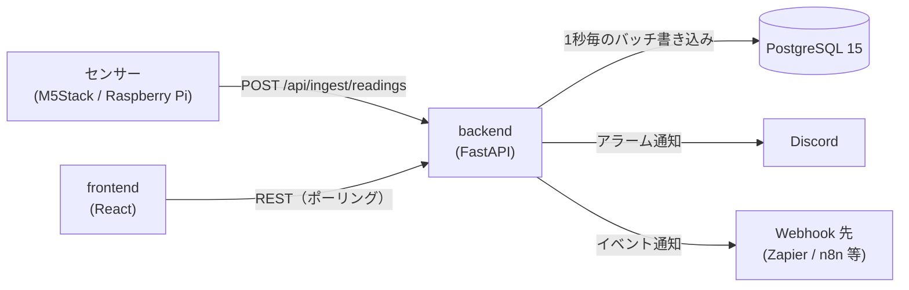

# FactorEye 仕様書

FactorEye の現行仕様です。

---

## 1. 概要

既存の PC と安価なセンサー（M5Stack / Raspberry Pi など）だけで使える工場監視 OSS です。

- センサー値を REST API で受け取り、しきい値でアラームを評価し、ダッシュボードに表示する
- 通知は Discord Webhook、外部連携は汎用 Webhook（Zapier / Make / n8n 等）
- self-hosted（Docker Compose）が基本。同じコードで SaaS（マルチテナント）モードも動く

**非目標**: Kubernetes・マイクロサービス、RBAC・SSO、生産管理の高度な機能（OEE・シフト管理など）

---

## 2. 構成



| レイヤー | 技術 |
|---|---|
| Backend | Python 3.12 / FastAPI / SQLModel / Alembic |
| Database | PostgreSQL 15 |
| Frontend | TypeScript / React 18 / Vite / Zustand / TanStack Query / Recharts / react-grid-layout |

`docker-compose.yml` は backend（8000）・frontend（3001、nginx）・postgres（`127.0.0.1` のみ）です。

---

## 3. データモデル

| テーブル | 役割 |
|---|---|
| `sensors` | センサー。名前、`ingest_key`（全体で一意）、単位、しきい値 4 項目、不感帯、有効/無効、所属する機器（`device_id`） |
| `readings` | 測定値。主キーは `(sensor_id, recorded_at)`。同じセンサー・同じ時刻の値は、後から来た値で上書きする |
| `alarms` | アラーム。状態（active / acknowledged / resolved）、重要度（warning / critical）、方向（min / max）、確認者 |
| `dashboards` / `widgets` | ダッシュボードとウィジェット（12 列グリッド）。ダッシュボードの削除は論理削除 |
| `notification_settings` | Discord Webhook URL（重故障・軽故障）、重故障の再通知 |
| `webhook_subscriptions` | Webhook の購読（イベント種別、送信先、有効/無効） |
| `ingest_devices` | 機器ごとのキー（self-hosted のみ）。キーは SHA-256 のハッシュだけを保存する |
| `users` / `workspaces` / `refresh_tokens` | 認証（SaaS のみ） |

テナント列（`workspace_id`）は SaaS で使います（self-hosted は `NULL`）。

---

## 4. REST API

JSON のキーは camelCase です。`ENVIRONMENT != production` のときは `/docs` で詳細を確認できます。

認証: 取り込みは `X-API-Key`（§5）。**self-hosted は取り込み以外に認証がありません**（§11）。SaaS は JWT が必須です（`/health`、`/api/ingest/readings`、`/api/auth/*`、`/api/settings/migration/status` を除く）。

| Method | Path | 内容 |
|---|---|---|
| GET | `/health` | 稼働確認（DB 接続状態。`ok` / `degraded`） |
| POST | `/api/ingest/readings` | センサー値の取り込み（§5） |
| GET / POST | `/api/sensors` | 一覧（ETag 付き）・作成 |
| GET / PUT / DELETE | `/api/sensors/{id}` | 詳細・更新・削除 |
| GET | `/api/sensors/{id}/readings` | 測定値（`from` / `to` / `limit`） |
| GET | `/api/sensors/{id}/readings/downsampled` | グラフ用の間引き（区間ごとの最小・平均・最大・件数。`buckets` 既定 500・上限 1000） |
| GET | `/api/sensors/{id}/readings/aggregate` | 期間の合計と件数（`from` 必須） |
| GET | `/api/readings` | 全センサーの直近測定値 |
| GET | `/api/alarms` | 一覧（`status` / `sensor_id` / `limit` / `offset`。新しい順） |
| GET / PATCH | `/api/alarms/{id}` `/ack` | 詳細・確認 |
| GET / POST | `/api/dashboards` | 一覧・作成 |
| GET / PUT / DELETE | `/api/dashboards/{id}` | 詳細・更新・削除 |
| POST / PUT / DELETE | `/api/dashboards/{id}/widgets` `/api/widgets/{id}` | ウィジェットの追加・更新・削除 |
| GET / PUT | `/api/settings/notifications` | Discord 通知設定 |
| GET / POST / PUT / DELETE | `/api/settings/webhooks` | Webhook 購読 |
| GET / POST | `/api/settings/migration/*` | データ移行（§10.1） |
| POST | `/api/auth/register` `/login` `/refresh` `/logout` | 認証（SaaS のみ） |
| GET | `/api/me` | 自分のユーザーとワークスペース（SaaS のみ） |
| `/api/admin/*` | 管理者 API（SaaS のみ、§10） | 管理者トークン |

センサー一覧は、件数と最終更新時刻から作った版を `ETag` で返し、`If-None-Match` が一致すれば 304 を返します。このため、センサーの作成・更新・削除では、必ず件数か `updated_at` を変えてください。

---

## 5. センサーの取り込み（Ingest）

### 認証
- **self-hosted**: 既定（`INGEST_AUTH=key`）では、`X-API-Key` に `INGEST_API_KEY` を送る（不一致は 401）。`INGEST_AUTH=off` ではキーなしで受け付ける。このとき `ingestKey` を知っていれば誰でも値を書けるので、取り込みの口を LAN などに限定する
- **SaaS**: ヘッダー不要。本文の `ingestKey`（センサー単位のキー）で識別する

### リクエスト
```json
{ "ingestKey": "sensor-001", "value": 23.5 }
```
- **バッチ**: `readings` 配列（各要素に `value` と任意の `timestamp`）。1 リクエスト 1,000 件まで
- **複数センサー**: `{ "sensors": [ { "ingestKey": "...", "value" か "readings": ... }, ... ] }`。2,000 センサー・測定値の合計 70,000 件まで。センサーごとの問題（未登録・無効・値なし）は、全体を失敗にせず応答の `rejected` に出し、残りは受け付ける
- **時刻ごとにまとめる形**: `{ "samples": [ { "timestamp": "...", "values": { "<ingestKey>": 12.34, ... } } ] }`。1 秒サンプリングを小さく送れる。時刻 1,000 個・値の合計 70,000 件まで
- `ingestKey` / `sensors` / `samples` は同時に使えない（どれか 1 つ）
- 本文は 8MB まで（超えると 413）。値が NaN・Infinity・数値でない、または値が無いときは 400
- `accepted` は受け付けた件数で、保存した件数ではない（同じ (センサー, 時刻) は上書き）

### 応答
| 状況 | HTTP |
|---|---|
| 受理（一部が `rejected` でも） | 202 |
| JSON 不正・形式不正・`timestamp` の範囲外 | 400 |
| API キー・機器キーが不正 | 401 |
| センサーが無効、機器のキーが合わない、自動登録の上限 | 403 |
| `ingestKey` が存在しない | 404 |
| 取り込み制限超過（IP ごと） | 429 |

### センサーの自動登録（self-hosted のみ）
`INGEST_AUTO_CREATE=on`（既定 off）のとき、未登録の `ingestKey` は 404 にせず、センサーを作ります。本文の `name`・`unit` が使えます（無ければ、名前は `ingestKey`、単位は `-`）。
- `ingestKey` は英数字と `.` `_` `-` のみ、64 文字まで
- センサーの総数が `INGEST_AUTO_CREATE_MAX_SENSORS`（既定 100）に達したら作らない（403）
- 打ち間違いの ID でもセンサーができるため、必要なときだけ on にする。SaaS では使えない

### 機器ごとのキー（self-hosted のみ）
機器（現場の 1 台）ごとにキーを発行し、`X-Device-Key` で送ります。キーは発行時に 1 回だけ表示し、DB にはハッシュだけを保存します。センサーは `device_id` で機器に所属させます。詳細は [`device-keys.md`](device-keys.md)。
- 所属のあるセンサーには、その機器のキーでしか送れない。所属のないセンサーには、機器のキーでは送れない（403）
- 機器のキーを付けたときは、共通の `X-API-Key` の検査を省く

### 時刻
- 既定は**サーバーの受信時刻**を使う（機器の時刻は信頼しない）
- `INGEST_DEVICE_TIME=on` では、各値の `timestamp`（時差つき ISO 8601、または UNIX 秒）を測定時刻にする（秒単位に切り捨て）。時差なし・未来（10 秒超）・30 日より前は、送信全体を 400 にする。通信が切れて溜めた値を後から送ってよく、同じ時刻の再送は二重にならない。機器の時計が合っていることが前提

### バッファ
- 受信値はメモリに溜め、**1 秒ごとに一括 INSERT** する。同じ処理の中でアラーム評価、通知、Webhook 配信を行う
- DB への書き込みに失敗したら、値を戻して次の周期で再試行する。溜められるのは最大 10 万件で、超えた分は古い値から捨てる
- 通常の停止では、残りを書いてから終了する。プロセスのクラッシュ時は、未書き込みの値（通常は最大 1 秒分）が失われ得る

### 照合のキャッシュ
取り込みのたびの DB の問い合わせ（機器キーの照合、センサーの検索）は、`INGEST_CACHE_SECONDS`（既定 5 秒）だけ覚えます。別プロセスからの変更は、最大でこの秒数だけ遅れて反映されます。

### レート制限
IP ごとに **100 回/分**（`INGEST_RATE_LIMIT`）。`off` で解除できます（負荷テスト用）。backend は `CF-Connecting-IP` を優先して IP を読むので、プロキシの内側に置くときは、このヘッダーをプロキシで上書きしてください。

---

## 6. アラーム評価

- センサーごとに **上限・下限 × 軽故障・重故障の 4 項目**のしきい値を設定する（使わない項目は未設定でよい）
- **不感帯**（`thresholdDeadBand`、既定 0）: 発生はしきい値を超えた時点で即時、解除はしきい値から不感帯の幅だけ戻ったとき

| 状況 | 動作 |
|---|---|
| 初めてしきい値を超えた | アラーム（active）を新規作成し、通知する |
| 発生中に重要度が変わった | 既存行を更新し、通知する |
| 発生中で重要度が同じ | 何もしない（重故障の再通知を除く） |
| 条件が解除された | resolved にする（通知はしない） |
| 確認（ack） | active → acknowledged |

同じ条件のアラームは 1 件にまとめます。アラーム行は履歴として削除しません。

---

## 7. 通知

### Discord
- 設定画面の「通知」タブで、**重故障と軽故障に別々の Webhook URL** を設定する
- 重故障は通常送信（通知音あり）、軽故障はサイレント送信
- **重故障の再通知**（既定で無効、間隔は既定 30 分）: 未解決のまま間隔を超えたら再通知する。軽故障には適用しない
- 送信失敗はログに残して無視する（取り込みは止めない）

### Webhook（外部連携）
Zapier・Make・n8n などへ、イベントを JSON で `POST` する（タイムアウト 10 秒。失敗しても再試行しない）。

| イベント | タイミング | 主な項目 |
|---|---|---|
| `reading.received` | センサー値の受信ごと | `sensorId`, `value`, `recordedAt` |
| `alarm.triggered` | アラーム発生ごと（重要度の変化を含む） | `sensorId`, `sensorName`, `value`, `severity`, `thresholdBreached`, `triggeredAt`, `isRepeat` |

- **SSRF 対策**: 送信先は `https` で、名前解決した**すべての**アドレスが公開 IP のものだけ。登録時と送信直前に検証し、リダイレクトは追わない。`WEBHOOK_ALLOW_PRIVATE_NETWORKS=true` で社内ネットワークを許可できる（既定 `false`）
- 同時に送るのは 10 件まで。送信待ちが 1,000 件を超えたら、新しいものは捨てる

---

## 8. ダッシュボード

- 12 列グリッドで自由に配置・サイズ変更でき、配置はサーバーに保存する
- 画面は**ポーリング**で更新する（センサー値・アラーム・ダッシュボードは 5 秒、グラフの直近モードは 30 秒）

| ウィジェット | 内容 |
|---|---|
| `SensorGraph` | 折れ線・棒・面グラフ |
| `MultiSensorComparison` | 複数センサーを重ねた比較グラフ |
| `StatValue` | 最新値とスパークライン。しきい値に応じて色が変わる |
| `AlarmAlert` | 発生中・確認済みのアラーム一覧（各 100 件まで）と確認ボタン |
| `ProductionStatus` | 稼働 ON/OFF、直近 1 時間と本日の生産数、目標達成率 |
| `TargetStrip` | 達成ストリップ。センサーごとに 1 行、一定の間隔（1・5・10 分）を 1 マスにした帯。`stripJudge: "count"`（既定。マスの合計が目標以上なら緑）と `"interval"`（`stripMaxGapSeconds`（既定 90 秒）を超える受信の途切れを赤で示す。ハートビートの確認用）の 2 つの判定がある。ほかに `stripBucketMinutes`・`stripHourlyTarget`・`stripWorkOnly`・`stripTolerant` を設定できる |

### 時間の操作（グラフ）
- 表示範囲は **直近モード**（右端が常に現在）と **固定モード**（開始と終了を指定）がある
- 操作: プリセット（5 分〜30 日）、任意の期間、前後への移動、拡大・縮小、ドラッグで選ぶ、今に戻る
- 範囲はダッシュボードごとに 1 つで、URL のクエリ（`?range=1h` または `?from=…&to=…`）に保持する。設定には保存しない
- グラフは `readings/downsampled` で取得する。表示の時刻はブラウザの地域時刻で、保存と API は UTC
- SaaS（Free Tier）は保持が 14 日のため、選べる範囲は 14 日まで

---

## 9. デバイス連携

- REST（JSON）が届けばどのデバイスでも使える
- 公式クライアント（MIT）: `clients/arduino-m5stack/`（M5Stack / ESP32）、`clients/raspberry-pi/`（Python）
- **送信失敗時の再試行（デバイス側）**: 指数バックオフ（1・2・4・8・16 秒、上限 30 秒、±10% のジッター）。失敗分は最大 100 件のリングバッファに保持し、次回成功時にまとめて送る
  - 再送するのは、通信エラー・タイムアウト・5xx・408・429。429 に `Retry-After` があれば、その秒数（上限 5 分）より早くは送らない
  - 401・403・404 は設定の誤り（キー・センサーの無効化）。警告ログを出して値を保持し、再送し続ける（1 センサーあたり最大 10 件、超えたら古い値から捨てる）。他のセンサーの送信は遅らせない
  - 400・422 など、送り直しても成功しない 4xx は、その送信分を捨てる（警告ログ）。NaN・Infinity・数値でない値は、送る前に捨てる

---

## 10. 認証・SaaS モード（`AUTH_MODE=multi_tenant`）

- **認証**: メール + パスワード（bcrypt）+ JWT。アクセストークン 15 分、リフレッシュトークン 30 日（使うたびにローテーション）。データはワークスペース単位で分離する
- **Free Tier**: センサーは 1 ワークスペース 10 個まで（11 個目は 402）。測定値は 14 日を超えたものを毎日 03:00（UTC）に削除する（self-hosted は無期限）
- **管理者画面（`/admin`）**: 運用者向け。管理者アカウントは DB に入れず、サーバー上のファイル（`admin/admins.txt`、`ID:bcryptハッシュ` の 1 行 1 件）で管理し、`python -m app.admin_cli` で追加・変更・削除する。件数・DB 使用量の確認、ユーザーの管理、取り込みのレート制限の期限付き解除ができる。管理者ファイルは DB バックアップに含まれないため、別途保管する

### 10.1 データ移行

SaaS の 1 ワークスペース、または self-hosted の全データを、別の self-hosted の DB へ移します（設定 → データ移行）。

- **書き出し**: gzip の JSON Lines。読み取りのみで、一貫した時点を取る
- **取り込み（self-hosted のみ）**: 1 トランザクションで取り込み、失敗すると何も残さない。`dry_run` で件数だけ確認できる。書き出し元と移行先の `alembic_version` が一致しないと取り込まない
- **移るもの**: センサー（取り込みキーを含む）、測定値、アラーム、ダッシュボード、ウィジェット、Webhook 購読、機器（キーのハッシュ）。通知設定は `with_notifications` を指定したときだけ
- **移らないもの**: ユーザー、リフレッシュトークン、ワークスペース

---

## 11. 運用

### ヘルスチェック
`GET /health` は `{ "status": "ok", "services": { "database": "connected" } }` を返します。DB に接続できないと `status` が `degraded` になります。

### バックアップ
`infra/backup.sh` が `pg_dump` を取得します（cron で毎日 3 時、保持は既定 7 日）。復元は `infra/restore.sh`。配布版は `install/` の cron が自動で実行します。

### 配布版のインストール（`install/`）
GHCR のイメージ（`ghcr.io/hide23link/factoreye-backend` / `factoreye-frontend`、amd64 と arm64）を使います。手順は [`install/README.md`](../install/README.md)。

- 設定は **`config/.env` の 1 ファイル**に集約する。backend は環境変数ではなくこのファイルを読む（`FACTOREYE_ENV_FILE`）。`config/` は、ファイル単体ではなく**ディレクトリごと**マウントする（置き換え保存で反映されなくなるため）
- 画面の「設定 → API・取り込み」から、`INGEST_*`・`WEBHOOK_ALLOW_PRIVATE_NETWORKS`・`FRONTEND_URL` を変更できる（管理パスワードが必要）。保存・反映は、再起動後と同じ検査を先に行い、通った場合だけ backend が約 4 秒で再起動する

### 設定（環境変数）
| 変数 | 既定 | 内容 |
|---|---|---|
| `DATABASE_URL` | 開発用の値 | DB 接続先。本番では必ず変更する |
| `INGEST_API_KEY` | `change-this-in-production` | 取り込みの共有キー。本番では必ず変更する |
| `INGEST_AUTH` | `key` | `off` でキーなしの取り込み |
| `INGEST_AUTO_CREATE` / `INGEST_AUTO_CREATE_MAX_SENSORS` | `false` / `100` | センサーの自動登録とその上限（§5） |
| `INGEST_DEVICE_TIME` | `false` | 機器の `timestamp` を測定時刻にする（§5） |
| `INGEST_CACHE_SECONDS` | `5` | 取り込みの照合を覚える秒数（0 で無効） |
| `INGEST_RATE_LIMIT` | `100/minute` | 取り込みの制限。`off` で解除 |
| `JWT_SECRET` | `change-this-in-production` | JWT の署名鍵。本番では必ず変更する |
| `ENVIRONMENT` | `development` | `production` で `/docs` を無効化。既定のキーのままだと起動しない |
| `FRONTEND_URL` | `http://localhost:3001` | CORS の許可オリジン（`*` は使わない） |
| `AUTH_MODE` | `disabled` | `multi_tenant` で SaaS モード |
| `ADMIN_PASSWORD_HASH` | 空 | 配布版の管理パスワード（bcrypt）。空なら画面から設定を変更できない |
| `WEBHOOK_ALLOW_PRIVATE_NETWORKS` | `false` | Webhook の社内ネットワーク送信を許可（§7） |
| `JWT_ACCESS_EXPIRE_MINUTES` / `JWT_REFRESH_EXPIRE_DAYS` | `15` / `30` | トークンの有効期限 |
| `ADMIN_CREDENTIALS_FILE` | `admin/admins.txt` | 管理者アカウントのファイル |
| `VITE_API_URL` / `VITE_AUTH_MODE` | `http://localhost:8000` / なし | frontend のビルド引数（変えるにはビルドし直す） |

例は `.env.example`（docker compose 用）、`backend/.env.example`（uvicorn を直接起動する場合）、`install/.env.template`（配布版）。

### セキュリティ上の前提
- self-hosted の API は取り込み以外に認証がない。**インターネットに直接公開せず**、社内 LAN や VPN で守る
- 秘密情報（`.env`）はリポジトリに含めない
- CI で `pip-audit`・`npm audit` を実行する

---

## 12. テスト

| 種類 | 内容 |
|---|---|
| Backend | pytest（PostgreSQL に接続）・mypy（strict）・ruff |
| Frontend | Vitest・typecheck・ESLint |
| E2E | Playwright（セットアップ、アラームの発生と確認、データ移行） |

**backend のテストは、接続先のすべてのテーブルを作り直して削除します。** `DATABASE_URL` は、必ずテスト専用の DB（例: `factoreye_test`）に向けてください。手順は [`development.md`](development.md)。

---

## 13. 既知の制限

- 取り込みの制限は IP 単位。ゲートウェイ 1 台に多数のセンサーを束ねる構成では、制限に当たりやすい
- Webhook は再試行せず、送信待ちが上限を超えると捨てる。DNS rebinding は防ぎきれていない
- self-hosted は測定値の保持期間が無期限（削除ポリシーなし）
- 管理画面は、ユーザー一覧のページングと、管理者の画面からの追加・削除が未対応
- データ移行: 同じデータを同じ DB に取り込み直すと失敗する（ID が重なるため）。取り込みファイルのサイズに上限はない
