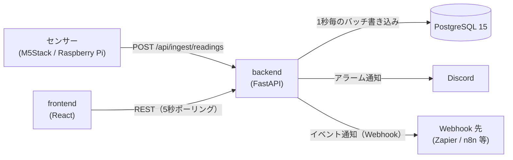

# FactorEye 仕様書

FactorEye の仕様（現行実装）をまとめたものです。各項目はコードと照合しています。
変更の経緯と判断理由は [`decisions.md`](decisions.md)、リリースごとの変更は [`CHANGELOG.md`](../CHANGELOG.md) を参照してください。

---

## 1. 概要

既存の PC と安価なセンサー（M5Stack / Raspberry Pi など）だけで使える工場監視 OSS です。

- センサー値を REST API で受け取り、しきい値でアラームを評価し、ダッシュボードに表示する
- 通知は Discord Webhook、外部連携は汎用 Webhook（Zapier / Make / n8n 等）
- self-hosted（Docker Compose）が基本。同じコードで SaaS（マルチテナント）モードも動く

### 非目標（現時点）

- Kubernetes・マイクロサービス・ロードバランシング
- RBAC・SSO・ユーザー単位の権限（self-hosted は認証なしで、ネットワーク境界で守る前提）
- 生産管理の高度な機能（OEE・停止理由の記録・シフト管理など）

---

## 2. 構成



| レイヤー | 技術 |
|---|---|
| Backend | Python 3.12 / FastAPI / SQLModel（SQLAlchemy 2.0）/ Alembic |
| Database | PostgreSQL 15（SQLite は使わない） |
| Frontend | TypeScript / React 18 / Vite / Zustand / TanStack Query / Recharts / react-grid-layout |
| 品質 | pytest・mypy・ruff・pip-audit（backend）、Vitest・ESLint・tsc・npm audit（frontend）、Playwright（E2E） |

**復旧ツール**: `tools/recovery/`。バックアップの確認・比較・書き出し・書き戻しを行う、本体とは別のプログラム（§11.1）。

**デプロイ**: `docker-compose.yml`（backend / frontend / postgres）。ポートは backend 8000、frontend 3001、postgres 5432。イメージは多段ビルドで、実行段には本体と実行時依存だけを入れる（frontend は nginx で静的配信。判断は [decisions.md](decisions.md)、サイズは §14）。

---

## 3. データモデル

| テーブル | 役割 | 主な内容 |
|---|---|---|
| `sensors` | センサー | 名前（ワークスペース内で一意）、`ingest_key`（全体で一意。取り込みAPIがキーだけで特定するため）、単位、しきい値4項目、不感帯、有効/無効 |
| `readings` | 測定値 | sensor_id、値、`recorded_at`（取り込んだサーバー時刻）。`(sensor_id, recorded_at)` で索引 |
| `alarms` | アラーム | sensor_id、状態（active / acknowledged / resolved）、重要度（warning / critical）、しきい値方向（min / max）、確認者、`last_notified_at`。ユーザー操作では削除しない（センサーを削除すると関連分も削除される） |
| `dashboards` | ダッシュボード | 名前、説明、レイアウト設定。削除は論理削除（`deleted_at`） |
| `widgets` / `widget_configs` | ウィジェット | ダッシュボードの配置（12列グリッド）、種別、センサーとの紐付け、設定 |
| `notification_settings` | 通知設定 | ワークスペースごとに1行（self-hosted は NULL の1行）。重故障・軽故障それぞれの Discord Webhook URL、有効/無効、重故障の再通知 |
| `webhook_subscriptions` | Webhook 購読 | イベント種別、送信先 URL、有効/無効 |
| `users` / `workspaces` / `refresh_tokens` | 認証（SaaS のみ） | ユーザー、ワークスペース（テナント）、リフレッシュトークン |

- センサーの `workspace_id` などテナント列は SaaS モードで使う（`NULL` が self-hosted）
- 管理者アカウントは DB に入れない（後述 §10）

---

## 4. REST API

認証欄の「APIキー」は `X-API-Key` ヘッダー（§5）。「JWT」は `AUTH_MODE=multi_tenant` 時のみ必要なもの。

| Method | Path | 内容 | 認証 |
|---|---|---|---|
| GET | `/health` | 稼働確認。DB 接続状態を返す（`ok` / `degraded`） | なし |
| POST | `/api/ingest/readings` | センサー値の取り込み（単発・バッチ） | APIキー（self-hosted） |
| GET / POST | `/api/sensors` | センサー一覧（ETag 付き。`If-None-Match` が一致すれば 304）・作成 | なし |
| GET / PUT / DELETE | `/api/sensors/{id}` | 詳細・更新・削除（物理削除） | なし |
| GET | `/api/sensors/{id}/readings` | 測定値（`from` / `to` / `limit`） | なし |
| GET | `/api/sensors/{id}/readings/downsampled` | グラフ用の間引き。`from` / `to` の範囲を `buckets` 区間（既定 500・上限 1000）に分け、区間ごとの最小・平均・最大・件数を返す | なし |
| GET | `/api/sensors/{id}/readings/aggregate` | 期間の合計と件数（`from` 必須） | なし |
| GET | `/api/readings` | 全センサーの直近測定値（`sensor_id` / `limit`） | なし |
| GET | `/api/alarms` | アラーム一覧（`status` / `sensor_id` / `limit` / `offset`）。新しい順。`limit` は 1〜500（省略時は条件に合う全件） | なし |
| GET | `/api/alarms/{id}` | アラーム詳細 | なし |
| PATCH | `/api/alarms/{id}/ack` | アラームの確認（`acknowledgedBy` を記録） | なし |
| GET / POST | `/api/dashboards` | ダッシュボード一覧・作成 | なし |
| GET / PUT / DELETE | `/api/dashboards/{id}` | 詳細・更新・削除（論理削除） | なし |
| POST | `/api/dashboards/{id}/widgets` | ウィジェット追加 | なし |
| PUT / DELETE | `/api/widgets/{id}` | ウィジェット更新・削除 | なし |
| GET / PUT | `/api/settings/notifications` | Discord 通知設定 | なし |
| GET / POST | `/api/settings/webhooks` | Webhook 購読の一覧・作成 | なし |
| PUT / DELETE | `/api/settings/webhooks/{id}` | Webhook 購読の更新・削除 | なし |
| GET | `/api/settings/migration/status` | 移行機能の状態（書き出し・取り込みのどちらが使えるか） | なし |
| GET | `/api/settings/migration/export` | ワークスペースを書き出す（SaaS のみ。404 は self-hosted） | JWT |
| POST | `/api/settings/migration/import?dry_run=&with_notifications=` | 書き出しファイル（gzip の本文）を取り込む（self-hosted のみ。404 は SaaS） | なし |
| POST | `/api/auth/register` `/login` `/refresh` `/logout` | 認証（SaaS のみ） | なし |
| GET | `/api/me` | 自分のユーザーとワークスペース（SaaS のみ） | JWT |
| `/api/admin/*` | 管理者 API（SaaS のみ、§10） | 管理者トークン | 管理者 |

- API の詳細は `DEBUG` 時（`ENVIRONMENT != production`）に `/docs` で確認できる
- JSON のキーは camelCase

### 4.1 一覧 API の応答（性能）

- **アラーム一覧のページング**: `limit` と `offset` で区切る。並びは `triggered_at` の新しい順で、同時刻は `id` の降順（ページの境界で重複・抜けを出さないため）。`total` は、ページで区切る前の、条件に合う件数
- **センサー一覧の版（ETag）**: 版は、件数と最終更新時刻（`updated_at` の最大）から作る。応答に `ETag` と `Cache-Control: no-cache` を付ける。`If-None-Match` が一致すれば、本体を送らずに 304 を返す
- **版ごとの JSON のキャッシュ**: 完成した一覧の JSON を、版ごとにプロセス内に保持する（上限 32 件）。版は、読み出しの前に作るため、キャッシュの内容が版より古くなることはない
- **応答の作り方**: 一覧は ORM のオブジェクトを作らず、必要な列だけを読む。Pydantic のモデルから JSON を 1 回だけ作る（`app/api/responses.py`）。OpenAPI の定義は `response_model` で残す。応答の形（camelCase の項目）は変えない
- **注意**: 版とキャッシュはプロセスごとに持つ。ワーカーを増やすと、ワーカーごとに持つ（内容は一致する）。センサーの作成・更新・削除は、必ず件数か `updated_at` を変えること（版の判定に使うため）

---

## 5. センサーの取り込み（Ingest）

### 認証
- **self-hosted（`AUTH_MODE=disabled`）**: `X-API-Key` ヘッダーに `INGEST_API_KEY` を送る。不一致は 401
- **SaaS（`AUTH_MODE=multi_tenant`）**: ヘッダー不要。本文の `ingestKey`（センサー単位のキー）で識別する

### リクエスト
```json
{ "ingestKey": "sensor-001", "value": 23.5 }
```
バッチは `readings` 配列（各要素に `value` と任意の `timestamp`）で送る。`value` も `readings` も無い場合は 400。

### 応答
| 状況 | HTTP |
|---|---|
| 受理（バッファに追加） | 202 |
| JSON 不正・形式不正 | 400 |
| APIキーが不正 | 401 |
| `ingestKey` が存在しない | 404 |
| センサーが無効 | 403 |
| 取り込み制限超過（IP ごと） | 429 |

### 時刻
- `recorded_at` は **サーバーが受信した時刻**を採用する。デバイス側の時刻は信頼しない（ずれや改ざんを避けるため）

### バッファ
- 受信値はメモリに溜め、**1秒ごとに一括 INSERT** する。同じバッチ処理の中でアラーム評価を行い、そのあと通知と Webhook 配信を行う
- DB への書き込み（commit）より前に失敗した場合は、取り出した値をバッファの先頭に戻し、次の周期で再試行する。DB の一時的な停止では値は失われない。再試行待ちは最大 10 万件で、超えた分は古いものから捨てる（ログに警告）
- 受信から書き込みまでの間に削除されたセンサーの値は捨てる（外部キー違反でバッチ全体が失敗し続けるのを防ぐため）
- 通常の停止（再起動・デプロイ）では、バッファに残った値を書いてから終了する
- トレードオフ: プロセスのクラッシュ時、バッファ上の未書き込みの値（通常は最大 1 秒分、DB 停止中はそれ以上）が失われ得る

### レート制限
- IP ごとに **100 回/分**（`INGEST_RATE_LIMIT`、既定 `100/minute`）
- `INGEST_RATE_LIMIT=off` で解除できる（実機・負荷テスト用。起動時に警告が出る）。解除中は上限が無いので、テスト後は必ず既定値に戻す
- 管理画面から **期限付きで解除** できる（§10「取り込みのレート制限」）。環境変数が `off` のときは、この画面からは変更できず、環境変数が優先される

---

## 6. アラーム評価

### しきい値
- センサーごとに **上限・下限 × 軽故障・重故障の 4 項目**（`thresholdMaxWarning` など）を設定できる。使わない項目は未設定（null）でよい
- **不感帯**（`thresholdDeadBand`、既定 0）: 閾値付近で値が揺れても発生と解除を繰り返さないための幅
  - 発生: 閾値を超えた時点で即時
  - 解除: 閾値から不感帯の幅だけ戻ったときに解除

### 状態遷移
| 状況 | 動作 |
|---|---|
| 初めて閾値を超えた | アラーム（active）を新規作成し、通知する |
| 発生中に重要度が変わった（軽故障 ⇄ 重故障） | 新規は作らず既存行を更新し、通知する |
| 発生中で重要度が同じ | 何もしない（重故障の再通知を除く） |
| 条件が解除された | 既存行を resolved にする（通知はしない） |
| 確認（ack） | active → acknowledged。解決するまで一覧に残る |

同じ条件のアラームは 1 件にまとめる（重複防止）。アラーム行は削除しない（履歴として残す）。

---

## 7. 通知

### Discord（基本機能）
- 設定は `notification_settings` で管理し、設定画面の「通知」タブで編集する
- **重故障と軽故障に別々の Webhook URL** を設定できる（チャンネルを分けられる）
- 重故障: 通常送信（通知音あり）。軽故障: サイレント送信（Discord の `SUPPRESS_NOTIFICATIONS` フラグ。チャンネルには表示される）
- **重故障の再通知**（既定で無効、間隔の既定は 30 分）: 未解決のまま間隔を超えたら同じアラームを再通知する。行は増やさず `last_notified_at` のみ更新する。軽故障には適用しない
- メッセージは日本語・日本時間の短い本文（発生時刻と送信時刻。再通知時は継続時間が分かる形）
- 送信失敗はログに残して無視する。取り込みパイプラインは止めない

### Webhook（外部連携）
Zapier・Make・n8n などのノーコード自動化サービスへ、イベントを JSON で送ります。利用者はコードを書く必要がありません。

| イベント | 発生タイミング | 主な項目 |
|---|---|---|
| `reading.received` | センサー値を受信するたび | `sensorId`, `value`, `recordedAt` |
| `alarm.triggered` | アラームが発生するたび（重要度の変化を含む） | `sensorId`, `sensorName`, `value`, `severity`, `thresholdBreached`, `triggeredAt`, `isRepeat` |

- 送信は `POST`（JSON、タイムアウト 10 秒）。失敗時の再試行は**しない**（ログのみ）
- 購読はワークスペース単位。購読の有効/無効を切り替えられる
- **送信先の制限（SSRF 対策）**: 次の条件を満たす宛先だけ送る
  - `https` のみ
  - 名前解決した**すべての**アドレスが公開 IP（ループバック・プライベート・リンクローカル・メタデータ用アドレス等は不可）
  - 登録・変更時に検証し、送信直前にも再検証する。リダイレクトは追わない
  - 例外: 環境変数 `WEBHOOK_ALLOW_PRIVATE_NETWORKS=true` で社内ネットワーク（http・プライベート IP）を許可できる。自己ホストで社内の自動化基盤を使う場合のみ。既定は `false`
- **送信数の上限**: 接続は 1 つのクライアントで使い回す。同時に送るのは 10 件まで（送信直前の検証を含む）。送信待ちが 1,000 件を超えたら、新しいものは送らずに捨てる（捨てた件数は、多くても 1 分に 1 回ログに出す）。送信先が遅い・大量に取り込むときに、CPU・メモリ・接続を使い切らないため
- 既知の制限: 検証と接続の間の DNS 変化（DNS rebinding）は防ぎきれていない。1 件ごとに送るため、バッチ化はしていない

---

## 8. ダッシュボード

- 12 列グリッドで自由に配置・サイズ変更できる（画面幅に応じて列数が変わる）。配置はサーバーに保存する
- 画面は **5 秒間隔のポーリング**で更新する（WebSocket は使わない）
- ウィジェット種別:

| 種別 | 内容 |
|---|---|
| `SensorGraph` | 折れ線・棒・面グラフ。色、Y 軸の範囲、時間窓を設定できる |
| `MultiSensorComparison` | 複数センサーを重ねた比較グラフ |
| `StatValue` | 最新値の大きな表示とスパークライン。しきい値に応じて色が変わる |
| `AlarmAlert` | 発生中・確認済みのアラーム一覧と確認ボタン |
| `ProductionStatus` | 稼働 ON/OFF、直近 1 時間と本日の生産数、本日の目標達成率 |

- 生産数は「直近 1 時間」「本日累計」「目標達成率」で集計する（生データは返さず、SQL で集計する）

### 時間の操作（SensorGraph・MultiSensorComparison）

Grafana と同じように、グラフの表示する時間範囲を操作できる。

**表示範囲の 2 つのモード**
- **直近モード**: 「直近 N 分／時間／日」。右端は常に現在時刻。5 秒ごとの更新で右端が進む
- **固定モード**: 開始と終了を指定した期間。更新しても範囲は変わらない（過去の期間を見るため）

**操作**

| 操作 | 内容 |
|---|---|
| 範囲の選択 | プリセット（5 分・15 分・1 時間・6 時間・24 時間・7 日・30 日）、または開始と終了を入力した任意の期間 |
| 前へ・後ろへ | 現在の範囲の幅だけ過去・未来へ移動する。移動すると固定モードになる |
| 今に戻る | 右端を現在時刻にして、直近モードに戻す |
| 拡大・縮小 | 範囲の幅を半分・2 倍にする（中心は現在の中心） |
| ドラッグで選ぶ | グラフ上で時間をドラッグし、その期間に拡大する（固定モードになる） |

**範囲の扱い**
- 時間範囲は、ダッシュボードごとに 1 つ。そのダッシュボードの `SensorGraph` と `MultiSensorComparison` は、この範囲に従う
- 範囲は URL のクエリ（直近は `?range=1h`、固定は `?from=…&to=…`）に保持し、そのリンクで同じ表示を開けるようにする
- 範囲はダッシュボードの設定に保存しない。開き直すと既定の「直近 1 時間」になる

**比較グラフ**
- `MultiSensorComparison` は、全センサーを同じ範囲・同じ区間数で取得し、時間軸を揃えて重ねる

**アラーム表示（`AlarmAlertWidget`）**
- 発生中（active）と確認済み（acknowledged）を、それぞれ新しい順 100 件まで取得し、5 秒ごとに取り直す
- 設定画面のアラーム一覧は、従来どおり全件を取得する
- 確認済みが 100 件を超えると、古いものはこの表示には出ない（設定画面では見られる）

**制限と注意**
- SaaS（Free Tier）は測定値の保持が 90 日（§10）のため、選べる範囲は 90 日までとする。self-hosted は保持期間の制限なし
- 範囲が長いと点が多すぎるため、グラフは `readings/downsampled` で取得する。生データ（`readings`）は、表示の詳細確認のためだけに使う
- 表示の時刻はブラウザの地域時刻（日本では JST）。保存と API は UTC

---

## 9. デバイス連携

- REST（JSON）が届けばどのデバイスでも使える
- 公式クライアント（MIT）:
  - `clients/arduino-m5stack/`（M5Stack / ESP32）
  - `clients/raspberry-pi/`（Python。GPIO / 1-Wire センサーの例を含む）
- **送信失敗時の再試行（デバイス側）**: 指数バックオフ（1・2・4・8・16 秒、上限 30 秒、±10% のジッター）。失敗分は最大 100 件のリングバッファに保持し、次回成功時にまとめて送る
- テスト用の工場エミュレータ: `tools/factory-emulator/`。手動操作画面（既定 `http://localhost:8765`）で生産負荷・温度・電力を指定し、しきい値アラームを狙って発生させられる

---

## 10. 認証・SaaS モード（`AUTH_MODE=multi_tenant`）

### 認証
- メール + パスワード（bcrypt）+ JWT
- アクセストークン 15 分、リフレッシュトークン 30 日（DB に保存し、使うたびにローテーション。旧トークンは即時失効）
- 全データはワークスペース単位で分離する

### Free Tier の制限
- センサーは **1 ワークスペースあたり 10 個まで**。11 個目の登録は 402
- 測定値は **90 日**を超えたものを毎日 03:00（UTC）に削除する。**SaaS のセンサーだけが対象**（self-hosted は無期限）
- ダッシュボード・ウィジェット・アラームは無制限

### 管理者画面（`/admin`）
SaaS の運用者向け。一般ユーザーのログイン画面とは別物です。
- 管理者アカウントは DB に入れず、サーバーのテキストファイル（`admin/admins.txt`、`ID:bcryptハッシュ` の 1 行 1 件）で管理する。追加・パスワード変更・削除は `app.admin_cli` で行う。ファイルは都度読み直すため、再起動なしで反映される
- 管理者トークンは 60 分で、リフレッシュはできない。ログインは 1 分あたり 5 回まで
- トークンは `sessionStorage` に保存する（タブを閉じると消える）
- 機能: 件数・DB 使用量の確認、ユーザー一覧・詳細、メール・プラン・パスワードの変更（パスワード変更で既存のリフレッシュトークンを全て失効）、ユーザーの削除（関連データを全て削除）
- 管理者ファイルは DB バックアップに含まれないため、別途保管が必要
- 取り込みのレート制限の解除（画面上部のカード）: 「60 分だけ解除」で制限を外し、期限（既定 60 分・最長 240 分）を過ぎると自動で既定の制限に戻る。「今すぐ制限を戻す」で即時に戻す。解除・停止は管理者 ID とともにサーバーのログへ残す。状態はメモリのみ（再起動すると制限あり＝既定に戻る）。API は `GET` / `PUT /api/admin/ingest-limit`

---

### 10.1 SaaS → OSS の移行

SaaS（マルチテナント）の1ワークスペースを、OSS（self-hosted）の DB へ移す。

- **書き出し（SaaS）**: ログイン中のワークスペースを、gzip の JSON Lines（`factoreye-workspace-export`、形式の版 2）に書き出す。読み取りのみで、REPEATABLE READ の一貫した時点を取る。画面は「設定」→「データ移行」
- **取り込み（OSS）**: 書き出しファイルを、移行先の DB に1トランザクションで取り込む。`dry_run` では件数だけ確認して戻す。失敗すると何も残さない。画面は同じ「データ移行」タブ（CLI は `python -m app.migrate_saas_to_oss`）
- **移るもの**: センサー（取り込みキー `ingest_key` を含む）、測定値、アラーム、ダッシュボード（削除済みを除く）、ウィジェット、ウィジェット設定、Webhook 購読。通知設定は `with_notifications` を指定したときだけ、移行先の ID=1 を上書きする
- **移らないもの**: ユーザー、リフレッシュトークン、ワークスペース（OSS には認証がないため）
- **ID**: センサー・ダッシュボードなどの UUID と取り込みキーは、そのまま保つ。測定値の ID は移行先で振り直す
- **測定値の形式（版 2）**: 1行 = 1センサー・最大 5,000 件。`[値, 前の行からの差分（マイクロ秒）]` の配列で、時刻は往復で完全に戻る。10 センサー・90 日分（約 1,550 万件）で、約 90〜110 MB（欠測や不規則な間隔があっても、ほぼ同程度）
- **スキーマ版の照合**: 書き出し元と移行先の `alembic_version` が一致しないと取り込まない
- **権限**: 書き出し API は SaaS のみ（JWT で自分のワークスペースに限定）。取り込み API は self-hosted のみで、認証はない（ネットワーク境界で守る前提。§11 の注意と同じ）。もう一方のモードでは 404 を返す

## 11. 運用

### ヘルスチェック
`GET /health` の応答:
```json
{ "status": "ok", "timestamp": "...", "services": { "database": "connected" } }
```
DB に接続できない場合は `status` が `degraded` になる。

### バックアップ
- `infra/backup.sh` が PostgreSQL を `pg_dump` で取得する。cron で毎日 3 時に実行する想定
- 保持は既定で 7 日（`BACKUP_RETENTION_DAYS`）。各ファイルの隣に sha256 を書く。復元は `infra/restore.sh`
- 設定ファイル（`.env`・管理者ファイルなど）も、暗号化して保存できる（`BACKUP_PASSPHRASE_FILE`）
- 本番の外の控え: S3 に送る（`infra/offsite-s3.sh`、追加だけの権限）か、別のマシンから取りに行く（`infra/offsite-pull.sh`、読むだけの鍵）
- バックアップのファイルは権限 640 で作り、書き込み中は `.partial-*` に書いてから名前を変える（書きかけを外部の取得や復旧ツールが拾わないように）
- 中身の確認・比較・書き出し・書き戻しは、復旧ツール（§11.1）
- 手順は [`infra/README.md`](../infra/README.md)

### 11.1 復旧ツール（`tools/recovery/`）

停電による DB の破損や、不正アクセスによるプログラムの破壊から復旧するための Web 画面。FactorEye 本体（backend）に依存せず、Docker があればどこでも動く（本番のホスト・ラズパイ・Mac）。違いは設定（`.env`）だけ。

| 機能 | 内容 |
|---|---|
| バックアップの一覧・検証 | 読み込み元はディレクトリか S3（`BACKUP_SOURCE`）。sha256（`.sha256`）と gzip を確かめてから、コンテナ内の作業用の Postgres に展開する。書き戻しの直前の控えも一覧に出す |
| 比較 | バックアップと今の DB の件数・スキーマの版・ワークスペースの増減（今の DB で消えたものを先に表示） |
| 閲覧・書き出し | 種類（測定値・アラームなど）・ワークスペース・期間で絞って表示し、CSV に書き出す。パスワードのハッシュなどは伏せる |
| 書き戻し | 選んだワークスペースについて、今の DB に**無い行だけ**を足す。今ある行は変えない・消さない |

**画面**: 「書き戻す」（①バックアップを選ぶ → ②戻すものを選ぶ → ③内容を確認 → ④書き戻す）と「データを見る・書き出す」の 2 つのタブ。全体に Basic 認証。待ち受けは既定で 127.0.0.1（SSH のトンネルか Tailscale で開く）。

**展開の安全策**（バックアップは、乗っ取られた本番で書き換えられている前提で扱う。`.sha256` も一緒に作り直せるため）:
- psql のメタコマンドを止める（乱数の鍵で `\restrict`、行頭のメタコマンドは拒否）
- 管理者ではないロール（`bk_restorer`）で流し込む。所有者が管理者のロールになっているバックアップは展開しない
- psql と作業用の Postgres に、秘密の環境変数を渡さない
- 一時的な名前（`bktmp_*`）で展開し、成功してから `bk_*` に変える

**書き戻しの規則**:
- 試行と実行は同じ処理。試行は最後に取り消す（件数・外部キー・一意制約の違反が、実行前に分かる）
- 実行は、画面で確認した件数と、実行の直前の試行の件数が一致したときだけ。直前に今の DB を `pg_dump` で控え（`before-merge-<日時>.sql.gz`）、1 トランザクションで書き込む
- 同じ行の判定は主キー。測定値は DB を作り直すと連番が重なるため（センサー, 時刻）で判定する
- 発生中のアラームは、今の DB の同じセンサーにも発生中のものがあれば、解除済みにして戻す（発生中はセンサーごとに 1 つが前提）
- ログインの状態（`refresh_tokens`）は戻さない
- バックアップと今の DB のスキーマの版（`alembic_version`）が違うときは書き戻さない

**OSS 版 ⇄ SaaS 版**: 所属を付け替えて書き戻せる。今の DB の版は `TARGET_MODE`（`saas` / `oss`）で指定する（書き戻しを使うなら必須。空の SaaS 版は、中身から OSS 版と見分けられないため）。

| バックアップ → 今の DB | 書き戻し方 |
|---|---|
| 同じ版どうし | 元と同じ所属のまま入れる |
| OSS 版 → SaaS 版 | 書き戻し先のワークスペースを選び、そのワークスペースのものとして入れる。ユーザー・ワークスペースの行は入れない |
| SaaS 版 → OSS 版 | OSS 版のデータ（`workspace_id` が NULL）として入れる。ユーザー・ワークスペースの行は入れない。通知設定は、OSS 版が読む id=1 の 1 行にする（既にあれば入れない） |

センサーの ID と取り込みキーは保つ（機器の設定を変えずに送り続けられる）。SaaS → OSS のワークスペース単位の移し替えは、§10.1 のデータ移行でもできる（通知設定の上書きの指定など、移行に特化した機能はそちら）。

**設定**（主なもの。全体は [`tools/recovery/README.md`](../tools/recovery/README.md)）:

| 変数 | 内容 |
|---|---|
| `RECOVERY_PASSWORD` | 画面の Basic 認証（12 文字以上、必須） |
| `BACKUP_SOURCE` / `BACKUP_DIR` | 読み込み元（ディレクトリか `s3://…`）。ディレクトリは読み取り専用でコンテナに見せる |
| `TARGET_DATABASE_URL` | 今の DB（読み取り専用で接続。DB 側も読み取り専用のロールにする） |
| `TARGET_WRITE_DATABASE_URL` | 書き戻しに使う接続。無ければ書き戻しは使えない |
| `TARGET_MODE` | 今の DB が `saas` か `oss` か |
| `BACKUP_GID` | バックアップのファイル（640）のグループ。コンテナはこのグループで読む |

### 設定（環境変数）
| 変数 | 既定 | 内容 |
|---|---|---|
| `DATABASE_URL` | 開発用の値 | DB 接続先。本番では必ず変更する |
| `INGEST_API_KEY` | `change-this-in-production` | 取り込みの共有キー（self-hosted）。本番では必ず変更する |
| `JWT_SECRET` | `change-this-in-production` | JWT の署名鍵。本番では必ず変更する |
| `ENVIRONMENT` | `development` | `production` で `/docs` を無効化 |
| `FRONTEND_URL` | `http://localhost:3001` | CORS の許可オリジン（`*` は使わない） |
| `AUTH_MODE` | `disabled` | `multi_tenant` で SaaS モード |
| `INGEST_RATE_LIMIT` | `100/minute` | 取り込みの制限。`off` で解除（管理画面からの期限付き解除は §10） |
| `WEBHOOK_ALLOW_PRIVATE_NETWORKS` | `false` | Webhook の社内ネットワーク送信を許可（§7） |

### セキュリティ上の前提
- self-hosted の API は取り込み以外に認証がない。**インターネットに直接公開しない**（ネットワーク境界で守る）
- 秘密情報（`.env`）はリポジトリに含めない
- CI で `pip-audit`・`npm audit` を実行する

---

## 12. テスト

| 種類 | 内容 | 実行 |
|---|---|---|
| Backend | pytest（PostgreSQL に接続）・mypy（strict）・ruff | `backend/` で実行（§12.1 の注意） |
| Frontend | Vitest・typecheck・ESLint | `frontend/` で実行 |
| E2E | Playwright（セットアップウィザード、アラームの発生と確認） | スタック起動後に `e2e/` で実行 |

### 12.1 テスト用 DB についての注意
backend のテストは、テストごとにすべてのテーブルを作り直し、終了時に削除する。**`DATABASE_URL` を開発用・本番用の DB に向けてはいけない**。テスト専用の DB（例: `factoreye_test`）を指定すること。CI は専用の PostgreSQL を都度起動するため、この問題は起きない。

---

## 13. 既知の制限と今後の課題

- 取り込みの制限は IP 単位。ゲートウェイ 1 台に多数のセンサーを束ねる構成では、制限に当たりやすい（ゲートウェイ単位への変更などが必要）
- Webhook: 再試行なし、送信待ちが上限を超えると捨てる、DNS rebinding 未対応（§7）
- 測定値の保持期間は、self-hosted では無期限（削除ポリシーなし）
- 管理画面: ユーザーのページング、管理者の画面からの追加・削除は未対応
- 次の段階の候補: ルールベースの設定
- 移行の制限: 同じワークスペースを、同じ DB に取り込み直すと失敗する（ID が重なるため。削除済みの行も残っているため同様）。取り込みファイルのサイズに上限はない
- 移行後のデバイス: OSS 版ではデバイスの送信に `X-API-Key` ヘッダー（`INGEST_API_KEY`）が必要。SaaS 版の `ingestKey` だけの送信とは異なる（§10.1）
- 一覧の件数が増えると、`total` の集計（件数を数える処理）と、ページの読み出しの両方のコストが増える。数十万件規模では見直す
- 測定値の一覧（`readings`）は、列だけを読むようにしたが、読み出す件数（`limit`）そのものは減らしていない。グラフは `downsampled` を使う（§8）
- 復旧ツール（§11.1）: DB を丸ごと戻す機能は無い（`infra/restore.sh` を使う）。スキーマの版が違うバックアップは書き戻せない（古い版を新しい版に上げてから書き戻す機能は無い）。書き戻しで SaaS の Free Tier のセンサー数の上限は確かめない。書き戻しは閲覧と同じ認証で使える
- 本番の外への控え（`offsite-s3.sh` / `offsite-pull.sh`）は、実機での確認がまだ

---

## 14. 更新履歴

| 日付 | 変更 |
|---|---|
| 2026-10-08 | 復旧ツール（§11.1）を追加。バックアップに sha256・設定ファイルの暗号化保存・本番の外への控えを追加（§11）。本番（SaaS）と OSS 版で、作成 → バックアップ → 削除 → 書き戻しの訓練を行い、両方向（OSS → SaaS、SaaS → OSS）も確認 |
| 2026-10-06 | Docker イメージを軽量化（§2）。frontend は Vite preview をやめ nginx で静的配信（428 MB → 63 MB）。backend は多段ビルドと、開発用依存（`requirements-dev.txt`）の分離（421 MB → 283 MB）。テスト（201 件）・mypy・ruff は Python 3.12 で通過 |
