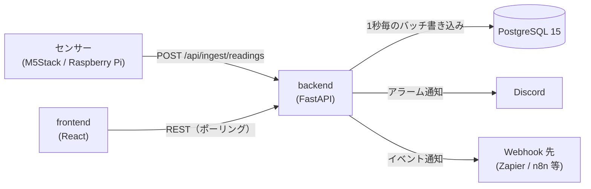

# FactorEye 仕様書

現行実装の仕様です。経緯と理由は [`decisions.md`](decisions.md)、変更履歴は [`CHANGELOG.md`](../CHANGELOG.md)、運用手順は [`infra/README.md`](../infra/README.md) と [`tools/recovery/README.md`](../tools/recovery/README.md) を参照してください。

---

## 1. 概要

既存の PC と安価なセンサー（M5Stack / Raspberry Pi など）だけで使える工場監視 OSS です。

- センサー値を REST API で受け取り、しきい値でアラームを評価し、ダッシュボードに表示する
- 通知は Discord Webhook、外部連携は汎用 Webhook（Zapier / Make / n8n 等）
- self-hosted（Docker Compose）が基本。同じコードで SaaS（マルチテナント）モードも動く

**非目標**: Kubernetes・マイクロサービス、RBAC・SSO・ユーザー単位の権限（self-hosted は認証なしで、ネットワーク境界で守る前提）、OEE・停止理由・シフト管理などの生産管理の高度な機能。

---

## 2. 構成



| レイヤー | 技術 |
|---|---|
| Backend | Python 3.12 / FastAPI / SQLModel（SQLAlchemy 2.0）/ Alembic |
| Database | PostgreSQL 15（SQLite は使わない） |
| Frontend | TypeScript / React 18 / Vite / Zustand / TanStack Query / Recharts / react-grid-layout |
| 品質 | pytest・mypy・ruff・pip-audit、Vitest・ESLint・tsc・npm audit、Playwright（E2E） |

**デプロイ**: `docker-compose.yml`（backend 8000 / frontend 3001 / postgres 5432）。postgres は `127.0.0.1` だけに公開する。frontend は nginx で静的配信する（実行段には本体と実行時依存だけを入れる）。

---

## 3. データモデル

| テーブル | 役割 | 主な内容 |
|---|---|---|
| `sensors` | センサー | 名前（ワークスペース内で一意）、`ingest_key`（全体で一意）、単位、しきい値 4 項目、不感帯、有効/無効 |
| `readings` | 測定値 | `sensor_id`、値、`recorded_at`（サーバーの受信時刻）。主キーは `(sensor_id, recorded_at)`（連番の `id` は無い） |
| `alarms` | アラーム | `sensor_id`、状態（active / acknowledged / resolved）、重要度（warning / critical）、しきい値方向（min / max）、確認者、`last_notified_at`。ユーザー操作では削除しない |
| `dashboards` | ダッシュボード | 名前、説明、レイアウト。削除は論理削除（`deleted_at`） |
| `widgets` | ウィジェット | 配置（12 列グリッド）、種別、センサーとの紐付け、設定 |
| `notification_settings` | 通知設定 | ワークスペースごとに 1 行（self-hosted は NULL の 1 行）。重故障・軽故障それぞれの Discord URL、有効/無効、重故障の再通知 |
| `webhook_subscriptions` | Webhook 購読 | イベント種別、送信先 URL、有効/無効 |
| `users` / `workspaces` / `refresh_tokens` | 認証（SaaS のみ） | |

- テナント列（`workspace_id`）は SaaS でだけ使う。`NULL` が self-hosted のデータ
- 管理者アカウントは DB に入れない（§10）

---

## 4. REST API

認証欄の「APIキー」は `X-API-Key` ヘッダー（§5）、「JWT」は SaaS（`AUTH_MODE=multi_tenant`）でのみ必要なものです。**認証欄が「なし」の API も、SaaS では JWT が必須**（なければ 401）。SaaS で JWT が要らないのは、`/health`・`/api/ingest/readings`（本文の `ingestKey` で識別）・`/api/auth/*`・`/api/settings/migration/status` だけです。管理者 API（`/api/admin/*`）は利用者の JWT ではなく、管理者トークンで認可します（§10）。

| Method | Path | 内容 | 認証 |
|---|---|---|---|
| GET | `/health` | 稼働確認。DB 接続状態（`ok` / `degraded`） | なし |
| POST | `/api/ingest/readings` | センサー値の取り込み（単発・バッチ） | APIキー（self-hosted。`INGEST_AUTH=off` でなし） |
| GET / POST | `/api/sensors` | 一覧（ETag 付き。一致すれば 304）・作成 | なし |
| GET / PUT / DELETE | `/api/sensors/{id}` | 詳細・更新・削除（物理削除） | なし |
| GET | `/api/sensors/{id}/readings` | 測定値（`from` / `to` / `limit`） | なし |
| GET | `/api/sensors/{id}/readings/downsampled` | グラフ用の間引き。`from`〜`to` を `buckets` 区間（既定 500・上限 1000）に分け、区間ごとの最小・平均・最大・件数を返す | なし |
| GET | `/api/sensors/{id}/readings/aggregate` | 期間の合計と件数（`from` 必須） | なし |
| GET | `/api/readings` | 全センサーの直近測定値（`sensor_id` / `limit`）。画面からは呼ばない公開 API | なし |
| GET | `/api/alarms` | 一覧（`status` / `sensor_id` / `limit` / `offset`）。新しい順。`limit` は 1〜500（省略時は全件） | なし |
| GET | `/api/alarms/{id}` | 詳細 | なし |
| PATCH | `/api/alarms/{id}/ack` | 確認（`acknowledgedBy` を記録） | なし |
| GET / POST | `/api/dashboards` | 一覧・作成 | なし |
| GET / PUT / DELETE | `/api/dashboards/{id}` | 詳細・更新・削除（論理削除） | なし |
| POST | `/api/dashboards/{id}/widgets` | ウィジェット追加 | なし |
| PUT / DELETE | `/api/widgets/{id}` | ウィジェット更新・削除 | なし |
| GET / PUT | `/api/settings/notifications` | Discord 通知設定 | なし |
| GET / POST | `/api/settings/webhooks` | Webhook 購読の一覧・作成 | なし |
| PUT / DELETE | `/api/settings/webhooks/{id}` | Webhook 購読の更新・削除 | なし |
| GET | `/api/settings/migration/status` | 移行機能の状態 | なし |
| GET | `/api/settings/migration/export` | 書き出し（SaaS は自分のワークスペース、self-hosted は全データ。§10.1） | なし |
| POST | `/api/settings/migration/import?dry_run=&with_notifications=` | 取り込み（self-hosted のみ。SaaS は 404） | なし |
| POST | `/api/auth/register` `/login` `/refresh` `/logout` | 認証（SaaS のみ） | なし |
| GET | `/api/me` | 自分のユーザーとワークスペース（SaaS のみ） | JWT |
| `/api/admin/*` | 管理者 API（SaaS のみ、§10・§11） | 管理者トークン | 管理者 |

- 詳細は `ENVIRONMENT != production` のとき `/docs` で確認できる
- JSON のキーは camelCase

### 4.1 一覧 API の応答

- **アラームのページング**: `limit` と `offset`。並びは `triggered_at` の新しい順、同時刻は `id` の降順。`total` はページで区切る前の件数
- **センサー一覧の ETag**: 版は件数と `updated_at` の最大から作る。`Cache-Control: no-cache`。`If-None-Match` が一致すれば 304
- **版ごとの JSON 保持**: 完成した JSON を版ごとにプロセス内に保持（上限 32 件）。版は読み出しの前に作る
- **応答の作り方**: ORM を通さず必要な列だけ読み、Pydantic から JSON を 1 回だけ作る（`app/api/responses.py`）。応答の形は変えない
- **注意**: 版とキャッシュはプロセスごと。センサーの作成・更新・削除では、必ず件数か `updated_at` を変える（変わらないと古い一覧が返る）

---

## 5. センサーの取り込み（Ingest）

### 認証
- **self-hosted（`AUTH_MODE=disabled`）**: 既定（`INGEST_AUTH=key`）は `X-API-Key` に `INGEST_API_KEY` を送る。不一致は 401。`INGEST_AUTH=off` ではキーを確かめず、センサーは本文の `ingestKey` だけで識別する（`ingestKey` を知っていれば誰でも書ける。起動時に警告を出す）
- **SaaS（`AUTH_MODE=multi_tenant`）**: ヘッダー不要。本文の `ingestKey`（センサー単位のキー）で識別する
- **レート制限の鍵**: IP ごと。`CF-Connecting-IP` を優先して読む（`app/rate_limit.py`）。プロキシを通らず backend に直接届く経路では、このヘッダーを偽装できる。キーなしで運用するときは、取り込みの口を信頼できる経路に限るか、前段で `CF-Connecting-IP` を上書きする。LAN 向けの窓口は `infra/lan-ingest/`

### リクエスト
```json
{ "ingestKey": "sensor-001", "value": 23.5 }
```
バッチは `readings` 配列（各要素に `value` と任意の `timestamp`）。1 リクエストあたり 1,000 件まで。

**自動登録（self-hosted のみ、`INGEST_AUTO_CREATE=on`、既定 off）**: 未登録の `ingestKey` を 404 にせず、本文の `name`・`unit` でセンサーを作る（なければ名前は `ingestKey`、単位は `-`）。
- 作るのは、`ingestKey` が英数字と `. _ -` だけで 64 文字まで、かつセンサーの総数（無効なものも数える）が `INGEST_AUTO_CREATE_MAX_SENSORS`（既定 100）未満のとき
- `name`・`unit` は拒否せず整える（制御文字・NUL・表示の向きを変える文字を除き、前後の空白を削り、名前 100 字・単位 20 字まで）
- 登録済みのセンサーは `name`・`unit` で上書きしない
- 名前が重なるときは「名前 (ingestKey)」→ `ingestKey` → 乱数つき、の順に使う
- 作成は PostgreSQL の advisory lock で 1 つずつ行い、上限と重複を守る
- 削除したセンサーも、次の送信で作り直される
- SaaS では使えず、無視する（`ingestKey` だけではワークスペースが決まらないため）

### 応答
| 状況 | HTTP |
|---|---|
| 受理（バッファに追加） | 202 |
| JSON 不正・形式不正（`ingestKey` の NUL を含む）、`value` も `readings` も無い、1,001 件以上、NaN・Infinity、自動登録の `ingestKey` の形式違い | 400 |
| APIキーが不正 | 401 |
| `ingestKey` が存在しない（自動登録が off、または SaaS） | 404 |
| センサーが無効 | 403 |
| 自動登録の上限に達している | 403 |
| 自動登録で、名前の候補がすべて重なった（まれ） | 409 |
| 取り込み制限超過（IP ごと） | 429 |

### 時刻・バッファ・レート制限
- `recorded_at` は**サーバーの受信時刻**。デバイスの時刻は信頼しない
- 受信値はメモリに溜め、**1 秒ごとに一括 INSERT**。同じ処理の中でアラーム評価を行い、commit の後に通知と Webhook を送る
- DB の commit より前に失敗したら、値をバッファの先頭に戻して再試行する（再試行待ちは最大 10 万件、超えた分は古いものから捨てる）
- 受信から書き込みまでの間に削除されたセンサーの値は捨てる
- 通常の停止（再起動・デプロイ）では、バッファを書いてから終了する。クラッシュ時は未書き込みの値（通常は最大 1 秒分）が失われ得る
- **レート制限**: IP ごとに 100 回/分（`INGEST_RATE_LIMIT`）。`off` で解除できる（実機・負荷テスト用。解除中は上限なしなので、テスト後は必ず戻す）。管理画面から期限付きで解除できる（§11）

---

## 6. アラーム評価

- センサーごとに **上限・下限 × 軽故障・重故障の 4 項目**。使わない項目は null でよい
- **不感帯**（`thresholdDeadBand`、既定 0）: 発生は閾値を超えた時点で即時、解除は閾値から不感帯の幅だけ戻ったとき

| 状況 | 動作 |
|---|---|
| 初めて閾値を超えた | アラーム（active）を作成し、通知する |
| 発生中に重要度が変わった（軽故障 ⇄ 重故障） | 新規は作らず既存行を更新し、通知する |
| 発生中で重要度が同じ | 何もしない（重故障の再通知を除く） |
| 条件が解除された | resolved にする（通知はしない） |
| 確認（ack） | active → acknowledged。解決するまで一覧に残る |

- 同じセンサーで発生中のアラームは同時に 1 件（重複防止）。アラーム行は削除せず履歴として残す
- 重故障を先に判定する

---

## 7. 通知

### Discord（基本機能）
- 設定は `notification_settings` で、設定画面の「通知」タブから編集する。ワークスペースごとに、そのワークスペースの設定で送る（設定が無ければ送らない）
- **重故障と軽故障に別々の Webhook URL**を設定できる
- 重故障は通常送信（通知音あり）、軽故障はサイレント（Discord の `SUPPRESS_NOTIFICATIONS`。チャンネルには表示される）
- **重故障の再通知**（既定で無効、間隔の既定 30 分）: 未解決のまま間隔を超えたら再通知する。行は増やさず `last_notified_at` だけ更新する。軽故障には適用しない
- メッセージは日本語・日本時間。送信失敗はログに残して無視する（取り込みは止めない）
- 通知先 URL は、登録時と送信直前に Webhook と同じ SSRF 検証を通す（不可なら 422）

### Webhook（外部連携）
Zapier・Make・n8n などへ、イベントを JSON で送ります。利用者はコードを書きません。

| イベント | 発生タイミング | 主な項目 |
|---|---|---|
| `reading.received` | センサー値を受信するたび | `sensorId`, `value`, `recordedAt` |
| `alarm.triggered` | アラームが発生するたび（重要度の変化を含む） | `sensorId`, `sensorName`, `value`, `severity`, `thresholdBreached`, `triggeredAt`, `isRepeat` |

- `POST`（JSON）、タイムアウト 10 秒。**再試行はしない**（ログのみ）。購読はワークスペース単位で、有効/無効を切り替えられる
- **送信先の制限（SSRF 対策）**: `https` のみ。名前解決した**すべての**アドレスが公開 IP のときだけ送る。登録時と送信直前に検証し、リダイレクトは追わない。例外は `WEBHOOK_ALLOW_PRIVATE_NETWORKS=true`（社内の自動化基盤を使う場合のみ）
- **送信数の上限**: 接続は共有し、同時送信は 10 件まで。送信待ちが 1,000 件を超えたら新しいものを捨て、件数をログに出す（多くても 1 分に 1 回）
- 既知の制限: 検証と接続の間の DNS 変化（DNS rebinding）は防いでいない

---

## 8. ダッシュボード

- 12 列グリッドで自由に配置・サイズ変更できる（配置はサーバーに保存する）
- 画面は**ポーリング**（WebSocket は使わない）。一覧・最新値・アラーム・ダッシュボードは 5 秒ごと、グラフの直近モードは 30 秒ごと
- ウィジェット種別:

| 種別 | 内容 |
|---|---|
| `SensorGraph` | 折れ線・棒・面グラフ。色、Y 軸の範囲、時間窓、線の形、しきい値線、区間の値などを設定できる |
| `MultiSensorComparison` | 複数センサーを重ねた比較グラフ（縦軸は実値か 0〜100%、積み上げに対応） |
| `StatValue` | 最新値の大きな表示とスパークライン。しきい値に応じて色が変わる |
| `Gauge` | 半円のメーター。正常・軽故障・重故障の帯と針。目盛りは自動（手動も可） |
| `AlarmAlert` | 発生中・確認済みのアラーム一覧と確認ボタン |
| `ProductionStatus` | 稼働 ON/OFF、直近 1 時間と本日の生産数、本日の目標達成率（SQL で集計し、生データは返さない） |
| `ProductionPlan` | 1 日の目標に対する計画差・達成率・終業時の見込み・稼働率と停止時間・時間別の実績 |

### 時間の操作（SensorGraph・MultiSensorComparison）
Grafana と同じ操作ができる。

- **直近モード**（「直近 N 分／時間／日」。右端は現在時刻で進む）と**固定モード**（開始と終了を指定。更新しても範囲は変わらない）
- プリセット（5 分〜7 日。SaaS は 14 日まで）・任意の期間・前後への移動（固定モードになる）・今に戻る・拡大縮小・グラフ上のドラッグ選択
- 範囲は**ダッシュボードごとに 1 つ**。そのダッシュボードの両グラフが従う。URL（`?range=1h`、固定は `?from=…&to=…`）に保持し、ダッシュボードには保存しない（開き直すと「直近 1 時間」）
- グラフは `readings/downsampled` で取得する。生データ（`readings`）は詳細確認のためだけに使う
- 表示時刻はブラウザの地域時刻（日本では JST）。保存と API は UTC

### アラーム表示（`AlarmAlert`）
発生中（active）と確認済み（acknowledged）を、それぞれ新しい順 100 件まで取得し、5 秒ごとに取り直す。設定画面のアラーム一覧は全件を取得する。

---

## 9. デバイス連携

- REST（JSON）が届けばどのデバイスでも使える
- 公式クライアント（MIT）: `clients/arduino-m5stack/`（M5Stack / ESP32）、`clients/raspberry-pi/`（Python）。どちらも次の再送の仕様に従う
- テスト用の工場エミュレータ: `tools/factory-emulator/`

**送信失敗時の再送（デバイス側）**
- 指数バックオフ（1・2・4・8・16 秒、上限 30 秒、±10% のジッター）。失敗分は最大 100 件のリングバッファに保持し、次の成功時にまとめて送る
- **再送する**: 通信エラー・タイムアウト・5xx・408・429。429 の `Retry-After` が付いていれば、その秒数（上限 5 分）より早くは送らない（現行の backend は付けない）
- **保持して再送し続ける**: 401・403・404（キー・取り込みキー・センサーの誤り）。1 センサー（取り込みキー）あたり最大 10 件で、超えたら古いものから捨てる。他のセンサーのバックオフとバッファは巻き込まない
- **捨てる**: 400・422 など、送り直しても成功しない 4xx（バッファ分を含む）。NaN・Infinity・数値でない値は、送る前に捨てる

---

## 10. 認証・SaaS モード（`AUTH_MODE=multi_tenant`）

### 認証
- メール + パスワード（bcrypt）+ JWT
- アクセストークン 15 分、リフレッシュトークン 30 日（`JWT_ACCESS_EXPIRE_MINUTES`・`JWT_REFRESH_EXPIRE_DAYS`）。リフレッシュトークンは DB に保存し、使うたびにローテーションする（旧トークンは即時失効）
- 登録は IP ごとに 10 回/分、ログインは 20 回/分
- 全データはワークスペース単位で分離する

### Free Tier
- センサーは 1 ワークスペースあたり **10 個**まで。11 個目は 402
- 測定値は **14 日**を超えたものを毎日 03:00（UTC）に削除する（SaaS のセンサーだけが対象。self-hosted は無期限）
- 期限切れから 7 日を過ぎたリフレッシュトークンも、同じ時刻に削除する（期限内の行は失効済みでも残す）
- ダッシュボード・ウィジェット・アラームは無制限

### 管理者画面（`/admin`）
SaaS の運用者向け。利用者のログイン画面とは別物。
- 管理者アカウントは DB に入れず、サーバーのテキストファイル（既定 `admin/admins.txt`。`ID:bcryptハッシュ` の 1 行 1 件）で管理する。追加・変更・削除は `app.admin_cli` で行い、ファイルは都度読み直す。**このファイルは DB バックアップに含まれないので別途保管する**
- 管理者トークンは 60 分（リフレッシュ不可）。ログインは 1 分あたり 5 回まで。トークンは `sessionStorage` に保存する
- 機能: 件数・DB 使用量、利用者の一覧・詳細、メール・プラン・パスワードの変更（変更で既存のリフレッシュトークンを全て失効）、利用者の削除（関連データを全て削除）
- **利用者として閲覧**（`POST /api/admin/users/{id}/impersonate`）: 専用トークン 15 分、リフレッシュ不可。開始と閲覧中の書き込み（GET / HEAD / OPTIONS 以外）は、管理者 ID とともにサーバーのログに残す
- **取り込みのレート制限の解除**（`GET` / `PUT /api/admin/ingest-limit`）: 「60 分だけ解除」（既定 60 分・最長 240 分）で外し、期限を過ぎると既定に戻る。「今すぐ制限を戻す」で即時に戻す。状態はメモリのみ（再起動で既定に戻る）。環境変数が `off` のときは画面から変えられず、環境変数が優先される
- **書き戻し（引き継ぎ・R2 からの復旧）**: §11 を参照

### 10.1 データ移行（書き出し・取り込み）

SaaS の 1 ワークスペース、または self-hosted の全データを、別の self-hosted の DB へ移す。画面は「設定」→「データ移行」。

- **書き出し**: gzip の JSON Lines（`factoreye-workspace-export`、形式の版 2）。SaaS はログイン中のワークスペース、self-hosted は全データ（`workspace_id` が NULL）。読み取りのみで、REPEATABLE READ の一貫した時点を取る。どちらのモードでも使える
- **取り込み（self-hosted のみ）**: 1 トランザクションで取り込む。`dry_run` では件数だけ確認して戻す。失敗すると何も残らない（CLI は `python -m app.migrate_saas_to_oss`）
- **OSS → OSS**: アプリ内だけで完結する
- **OSS → SaaS**: このアプリでは行わない。復旧ツールの書き戻しを使う（ワークスペースの選択と Free Tier の確認が要るため）
- **移るもの**: センサー（`ingest_key` を含む）、測定値、アラーム、ダッシュボード（削除済みを除く）、ウィジェット、ウィジェット設定、Webhook 購読。通知設定は `with_notifications` を指定したときだけ、移行先の ID=1 を上書きする
- **移らないもの**: ユーザー、リフレッシュトークン、ワークスペース
- **ID**: センサー・ダッシュボードの UUID と取り込みキーは保つ。測定値の ID は振り直す
- **測定値の形式（版 2）**: 1 行 = 1 センサー・最大 5,000 件。`[値, 前の行からの差分（マイクロ秒）]` の配列。時刻は往復で完全に戻る。90 日分（約 1,550 万件）で約 90〜110 MB
- **スキーマ版の照合**: 書き出し元と移行先の `alembic_version` が一致しないと取り込まない
- **権限**: 書き出しは両モードで使える（SaaS は JWT で自分のワークスペースに限定）。取り込みは self-hosted のみで、認証はない（§11 の前提と同じ）。SaaS では 404

---

## 11. 運用

### ヘルスチェック
`GET /health` は `{ "status": "ok", "timestamp": "...", "services": { "database": "connected" } }`。DB に接続できなければ `status` は `degraded`。

### バックアップ・復旧（要点。手順は各 README）

| 対象 | 方式 | 手順 |
|---|---|---|
| OSS 版の DB | `infra/backup.sh`（`pg_dump`、毎日 3 時、既定 7 日保持）。`infra/restore.sh` で空の DB へ復元 | [`infra/README.md`](../infra/README.md) |
| クラウド版の DB | WAL-G で WAL とベースを R2 に送る（pg_dump は使わない） | [`infra/walg/README.md`](../infra/walg/README.md) |
| 設定ファイル | 暗号化して保存（`BACKUP_PASSPHRASE_FILE`）。`.env`・管理者ファイル・cloudflared 設定 | [`infra/README.md`](../infra/README.md) |
| 本番の外への控え | `offsite-pull.sh`（ラズパイが取りに行く。稼働中）、`offsite-s3.sh`（S3 / R2 へ送る） | [`infra/README.md`](../infra/README.md) |
| 中身の確認・比較・書き戻し | 復旧ツール（`tools/recovery/`。本体とは別のプログラム） | [`tools/recovery/README.md`](../tools/recovery/README.md) |

- バックアップは権限 640（復旧ツールはグループの権限で読む）。書き込み中は `.partial-*` に書き、完成してから名前を変える
- **書き戻しは「無い行だけ足す」**: 今ある行は変えない・消さない。試算と実行の件数が一致したときだけ、直前に今の DB の控えを取り、1 トランザクションで書く。測定値の同一判定は（センサー, 時刻）、それ以外は UUID
- **書き戻しの対象**: 復旧ツールでの書き戻し（バックアップ → 今の DB。OSS ⇄ SaaS の所属の付け替えを含む。`TARGET_MODE` で今の DB の版を明示する）
- **引き継ぎ・R2 からの復旧（SaaS の管理画面 `/admin`）**: 「書き戻し」（引き継ぎ）と「R2 から復旧する」は、一覧 → 試算 → 確認 → 実行の順で行う。backend は内部ネットワークで復旧ツールの API を呼び、DB への書き込みは復旧ツール側が行う（`FAILBACK_RECOVERY_URL` / `_USERNAME` / `_PASSWORD` / `FAILBACK_TIMEOUT_SECONDS`）。スキーマの版が違えば 409 で書かない

### マイグレーション（スキーマの版が変わる更新）
1. DB のディスクの空きを確かめる（`./infra/check-migration-space.sh`。readings の 2 倍程度）
2. 適用の直前にバックアップを取る（`infra/backup.sh`。クラウド版は `BACKUP_DB=on`）
3. アプリを止めてから更新する（起動時の `alembic upgrade head`。稼働中だと書き込みが移行の終わりまで待たされる）
4. 適用の直後にもバックアップを取る（新しい版のバックアップができるまでは、書き戻しに使えない）
5. クラウド版は、DR の控えのイメージも更新する（`tools/aws-dr/publish-images.sh`。ecopower 側）

### 設定（環境変数）
| 変数 | 既定 | 内容 |
|---|---|---|
| `DATABASE_URL` | 開発用の値 | DB 接続先。本番では必ず変更する |
| `INGEST_API_KEY` | `change-this-in-production` | 取り込みの共有キー（self-hosted）。`INGEST_AUTH=off` のときは使わない |
| `INGEST_AUTH` | `key` | `off` でキーなしの取り込み（self-hosted のみ。機器に API キーを入れない運用向け） |
| `INGEST_AUTO_CREATE` | `false` | 未登録の `ingestKey` のセンサーを自動で作る（self-hosted のみ。§5） |
| `INGEST_AUTO_CREATE_MAX_SENSORS` | `100` | 自動で作ってよい、センサー全体の数の上限（1〜10000） |
| `INGEST_RATE_LIMIT` | `100/minute` | 取り込みの制限。`off` で解除 |
| `JWT_SECRET` | `change-this-in-production` | JWT の署名鍵（SaaS）。本番では必ず変更する |
| `ENVIRONMENT` | `development` | `production` で `/docs` を無効化し、既定の秘密値のままだと起動を拒否する（大文字小文字は区別しない）。`INGEST_AUTH=off` なら `INGEST_API_KEY` は検査しない |
| `FRONTEND_URL` | `http://localhost:3001` | CORS の許可オリジン（`*` は使わない） |
| `AUTH_MODE` | `disabled` | `multi_tenant` で SaaS モード |
| `WEBHOOK_ALLOW_PRIVATE_NETWORKS` | `false` | Webhook の社内ネットワーク送信を許可（§7） |
| `JWT_ACCESS_EXPIRE_MINUTES` / `JWT_REFRESH_EXPIRE_DAYS` | `15` / `30` | トークンの有効期限 |
| `ADMIN_ACCESS_EXPIRE_MINUTES` / `IMPERSONATION_EXPIRE_MINUTES` | `60` / `15` | 管理者・閲覧用トークンの有効期限（分） |
| `ADMIN_CREDENTIALS_FILE` | `admin/admins.txt` | 管理者アカウントのファイル |
| `FAILBACK_RECOVERY_URL` / `_USERNAME` / `_PASSWORD` | `http://recovery:8090` / `admin` / 空 | 管理画面の書き戻しが呼ぶ復旧ツール（SaaS。値は `.env` にだけ置く） |
| `VITE_API_URL` / `VITE_AUTH_MODE` | `http://localhost:8000` / なし | frontend のビルド引数。変えるにはビルドし直す |

環境変数の例: `.env.example`（compose）、`backend/.env.example`（直接起動）、`infra/cloud/.env.cloud.example`（クラウド版）。

### セキュリティ上の前提
- self-hosted の API は取り込み以外に認証がない。**インターネットに直接公開しない**（ネットワーク境界で守る）
- 秘密情報（`.env`・`walg.env`・管理者ファイル）はリポジトリに含めない
- CI で `pip-audit`・`npm audit` を実行する

---

## 12. テスト

| 種類 | 内容 | 実行 |
|---|---|---|
| Backend | pytest（PostgreSQL に接続）・mypy（strict）・ruff | `backend/`。テスト用 DB に注意（下） |
| Frontend | Vitest・typecheck・ESLint | `frontend/` |
| E2E | Playwright（セットアップ、アラームの発生と確認、データ移行画面） | スタック起動後に `e2e/` |

backend のテストは、接続先のすべてのテーブルを作り直して削除する。**`DATABASE_URL` を開発用・本番用の DB に向けてはいけない**。CI は専用の PostgreSQL を都度起動する。

---

## 13. 既知の制限と見送り

見送りの判断は 2026-10-29 に一覧化した。利用者が増えた、または仕様が決まったときに見直す。

| 項目 | 状態 | 再検討のきっかけ |
|---|---|---|
| 取り込みの制限は IP 単位（ゲートウェイ 1 台に多数のセンサーを束ねると当たりやすい） | 見送り | ゲートウェイ単位の制限が必要になったとき |
| Webhook の再試行なし、上限超えで捨てる、DNS rebinding 未対応 | 見送り | 確実な配送が必要になったとき（送信キュー・再試行） |
| self-hosted の測定値の保持は無期限（削除ポリシーなし） | 見送り | 保持期間の要件が出たとき |
| 有料プランのセンサー上限は Free Tier の固定 10 個 | 見送り | 有料プランの仕様が決まったとき |
| 管理画面: 利用者のページング、管理者の画面からの追加・削除 | 見送り | 利用者が増えたとき |
| 管理画面のモーダルのアクセシビリティ | 見送り | 利用者が増えたとき |
| 登録時のメール存在確認の方針 | 見送り | 利用者が増えたとき |
| 認証の同時負荷 | 見送り | 利用者が増えたとき |
| `refresh_tokens.expires_at` に索引がない（数万行までは問題ない） | 見送り | 行数が増えたとき |
| TimescaleDB 未採用（`decisions.md` の再検討の目安） | 見送り | 測定値が 1,000 万行超、または画面のクエリが 500 ms 超 |
| `total` の集計・一覧の読み出しは、数十万件規模で重くなる | 既知 | 数十万件規模になったとき |
| 測定値の一覧（`readings`）は必要な列だけ読むが、読み出す件数（`limit`）は減らしていない（グラフは `downsampled`） | 既知 | — |
| 移行: 同じワークスペースを同じ DB に取り込み直すと、ID の重複で失敗する。取り込みファイルのサイズに上限はない | 既知 | — |
| 移行後の OSS 版デバイスは `X-API-Key` が必要（SaaS の `ingestKey` のみとは異なる） | 既知 | — |
| 復旧: DB の丸ごと戻しは `infra/restore.sh`（書き戻しではない）。版が違うバックアップは書き戻せない | 既知 | — |
| 復旧: 書き戻しで Free Tier のセンサー数の上限は確かめない | 既知 | — |
| 復旧: 控えの稼働中の既存行の更新・削除は戻らない。本番に復帰後に削除した行は、縮小ダンプに残っていれば復活する | 既知 | — |
| 復旧: 書き戻しの間は `readings` をロックするので、取り込みを止めるか減らしてから行う | 既知 | — |
| 控え: `offsite-s3.sh` は未使用のため実機確認なし（使うときに確認する） | 見送り | S3 を使うことになったとき |
| 控え: 空の本番へ戻す物理の復元スクリプト（`restore-prod.sh`）は作らない（R2 からの復旧は管理画面で確認済み） | 見送り | 本番が完全に空になり、管理画面で戻せないとき |
| 控え（AWS）の実機での R2 送信・AMI 復旧の訓練は未確認 | 未確認 | 控えを実際に使うとき |
| 次の段階の候補: ルールベースの設定 | 候補 | — |
