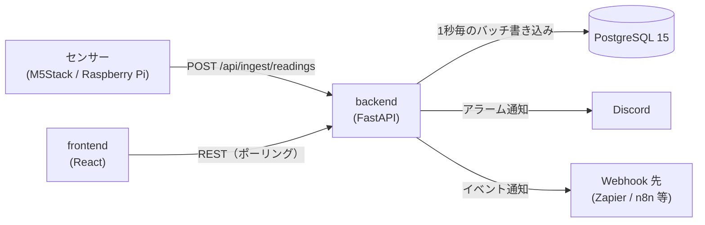

# FactorEye 仕様書

FactorEye の現行仕様です。

---

## 1. 概要

既存の PC と安価なセンサー（M5Stack / Raspberry Pi など）だけで使える工場監視 OSS です。

- センサー値を REST API で受け取り、しきい値でアラームを評価し、ダッシュボードに表示する
- 通知は Discord Webhook、外部連携は汎用 Webhook（Zapier / Make / n8n 等）
- self-hosted（Docker Compose）が基本。同じコードで SaaS（マルチテナント）モードも動く

**非目標**: Kubernetes・マイクロサービス、RBAC・SSO、生産管理の高度な機能（OEE・シフト管理など）

---

## 2. 構成



| レイヤー | 技術 |
|---|---|
| Backend | Python 3.12 / FastAPI / SQLModel / Alembic |
| Database | PostgreSQL 15 |
| Frontend | TypeScript / React 18 / Vite / Zustand / TanStack Query / Recharts / react-grid-layout |

`docker-compose.yml` は backend（8000）・frontend（3001、nginx）・postgres（`127.0.0.1` のみ）です。

---

## 3. データモデル

- `sensors`: センサー
  - 名前、`ingest_key`（全体で一意）、単位
  - しきい値 4 項目、不感帯、有効/無効
  - 所属する機器（`device_id`）
- `readings`: 測定値
  - 主キーは `(sensor_id, recorded_at)`
  - 同じセンサー・同じ時刻は、後から来た値で上書き
- `alarms`: アラーム
  - 状態: active / acknowledged / resolved
  - 重要度: warning / critical、方向: min / max、確認者
- `dashboards` / `widgets`: 12 列グリッドの配置。ダッシュボードの削除は論理削除
- `notification_settings`: Discord Webhook URL（重故障・軽故障）、重故障の再通知
- `webhook_subscriptions`: イベント種別、送信先、有効/無効
- `ingest_devices`: 機器ごとのキー（self-hosted のみ）。SHA-256 のハッシュだけを保存
- `users` / `workspaces` / `refresh_tokens`: 認証（SaaS のみ）

テナント列（`workspace_id`）は SaaS で使います（self-hosted は `NULL`）。

---

## 4. REST API

- JSON のキーは camelCase。`ENVIRONMENT != production` のときは `/docs` で詳細を確認できる
- 取り込みは `X-API-Key`（§5）。**self-hosted は取り込み以外に認証なし**（§11）
- SaaS は JWT が必須（`/health`、`/api/ingest/readings`、`/api/auth/*`、`/api/settings/migration/status` を除く）

| Method | Path | 内容 |
|---|---|---|
| GET | `/health` | 稼働確認（`ok` / `degraded`） |
| POST | `/api/ingest/readings` | センサー値の取り込み（§5） |
| GET / POST | `/api/sensors` | 一覧・作成 |
| GET / PUT / DELETE | `/api/sensors/{id}` | 詳細・更新・削除 |
| GET | `/api/sensors/{id}/readings` | 測定値（`from` / `to` / `limit`） |
| GET | `/api/sensors/{id}/readings/downsampled` | グラフ用の間引き（`buckets` 既定 500・上限 1000） |
| GET | `/api/sensors/{id}/readings/aggregate` | 期間の合計と件数 |
| GET | `/api/readings` | 全センサーの直近測定値 |
| GET | `/api/alarms` | 一覧（`status` / `sensor_id` / `limit` / `offset`） |
| GET / PATCH | `/api/alarms/{id}` `/ack` | 詳細・確認 |
| GET / POST | `/api/dashboards` | 一覧・作成 |
| GET / PUT / DELETE | `/api/dashboards/{id}` | 詳細・更新・削除 |
| POST / PUT / DELETE | `/api/dashboards/{id}/widgets` `/api/widgets/{id}` | ウィジェット操作 |
| GET / PUT | `/api/settings/notifications` | Discord 通知設定 |
| GET / POST / PUT / DELETE | `/api/settings/webhooks` | Webhook 購読 |
| GET / POST | `/api/settings/migration/*` | データ移行（§10.1） |
| POST | `/api/auth/register` `/login` `/refresh` `/logout` | 認証（SaaS） |
| GET | `/api/me` | 自分の情報（SaaS） |
| `/api/admin/*` | 管理者 API（SaaS、§10） | 管理者トークン |

- センサー一覧は `ETag` を返す（`If-None-Match` が一致すれば 304）
- 版は件数と `updated_at` から作る。作成・更新・削除では、どちらかを必ず変える

---

## 5. センサーの取り込み（Ingest）

### 認証
- **self-hosted**: `X-API-Key` に `INGEST_API_KEY` を送る（不一致は 401）
  - `INGEST_AUTH=off` ならキーなし。`ingestKey` を知っていれば誰でも書けるので、口を LAN に限る
- **SaaS**: ヘッダー不要。本文の `ingestKey` で識別する

### リクエストの形
```json
{ "ingestKey": "sensor-001", "value": 23.5 }
```
| 形 | 内容 | 上限 |
|---|---|---|
| `readings` | 1 センサーの複数値（各要素に `value`、任意で `timestamp`） | 1,000 件 |
| `sensors` | 複数センサーを 1 回で送る | 2,000 センサー・値 70,000 件 |
| `samples` | 時刻ごとに値をまとめる（1 秒サンプリング向け） | 時刻 1,000・値 70,000 件 |

- `ingestKey` / `sensors` / `samples` は、どれか 1 つだけ
- センサー単位の問題（未登録・無効・値なし）は、応答の `rejected` に出し、残りは受け付ける
- 本文は 8MB まで（超えると 413）。値が NaN・Infinity・数値でない、または無いときは 400
- `accepted` は受け付けた件数（保存数ではない）

### 応答
| 状況 | HTTP |
|---|---|
| 受理（一部 `rejected` でも） | 202 |
| 形式不正・`timestamp` の範囲外 | 400 |
| API キー・機器キーが不正 | 401 |
| センサー無効、機器キーが合わない、自動登録の上限 | 403 |
| `ingestKey` が無い | 404 |
| 取り込み制限超過 | 429 |

### センサーの自動登録（self-hosted のみ、既定 off）
- `INGEST_AUTO_CREATE=on` で、未登録の `ingestKey` からセンサーを作る（`name`・`unit` も指定できる）
- `ingestKey` は英数字と `. _ -` で 64 文字まで
- 総数が `INGEST_AUTO_CREATE_MAX_SENSORS`（既定 100）に達したら 403
- 打ち間違いの ID でも作られるので、必要なときだけ on にする

### 機器ごとのキー（self-hosted のみ）
- 機器ごとにキーを発行し、`X-Device-Key` で送る。DB にはハッシュだけを保存する
- 所属のあるセンサーには、その機器のキーでしか送れない。所属のないセンサーには送れない（403）
- 機器のキーがあれば、共通の `X-API-Key` は不要
- 詳細は [`device-keys.md`](device-keys.md)

### 時刻
- 既定はサーバーの受信時刻（機器の時刻は信頼しない）
- `INGEST_DEVICE_TIME=on` なら、`timestamp`（時差つき ISO 8601 または UNIX 秒）を秒単位で使う
  - 時差なし・未来（10 秒超）・30 日より前が 1 つでもあれば、全体を 400
  - 溜めた値の後送りと、同じ時刻の再送（上書き）が可能
  - 機器の時計が合っていることが前提

### バッファ
- 受信値はメモリに溜め、**1 秒ごとに一括 INSERT** し、同じ処理でアラーム評価・通知・Webhook を行う
- DB 書き込みに失敗したら、次の周期で再試行する。最大 10 万件で、超えたら古い値から捨てる
- 通常の停止: 残りを書いてから終了
- クラッシュ時: 未書き込みの値（通常は最大 1 秒分）が失われ得る

### キャッシュとレート制限
- 機器キー・センサーの照合は `INGEST_CACHE_SECONDS`（既定 5 秒）覚える
- 別プロセスからの変更は、最大この秒数遅れる
- IP ごとに **100 回/分**（`INGEST_RATE_LIMIT`。`off` で解除）
- IP は `CF-Connecting-IP` を優先して読む
- プロキシの内側では、プロキシでこのヘッダーを上書きする

---

## 6. アラーム評価

- センサーごとに **上限・下限 × 軽故障・重故障の 4 項目**のしきい値（使わない項目は未設定）
- **不感帯**（`thresholdDeadBand`、既定 0）
  - 発生: しきい値を超えた時点で即時
  - 解除: しきい値から不感帯の幅だけ戻ったとき

| 状況 | 動作 |
|---|---|
| 初めてしきい値を超えた | アラーム（active）を作り、通知する |
| 発生中に重要度が変わった | 既存行を更新し、通知する |
| 発生中で重要度が同じ | 何もしない（重故障の再通知を除く） |
| 条件が解除された | resolved にする（通知なし） |
| 確認（ack） | active → acknowledged |

同じ条件は 1 件にまとめる。行は履歴として削除しない。

---

## 7. 通知

### Discord
- 設定画面の「通知」タブで、**重故障と軽故障に別の Webhook URL** を設定する
- 重故障は通常送信、軽故障はサイレント送信
- **重故障の再通知**（既定 無効・30 分）: 未解決のまま間隔を超えたら再通知。軽故障は対象外
- 送信失敗はログに残して無視する（取り込みは止めない）

### Webhook（外部連携）
Zapier・Make・n8n などへ JSON を `POST` する。タイムアウト 10 秒、再試行なし。

| イベント | タイミング | 主な項目 |
|---|---|---|
| `reading.received` | センサー値の受信ごと | `sensorId`, `value`, `recordedAt` |
| `alarm.triggered` | アラーム発生ごと | `sensorId`, `sensorName`, `value`, `severity`, `thresholdBreached`, `triggeredAt` ほか |

- **SSRF 対策**: 送信先は `https` で、名前解決した全アドレスが公開 IP のものだけ
  - 登録時と送信直前に検証し、リダイレクトは追わない
  - `WEBHOOK_ALLOW_PRIVATE_NETWORKS=true` で社内ネットワークを許可（既定 false）
- 同時送信は 10 件まで。送信待ちが 1,000 件を超えたら、新しいものを捨てる

---

## 8. ダッシュボード

- 12 列グリッドで自由に配置・サイズ変更でき、配置はサーバーに保存する
- ポーリングで更新する（値・アラームは 5 秒、グラフの直近モードは 30 秒）

| ウィジェット | 内容 |
|---|---|
| `SensorGraph` | 折れ線・棒・面グラフ |
| `MultiSensorComparison` | 複数センサーを重ねた比較グラフ |
| `StatValue` | 最新値とスパークライン（しきい値で色が変わる） |
| `AlarmAlert` | 発生中・確認済みのアラーム（各 100 件まで）と確認ボタン |
| `ProductionStatus` | 稼働 ON/OFF、直近 1 時間と本日の生産数、目標達成率 |
| `TargetStrip` | 達成ストリップ（下記） |

**TargetStrip**: センサーごとに 1 行。一定の間隔（1・5・10 分）を 1 マスにした帯。
- `stripJudge: "count"`（既定）: マスの合計が目標以上なら緑
- `stripJudge: "interval"`: 受信の途切れが `stripMaxGapSeconds`（既定 90 秒）を超えたら赤（ハートビート確認用）
- ほかの設定: `stripBucketMinutes`・`stripHourlyTarget`・`stripWorkOnly`・`stripTolerant`

### グラフの時間操作
- **直近モード**（右端が常に現在）と**固定モード**（開始・終了を指定）
- 操作: プリセット（5 分〜30 日）、任意の期間、前後へ移動、拡大・縮小、ドラッグで選択、今に戻る
- 範囲はダッシュボードごとに 1 つ。URL（`?range=1h` / `?from=…&to=…`）に保持し、設定には保存しない
- グラフは `readings/downsampled` で取得する
- 表示はブラウザの地域時刻、保存と API は UTC
- SaaS（Free Tier）は保持が 14 日のため、範囲は 14 日まで

### グラフを 1 画面で開くリンク
- 形: `https://<アドレス>/?dashboard=<ダッシュボードID>&graph=<ウィジェットID>&range=<N>m`（N は 10〜10080。おかしいときは 30）。ダッシュボードの「🔗 リンク」で作る（グラフ・直近の分数を選んでコピー）
- 開くと、そのグラフ 1 つを画面いっぱいに出す（ヘッダー・メニューなし、縦スクロールなし）。線・色・縦軸・センサーはウィジェットの設定のまま（同じウィジェットの部品で描く）
- 操作: 上下スワイプ・ピンチ・ホイールで拡大・縮小（10 分〜7 日。表示できる最長を超えない）、左右ドラッグで移動（右端は今より先に、左端は戻れる最も古い時刻より前に行かない。長さがその範囲より長ければ今を見る）、期間のボタン（30 分〜24 時間）、時刻の指定（次の項目）、タップで値、ダブルタップ・「今に戻る」でリンクの設定に戻す
- 時刻の指定（上の期間の表示を押すと、下からシートが出る。長さは今のまま、選んだ時刻から表示する）
  - 近道（1 時間前・3 時間前・今日 8:00・昨日 8:00・昨日 13:00）は押すとすぐ移る。未来になるものは押せない
  - ほかは 2 回: ① 時刻の帯（0〜24 時）を押すかなぞって選ぶ（15 分刻み。初めは 8:00、閉じても残る）→ ② カレンダーの日付を押すと「その日＋① の時刻」へ移る。① の時刻がまだ来ていない日は押せない
  - 戻れる最も古い時刻: SaaS は測定値の保持期間（14 日）、self-hosted は 12 か月前の月の 1 日。カレンダーの ◀ はその月まで、▶ は今月まで
  - 開くと ✕ にフォーカスし、Esc・✕ で閉じる（閉じたら 🕘 へ戻す）。「◯ 時間前」は押した時刻から数える
  - 日付・時刻は端末の時刻。シートを開いている間は、グラフの指・ホイールの操作を受けない（置いていた指は離した扱いにする）。移った期間・選んだ時刻は保存しない（localStorage・URL に書かない）
- 今を見ている間は、グラフの設定の間隔で自動更新し、過去を見ている間は止める
- 期間はこの画面の中だけで持つ。端末に覚えた期間・URL の期間では上書きせず、指で変えた期間も保存しない
- SaaS で未ログインなら、ログイン後に同じリンクの画面を開く。ダッシュボードかグラフが無い・見られないときは、一覧を開いて知らせ、URL のリンクを消す
- 画面だけの機能で、API・DB は変えない

---

## 9. デバイス連携

- REST（JSON）が届けばどのデバイスでも使える
- 公式クライアント（MIT）: `clients/arduino-m5stack/`（M5Stack / ESP32）、`clients/raspberry-pi/`（Python）

**送信失敗時の再試行（デバイス側）**
- 指数バックオフ: 1・2・4・8・16 秒、上限 30 秒、±10% のジッター
- 失敗分は最大 100 件のリングバッファに保持し、次の成功時にまとめて送る

| 失敗の種類 | 動作 |
|---|---|
| 通信エラー・タイムアウト・5xx・408・429 | 再送する（429 の `Retry-After` は上限 5 分まで尊重） |
| 401・403・404（設定の誤り） | 警告ログを出し、値を保持して再送し続ける（1 センサー最大 10 件） |
| 400・422 など、再送しても直らない 4xx | その送信分を捨てる（警告ログ） |

NaN・Infinity・数値でない値は、送る前に捨てる。

---

## 10. 認証・SaaS モード（`AUTH_MODE=multi_tenant`）

- **認証**: メール + パスワード（bcrypt）+ JWT
  - アクセストークン 15 分、リフレッシュトークン 30 日（使うたびにローテーション）
  - データはワークスペース単位で分離する
- **Free Tier**
  - センサーは 1 ワークスペース 10 個まで（11 個目は 402）
  - 測定値は 14 日超を毎日 03:00（UTC）に削除（self-hosted は無期限）
- **管理者画面（`/admin`）**: 運用者向け
  - アカウントは DB ではなくファイル（`admin/admins.txt`）で管理
  - 形式は `ID:bcryptハッシュ`。操作は `python -m app.admin_cli`
  - できること: 件数・DB 使用量の確認、ユーザー管理、取り込みのレート制限の期限付き解除
  - このファイルは DB バックアップに含まれないので、別に保管する

### 10.1 データ移行
- 対象: SaaS の 1 ワークスペース、または self-hosted の全データ
- 移行先: 別の self-hosted（設定 → データ移行）

- **書き出し**: gzip の JSON Lines。読み取りのみ
- **取り込み**（self-hosted のみ）
  - 1 トランザクション。失敗したら何も残さない。`dry_run` で件数だけ確認できる
  - `alembic_version` が一致しないと取り込まない
- **移るもの**
  - センサー（取り込みキー込み）、測定値、アラーム
  - ダッシュボード、ウィジェット、Webhook 購読、機器（キーのハッシュ）
  - 通知設定は `with_notifications` 指定時のみ
- **移らないもの**: ユーザー、リフレッシュトークン、ワークスペース

---

## 11. 運用

- **ヘルスチェック**: `GET /health`。DB に接続できないと `status` が `degraded`
- **バックアップ**: `infra/backup.sh`（`pg_dump`）
  - 毎日 3 時の cron、保持 7 日。復元は `infra/restore.sh`
  - 配布版は cron が自動で実行する
- **配布版**: GHCR のイメージ（amd64 / arm64）を使う。手順は [`install/README.md`](../install/README.md)
- **外部への公開**: 配布版の nginx（3001 番）は HTTPS 非対応。Cloudflare Tunnel・AWS・VPN・Caddy などを前段に置く。方法と注意は [`install/README.md`](../install/README.md#インターネットへの公開)

**配布版の設定ファイル**
- 設定は `config/.env` の 1 ファイル。backend はこれを読む（`FACTOREYE_ENV_FILE`）
- `config/` は、ディレクトリごとマウントする（ファイル単体だと、置き換え保存で反映されない）
- 画面の「設定 → API・取り込み」から変更できる（管理パスワードが必要）
  - 対象: `INGEST_*`・`WEBHOOK_ALLOW_PRIVATE_NETWORKS`・`FRONTEND_URL`
- 保存時は、先に再起動後と同じ検査を行い、通れば backend が約 4 秒で再起動する

### 設定（環境変数）
| 変数 | 既定 | 内容 |
|---|---|---|
| `DATABASE_URL` | 開発用の値 | DB 接続先。本番では変更する |
| `INGEST_API_KEY` | `change-this-in-production` | 取り込みの共有キー。本番では変更する |
| `INGEST_AUTH` | `key` | `off` でキーなし |
| `INGEST_AUTO_CREATE` / `_MAX_SENSORS` | `false` / `100` | センサーの自動登録とその上限 |
| `INGEST_DEVICE_TIME` | `false` | 機器の `timestamp` を測定時刻にする |
| `INGEST_CACHE_SECONDS` | `5` | 照合を覚える秒数（0 で無効） |
| `INGEST_RATE_LIMIT` | `100/minute` | 取り込みの制限（`off` で解除） |
| `JWT_SECRET` | `change-this-in-production` | JWT の署名鍵。本番では変更する |
| `ENVIRONMENT` | `development` | `production` で `/docs` を無効化。既定キーのままだと起動しない |
| `FRONTEND_URL` | `http://localhost:3001` | CORS の許可オリジン（`*` は不可） |
| `AUTH_MODE` | `disabled` | `multi_tenant` で SaaS |
| `ADMIN_PASSWORD_HASH` | 空 | 配布版の管理パスワード（bcrypt）。空なら画面から設定変更できない |
| `WEBHOOK_ALLOW_PRIVATE_NETWORKS` | `false` | Webhook の社内ネットワーク送信を許可 |
| `JWT_ACCESS_EXPIRE_MINUTES` / `JWT_REFRESH_EXPIRE_DAYS` | `15` / `30` | トークンの有効期限 |
| `ADMIN_CREDENTIALS_FILE` | `admin/admins.txt` | 管理者アカウントのファイル |
| `VITE_API_URL` / `VITE_AUTH_MODE` | `http://localhost:8000` / なし | frontend のビルド引数（変更には再ビルド） |

例: `.env.example`（docker compose）、`backend/.env.example`（uvicorn 直接）、`install/.env.template`（配布版）。

### セキュリティ上の前提
- self-hosted の API は取り込み以外に認証がない。**インターネットに直接公開せず**、LAN や VPN で守る
- 秘密情報（`.env`）はリポジトリに含めない
- CI で `pip-audit`・`npm audit` を実行する

---

## 12. テスト

| 種類 | 内容 |
|---|---|
| Backend | pytest（PostgreSQL に接続）・mypy（strict）・ruff |
| Frontend | Vitest・typecheck・ESLint |
| E2E | Playwright（セットアップ、アラームの発生と確認、データ移行） |

- **backend のテストは、接続先のテーブルをすべて作り直して削除する**
- `DATABASE_URL` は、必ずテスト専用の DB（例: `factoreye_test`）にする
- 手順は [`development.md`](development.md)

---

## 13. 既知の制限

- 取り込みの制限は IP 単位
  - ゲートウェイ 1 台に多数のセンサーを束ねると、制限に当たりやすい
- Webhook は再試行せず、送信待ちが上限を超えると捨てる。DNS rebinding は防ぎきれていない
- self-hosted は測定値の保持期間が無期限（削除ポリシーなし）
- 管理画面は、ユーザー一覧のページングと、管理者の画面からの追加・削除が未対応
- データ移行
  - 同じデータを同じ DB に取り込み直すと失敗する（ID が重なる）
  - 取り込みファイルのサイズに上限はない
