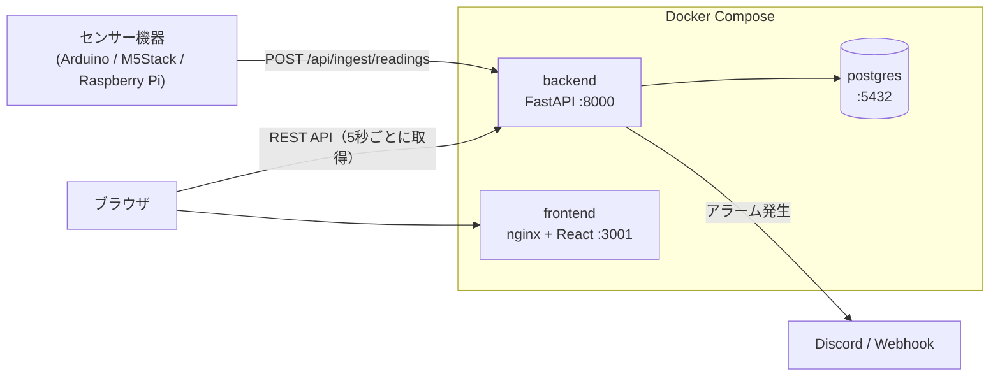
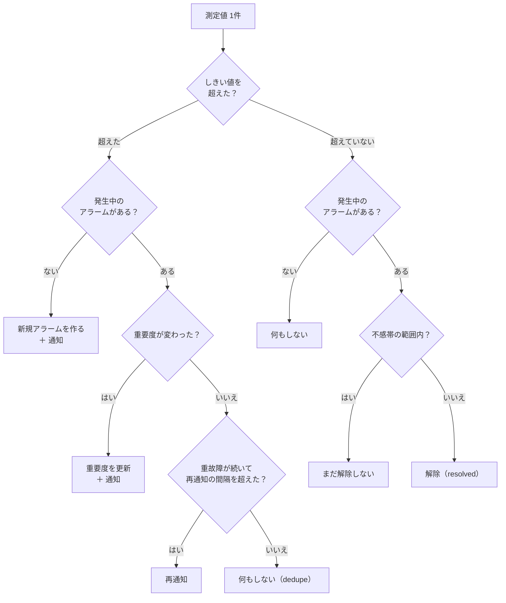
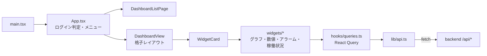

# コードの読み方ガイド

FactorEye のコードを初めて読む人向けの地図です。**どこに何があるか**と**データがどう流れるか**を先に頭に入れます。仕様は [`architecture.md`](architecture.md)、判断の経緯は [`decisions.md`](decisions.md) にあります。

> 2026-10-29 時点の `main` に基づく。コードの構成を変えたら、この文書も直す。

---

## 1. 全体像



- 3 つのコンテナ（`docker-compose.yml`）: backend（Python）、frontend（React を nginx で配信）、postgres
- ブラウザが直接 backend の API を呼ぶ（frontend のサーバーは中継しない）
- 機器は測定値を backend に送るだけ。画面とは関係しない

---

## 2. ファイル構成

```
backend/app/
  main.py              アプリの組み立て（ルーター登録・常駐タスクの起動）  ★
  config.py            環境変数（AUTH_MODE など）
  api/                 HTTP の入口（1 ファイル＝1 種類のリソース）
  db/                  models.py（テーブル定義）、session.py（DB 接続）
  ingest_buffer.py     測定値のバッファと、1 秒ごとの書き込み（flush）   ★
  alarm_engine.py      しきい値の判定・アラームの発生と解除              ★
  notifications.py     Discord への通知
  webhooks.py          汎用 Webhook の送信（SSRF 対策つき）
  purge.py             古い測定値の定期削除（SaaS のみ）
  auth.py              パスワード・JWT（SaaS のみ）
  failback_client.py   管理画面の書き戻しから復旧ツールを呼ぶ
  rate_limit.py / validation.py / schemas.py / admin_*.py / migrate_saas_to_oss.py
backend/alembic/       DB スキーマの変更履歴（マイグレーション）
backend/tests/         pytest
frontend/src/
  main.tsx             入口（通常画面と /admin の振り分け）
  App.tsx              画面の土台（ヘッダー・メニュー・ログイン判定）
  components/          DashboardView / WidgetCard / widgets/ / settings/ / admin/
  hooks/queries.ts     データ取得（React Query）
  lib/api.ts           backend API を呼ぶ関数の集まり（唯一の入口）
  store/               画面の状態（zustand）
  types.ts             API の型
clients/               機器側のライブラリ（arduino-m5stack / raspberry-pi）
tools/                 factory-emulator（テスト用の疑似工場）、recovery（復旧ツール）
infra/                 バックアップ・復元、窓口（lan-ingest）、クラウド版（cloud / walg）
e2e/ ・ loadtest/      Playwright の E2E テスト、負荷テスト
docs/                  architecture.md（仕様）、decisions.md（判断の経緯）
```

**おすすめの読む順**: `backend/app/main.py` → `api/ingest.py` → `ingest_buffer.py` → `alarm_engine.py` → `db/models.py`。そのあと frontend の `main.tsx` → `App.tsx` → `DashboardView.tsx`。

---

## 3. データの流れ ① 測定値の取り込み

機器がセンサー値を送ってから、DB に入り、通知が飛ぶまで。**API の応答と DB への書き込みを分けている**のが特徴です。

```mermaid
sequenceDiagram
    participant 機器
    participant API as api/ingest.py
    participant Buf as ingest_buffer<br/>(メモリ)
    participant Loop as flush_loop<br/>(1秒ごと)
    participant DB as PostgreSQL
    participant Out as Discord / Webhook

    機器->>API: POST {ingestKey, value}
    API->>API: 認証・レート制限・JSON 検査
    API->>DB: ingestKey でセンサーを探す
    API->>Buf: PendingReading を追加
    API-->>機器: 202 Accepted（まだ DB には入っていない）
    loop 1秒ごと
        Loop->>Buf: take_all（全部取り出す）
        Loop->>DB: Reading をまとめて INSERT
        Loop->>DB: アラーム評価（alarm_engine）
        Loop->>DB: commit（ここで確定）
        Loop-->>Out: commit の後で通知を送る
    end
```

- **受け付け**（`api/ingest.py`）: 認証（self-hosted は `X-API-Key`、SaaS は本文の `ingestKey`）→ センサーを特定（無ければ 404、無効なら 403）→ 時刻はサーバーの受信時刻 → バッファに入れて `202`
- **バッファ**（`IngestBuffer`）: メモリ上のリスト。`lock` で守る。DB が止まったら `put_back` で戻して次回に再試行する（上限 10 万件）
- **flush**（`flush_once`、`flush_loop` が 1 秒ごとに呼ぶ）: INSERT → `evaluate_alarms` → **commit**。commit の後に Webhook と Discord を送る。commit 前に失敗したら値を戻す。commit 後は戻さない（二重に書かないため）
- **送信**（`run_in_background`）: 結果を待たずにバックグラウンドで送る。遅い送信先が書き込みを止めないため

---

## 4. データの流れ ② アラームの判定

`alarm_engine.py` が、flush の中で測定値を 1 件ずつ見て判定します。



- しきい値は 4 つ（上限・下限 × 軽故障・重故障）。**重故障を先に判定**する（`_check_threshold`）
- 同じセンサーで発生中のアラームは同時に 1 件。状態は `active` → `acknowledged` → `resolved`
- 軽故障は Discord にサイレントで送る。重故障は通常送信し、設定すれば一定間隔で再通知する

---

## 5. データの流れ ③ 画面の表示



- 構造: **ダッシュボード**が複数の**ウィジェット**を持つ。ウィジェットは「どのセンサーを、どう表示するか」を持つ
- データ取得は 5 秒ごとのポーリング（`POLL_INTERVAL_MS`、`hooks/queries.ts`）。ライブ表示のグラフだけ 30 秒
- `lib/api.ts` が API を呼ぶ唯一の入口。**401 を受けたら、リフレッシュトークンで 1 回だけ再発行して再試行**する
- 状態の置き場: サーバーのデータ → React Query（キャッシュ）、画面の状態・ログイン情報・時間範囲 → zustand（`store/`）
- グラフ系は `lazyNamed` で、画面に出るときに読み込む

---

## 6. データモデルと 2 つの動作モード

テーブルの一覧は [`architecture.md`](architecture.md) §3、定義は `backend/app/db/models.py` にあります。覚えておくこと:

- `ingest_key` は全体で一意。名前はワークスペース内で一意
- **`workspace_id` が NULL の行は self-hosted のデータ**。コード中の「NULL を別に扱う」処理（部分インデックス、`IS NULL` の条件など）は、すべてこの区別のため
- センサーを消すと測定値とアラームも消える（外部キーの連動削除）

`AUTH_MODE`（`config.py`）で self-hosted と SaaS を切り替え、コードのあちこちに分岐があります。

---

## 7. API と担当ファイル

| ファイル | パス | 内容 |
|---|---|---|
| `ingest.py` | `POST /api/ingest/readings` | 測定値の取り込み |
| `sensors.py` | `/api/sensors` | センサーの管理、測定値の取得・集計・間引き |
| `readings.py` | `GET /api/readings` | 測定値の一覧（公開 API。画面は呼ばない） |
| `alarms.py` | `/api/alarms` | アラームの一覧、確認（ack） |
| `dashboards.py` / `widgets.py` | `/api/dashboards` `/api/widgets` | ダッシュボードとウィジェット |
| `settings.py` / `webhooks.py` | `/api/settings/*` | 通知・Webhook の設定、移行 |
| `migration.py` | `/api/settings/migration/*` | データの書き出し・取り込み |
| `auth.py` | `/api/auth/*` `/api/me` | 登録・ログイン・更新・ログアウト（SaaS のみ） |
| `admin.py` / `admin_failback.py` | `/api/admin/*` | 管理者 API・書き戻し（SaaS のみ） |
| `updates.py` / `responses.py` | — | 一覧の ETag と JSON の共通処理 |
| `deps.py` | — | 認証・ワークスペース特定の `Depends` |

---

## 8. 起動と常駐タスク

`main.py` の `start_and_stop` が、起動時に 2 つの常駐タスクを始め、終了時に止めます。

1. `flush_loop`: 1 秒ごとにバッファを DB に書く（§3）
2. `purge_loop`（`purge.py`）: 毎日 UTC 03:00 に古いデータを消す（SaaS のみ意味がある）

終了時は、バッファに残った測定値を最後に 1 回書いてから止めます。backend のコンテナは、起動時に `alembic upgrade head` を実行してから uvicorn を起動します。

---

## 9. 次に読むと理解が深まるところ

- アラームの境界の動き: `backend/tests/test_alarms.py`
- 取り込みの失敗時の動き: `backend/tests/test_flush_sensor_reads.py`
- Webhook の安全対策（SSRF）: `backend/app/webhooks.py` の検証関数
- 画面の時間範囲の操作: `frontend/src/store/`、`hooks/useDragSelect.ts`
- 設計判断の理由: [`decisions.md`](decisions.md)
