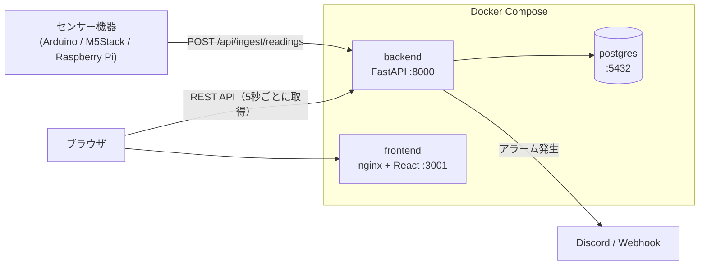
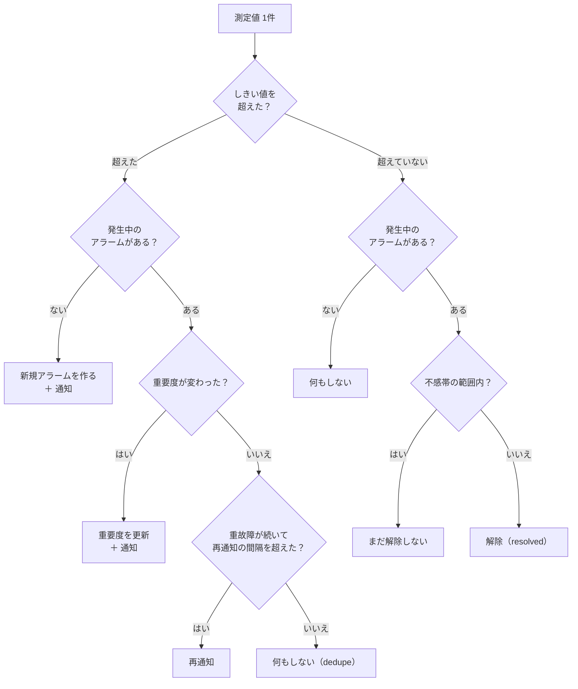
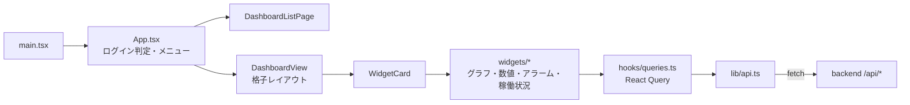
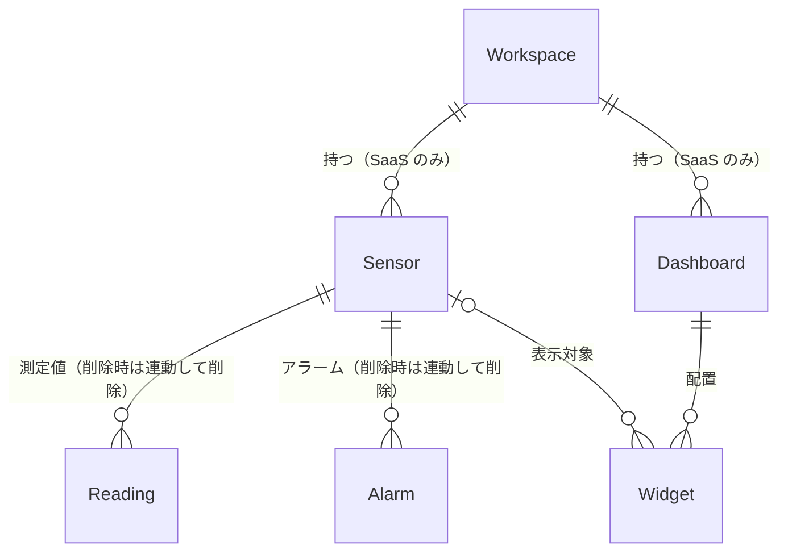

# コードの読み方ガイド（ファイル構成とデータの流れ）

FactorEye のコードを初めて読む人が、**どこに何があるか**と**データがどう流れるか**を、先に頭に入れるためのガイドです。
仕様の正式な定義は [`architecture.md`](architecture.md)、判断の経緯は [`decisions.md`](decisions.md) にあります。ここは「読む順番の地図」です。

> 読んだ時点のコード（2026-10-12、`main`）に基づく。コードを変えたら、この文書も直す。

---

## 1. 全体像



- 3 つのコンテナ（`docker-compose.yml`）: **backend**（Python）、**frontend**（React を nginx で配信）、**postgres**（データ保存）。
- フロントは、ブラウザの中で動く。ブラウザが直接 backend の API を呼ぶ（フロントのサーバーが中継するわけではない）。
- 機器は、測定値を backend に送るだけ。画面とは関係しない。

---

## 2. ファイル構成

```
factoreye/
├─ backend/               Python / FastAPI（サーバー側の処理すべて）
│  ├─ app/
│  │  ├─ main.py             アプリの組み立て（ルーター登録・常駐タスクの起動）
│  │  ├─ config.py           環境変数の読み込み（AUTH_MODE など）
│  │  ├─ api/                HTTP の入口（1ファイル＝1種類のリソース）
│  │  ├─ db/                 models.py（テーブル定義）、session.py（DB 接続）
│  │  ├─ ingest_buffer.py    測定値のバッファと、1秒ごとの DB 書き込み ★中心
│  │  ├─ alarm_engine.py     しきい値の判定・アラームの発生と解除 ★中心
│  │  ├─ notifications.py    Discord への通知
│  │  ├─ webhooks.py         汎用 Webhook の送信（SSRF 対策つき）
│  │  ├─ purge.py            古い測定値の定期削除（SaaS のみ）
│  │  ├─ auth.py             パスワード・JWT（SaaS のみ）
│  │  ├─ schemas.py          API の入出力の型（Pydantic）
│  │  └─ ほか                rate_limit / validation / admin_* / migrate_saas_to_oss
│  ├─ alembic/             DB スキーマの変更履歴（マイグレーション）
│  └─ tests/               pytest
├─ frontend/              React / TypeScript / Vite / Tailwind
│  └─ src/
│     ├─ main.tsx            入口（通常画面と /admin の振り分け）
│     ├─ App.tsx             画面の土台（ヘッダー・メニュー・ログイン判定）
│     ├─ components/         画面の部品（DashboardView / WidgetCard / widgets/ / settings/ / admin/）
│     ├─ hooks/queries.ts    データ取得（React Query）
│     ├─ lib/api.ts          backend API を呼ぶ関数の集まり
│     ├─ store/              画面の状態（zustand）
│     └─ types.ts            API の型
├─ clients/               機器側のライブラリ（arduino-m5stack / raspberry-pi）
├─ tools/                 factory-emulator（テスト用の疑似工場）、recovery（復旧ツール）
├─ infra/                 バックアップ・復元、クラウド版のサーバー設定
├─ e2e/ ・ loadtest/      Playwright の E2E テスト、負荷テスト
└─ docs/                  architecture.md（仕様）、decisions.md（判断の経緯）
```

読む順番のおすすめ: `backend/app/main.py` → `api/ingest.py` → `ingest_buffer.py` → `alarm_engine.py` → `db/models.py`。そのあとフロントの `main.tsx` → `App.tsx` → `DashboardView.tsx`。

---

## 3. データの流れ ① 測定値の取り込み（書き込み側）

機器がセンサー値を送ってから、DB に入り、通知が飛ぶまで。**API の応答と DB への書き込みを分けている**のが、この設計の特徴です。

```mermaid
sequenceDiagram
    participant 機器
    participant API as api/ingest.py
    participant Buf as ingest_buffer<br/>(メモリ)
    participant Loop as flush_loop<br/>(1秒ごと)
    participant DB as PostgreSQL
    participant Out as Discord / Webhook

    機器->>API: POST {ingestKey, value}
    API->>API: 認証・レート制限・JSON 検査
    API->>DB: ingestKey でセンサーを探す
    API->>Buf: PendingReading を追加
    API-->>機器: 202 Accepted（まだ DB には入っていない）
    loop 1秒ごと
        Loop->>Buf: take_all（全部取り出す）
        Loop->>DB: Reading をまとめて INSERT
        Loop->>DB: アラーム評価（alarm_engine）
        Loop->>DB: commit（ここで確定）
        Loop-->>Out: commit の後で通知を送る
    end
```

### 各ステップの要点

1. **受け付け**（`api/ingest.py`）
   - 認証: self-hosted は `X-API-Key`（共有シークレット）または機器ごとのキー `X-Device-Key`、SaaS は本文の `ingestKey`（センサーごとの鍵）。機器のキーを付けると、その機器に所属するセンサーにだけ送れる（`device_keys.py`）。
   - 本文は 4 つの形: 1 センサー（`ingestKey` ＋ `value` / `readings`）、`sensors`（センサーごと）、`samples`（時刻ごと、複数センサー）。上限は本文 8MB、`sensors`・`samples` は合計 70,000 件。
   - `ingestKey` からセンサーを特定する。無ければ 404、無効化されていれば 403。複数センサーの形では、センサーごとの問題を `rejected` に出して、残りを受け付ける。照合（機器のキー・センサー）は 5 秒だけ覚える（`ingest_cache.py`、`INGEST_CACHE_SECONDS`）。
   - 時刻は既定で**サーバーが受け取った時刻**（機器の時計は信頼しない）。`INGEST_DEVICE_TIME=on`（self-hosted だけ）では、機器が付けた `timestamp` を秒単位で使う。
   - バッファに入れて、すぐ `202` を返す。DB は待たない。
2. **バッファ**（`ingest_buffer.py` の `IngestBuffer`）
   - メモリ上のリスト。複数のリクエストが同時に入れても壊れないよう `lock` で守る。
   - 最大 1 秒分は、サーバーが落ちると失われうる（許容している）。
   - DB が止まって書けないときは、`put_back` で戻して次回に再試行する（上限 10 万件、超えたら古いものから捨てる）。
3. **flush**（`flush_once`、1 秒ごとに `flush_loop` が呼ぶ）
   - `Reading` を INSERT（同じ（センサー, 時刻）は後の値で上書き）→ `evaluate_alarms` でアラーム評価（測定時刻の順）→ **commit**。
   - **commit の後**に、Webhook と Discord を送る。送信に失敗しても、DB は確定済みなので巻き戻らない。
   - commit 前に失敗したら、値をバッファに戻す。commit 後は戻さない（二重に書かないため）。
4. **送信**（`run_in_background`）
   - 結果を待たずに、バックグラウンドで送る。遅い送信先が、書き込みを止めないようにしている。

---

## 4. データの流れ ② アラームの判定

`alarm_engine.py` が、flush の中で測定値を 1 件ずつ見て判定します。



- しきい値は 4 つ（上限・下限 × 軽故障・重故障）。すべて任意。**重故障を先に判定**する（`_check_threshold`）。
- **不感帯**: 値がしきい値の付近で揺れても、発生・解除が繰り返されないようにする仕組み。発生は「超えた瞬間」、解除は「しきい値から不感帯の分だけ戻った時」。
- アラームの状態: `active`（発生中）→ `acknowledged`（人が確認済み）→ `resolved`（解除）。
- 同じセンサーで、発生中のアラームは**同時に 1 件だけ**。
- 通知先: 軽故障は Discord にサイレントで送る（通知音なし）、重故障は通常送信し、設定すれば一定間隔で再通知する。

---

## 5. データの流れ ③ 画面の表示（読み出し側）



- 画面の構造: **ダッシュボード** が複数の **ウィジェット** を持つ。ウィジェットは「どのセンサーを、どう表示するか」を持つ。
- データ取得は **5 秒ごとのポーリング**（`POLL_INTERVAL_MS`）。WebSocket などは使っていない。ライブ表示のグラフだけ 30 秒ごと。
- `lib/api.ts` が API を呼ぶ唯一の入口。**401 を受けたら、リフレッシュトークンで 1 回だけ再発行して再試行**する。
- ウィジェットを動かす・大きさを変える → 位置を backend に保存（`updateWidget`）。
- グラフ系は、画面に出る時に読み込む（`lazyNamed`）。初回の表示を軽くするため。
- 状態の置き場: サーバーのデータ → React Query（キャッシュ）、画面の状態・ログイン情報・時間範囲 → zustand（`store/`）。

---

## 6. データモデル（`backend/app/db/models.py`）



| テーブル | 役割 | 覚えておくこと |
|---|---|---|
| `sensors` | センサー（しきい値・不感帯・`ingest_key`） | `ingest_key` は全体で一意。名前はワークスペース内で一意 |
| `readings` | 測定値（時系列） | 主キーは `(sensor_id, recorded_at)`（連番の `id` は無い）。この主キーの索引で範囲検索も速くする |
| `alarms` | アラームの履歴 | センサーを消すと、アラームも一緒に消える |
| `dashboards` / `widgets` | ダッシュボードと、その中のウィジェット | 位置は 12 列の格子（`grid_column` など）で持つ |
| `notification_settings` | Discord 通知の設定 | ワークスペースごとに 1 行 |
| `webhook_subscriptions` | Webhook の購読 | `reading.received` と `alarm.triggered` |
| `users` / `workspaces` / `refresh_tokens` | SaaS の認証 | self-hosted では使わない |

**`workspace_id` が NULL の行は self-hosted のデータ**です。コード中の「NULL を別に扱う」処理（部分インデックス、`IS NULL` の条件など）は、すべてこの区別のためです。

---

## 7. 2 つの動作モード

環境変数 `AUTH_MODE`（`config.py`）で切り替わります。コードのあちこちに、この分岐が出てきます。

| | self-hosted（`disabled`、既定） | SaaS（`multi_tenant`） |
|---|---|---|
| ログイン | なし | あり（JWT） |
| 取り込みの認証 | `X-API-Key`（共有シークレット）、または機器ごとのキー `X-Device-Key` | 本文の `ingestKey` |
| データの分け方 | 分けない（`workspace_id` = NULL） | ワークスペースごと |
| `/api/auth/*`・`/api/admin/*` | 登録されない（404） | 登録される |
| 古い測定値の削除 | しない | 14 日より前を毎日削除（`purge.py`） |

---

## 8. API の一覧（`backend/app/api/`）

| ファイル | パス | 内容 |
|---|---|---|
| `ingest.py` | `POST /api/ingest/readings` | 測定値の取り込み |
| `sensors.py` | `/api/sensors` | センサーの管理、測定値の取得・集計・間引き（downsampled） |
| `readings.py` | `GET /api/readings` | 測定値の一覧 |
| `alarms.py` | `/api/alarms` | アラームの一覧、確認済み（ack） |
| `dashboards.py` / `widgets.py` | `/api/dashboards` `/api/widgets` | ダッシュボードとウィジェット |
| `settings.py` / `webhooks.py` | `/api/settings/notifications` `/api/settings/webhooks` | 通知・Webhook の設定 |
| `migration.py` | `/api/settings/migration/*` | SaaS → OSS の移行（書き出し・取り込み） |
| `auth.py` | `/api/auth/*` `/api/me` | 登録・ログイン・更新・ログアウト（SaaS のみ） |
| `admin.py` | `/api/admin/*` | 管理者用（SaaS のみ） |
| `deps.py` | （共通部品） | 認証・ワークスペース特定の `Depends` |

---

## 9. 起動と常駐タスク

`main.py` の `start_and_stop` が、起動時に 2 つの常駐タスクを始め、終了時に止めます。

1. `flush_loop`: 1 秒ごとにバッファを DB に書く（§3）
2. `purge_loop`: 毎日 UTC 03:00 に古いデータを消す（SaaS のみ意味がある）

終了時は、バッファに残った測定値を最後に 1 回書いてから止める（取りこぼしを減らすため）。
backend のコンテナは、起動時に `alembic upgrade` を実行してから uvicorn を起動する（DB スキーマが最新になる）。

---

## 10. 次に読むと理解が深まるところ

- アラームの境界の動き: `backend/tests/test_alarms.py`
- 取り込みの失敗時の動き: `backend/tests/test_flush_sensor_reads.py`
- Webhook の安全対策（SSRF）: `backend/app/webhooks.py` の先頭〜検証関数
- 画面の時間範囲の操作: `frontend/src/store/useTimeRangeStore.ts`、`hooks/useDragSelect.ts`
- 設計判断の理由: `docs/decisions.md`
